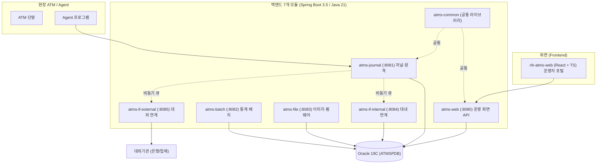
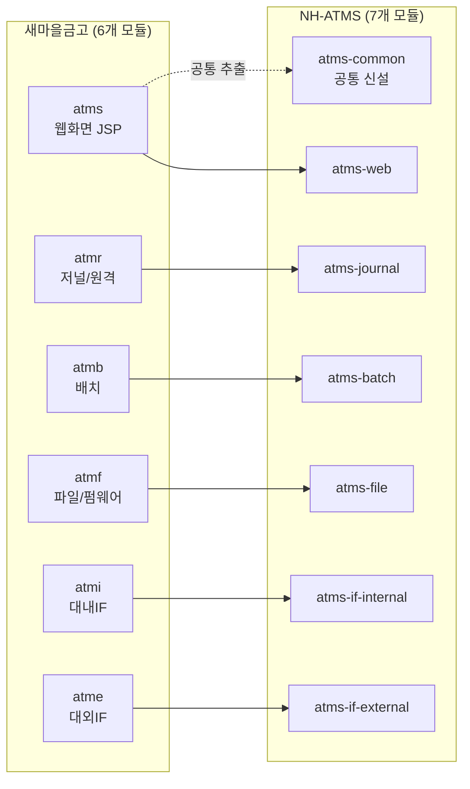

# NH-ATMS 차세대 자동화기기 관리시스템 — 구축 현황 리뷰

> 발표용 자료 (Backend / Frontend 개발 현황 종합 리뷰)
> 기준일: 2026-06 · 대상: 경영진 / 사업 관계자 보고
> 비교 기준: 새마을금고 ATMS(레거시) → NH-ATMS(차세대) 마이그레이션

---

## 발표 흐름 한눈에 보기

| #   | 슬라이드                  | 핵심 메시지               |
| --- | --------------------- | -------------------- |
| 1   | 추진 배경과 목표             | 검증된 노하우 + 최신 기술로 재설계 |
| 2   | 기술 혁신 (AS-IS → TO-BE) | 10년 묵은 기술을 최신으로      |
| 3   | 전체 시스템 구조             | 7개 모듈 + 화면 + 인프라     |
| 4   | 옛 시스템 ↔ 새 시스템 1:1 매핑  | 빠짐없이 옮겼다             |
| 5   | 백엔드 구현 현황             | 모듈별 완성도              |
| 6   | 화면(프론트엔드) 구현 현황       | 22개 업무 화면            |
| 7   | 핵심 기술 성과 4가지          | 자랑할 포인트              |
| 8   | 인프라 · 자동화 · 시뮬레이터     | 운영 준비도               |
| 9   | 옛 시스템 대비 반영 점검표       | 누락 없이 점검             |
| 10  | 잔여 과제와 로드맵            | 남은 일과 계획             |
| 11  | 종합 결론                 | 한 문장 요약              |

---

## 1. 추진 배경과 목표

 

### 왜 새로 만드는가

- 기존 새마을금고 ATMS는 **10년 이상 검증된 업무 노하우**를 담고 있으나, 기반 기술(2014년 수준)이 노후화됨.
- 농협 환경(Oracle, JEUS, SSO, 대내·대외 연계)에 맞춰 **처음부터 재설계**.

### 한 줄 정의

> **"검증된 업무 흐름은 그대로 계승하고, 기술은 최신으로 갈아끼운 차세대 ATM 관리 시스템"**

### 비유로 이해하기

- 옛 시스템 = 오래된 건물. 골조(업무)는 튼튼하나 배관·전기(기술)가 낡음.
- NH-ATMS = 같은 설계도(업무 노하우)로 **신축**. 최신 자재(Java 21, React)로 다시 지음.

---

## 2. 기술 혁신 (AS-IS → TO-BE)

 

| 항목     | 새마을금고 (옛)           | NH-ATMS (새)            | 효과              |
| ------ | ------------------- | ---------------------- | --------------- |
| 개발 언어  | Java 8 (2014)       | **Java 21** (2023)     | 최신 표준, 장기 지원    |
| 프레임워크  | Spring 4 + eGov 3.9 | **Spring Boot 3.5**    | 설정 간소화, 생산성     |
| 화면 방식  | JSP (서버에서 화면 생성)    | **React + TypeScript** | 화면/서버 분리, 빠른 반응 |
| 구조     | 하나의 큰 덩어리(WAR)      | **7개 모듈 분리**           | 독립 배포·확장 용이     |
| 데이터베이스 | MySQL               | **Oracle 19C**         | 농협 표준           |
| 보안     | 세션 기반               | **JWT 토큰 + HMAC 서명**   | 무상태·변조방지        |
| 화면 수   | JSP 194개 (단편)       | **체계화된 22개 업무 화면**     | 일관된 UX          |

> 핵심: **업무 로직(MyBatis SQL)은 계승**하되, 그것을 감싸는 기술 골격을 전면 교체.

---

## 3. 전체 시스템 구조

 

### 모듈 한 줄 요약

| 모듈               | 포트   | 역할                    | 옛 모듈  |
| ---------------- | ---- | --------------------- | ----- |
| atms-common      | —    | 보안·JWT·예외·응답 공통 라이브러리 | (cmm) |
| atms-web         | 8080 | 운영자 화면 REST API (메인)  | atms  |
| atms-journal     | 8081 | ATM 저널 수신·저장·원격명령     | atmr  |
| atms-batch       | 8082 | 일일 통계·장애율 집계 배치       | atmb  |
| atms-file        | 8083 | 저널 이미지·펌웨어 파일 송수신     | atmf  |
| atms-if-internal | 8084 | 대내(시재조회·SMS·메신저) 연계   | atmi  |
| atms-if-external | 8085 | 대외(장애 통보·출동 요청) 연계    | atme  |

---

## 4. 옛 시스템 ↔ 새 시스템 1:1 매핑

 

> **"빠진 모듈 없이 모두 옮겼습니다."**

- 옛 6개 모듈 → 새 6개 모듈로 **1:1 대응**.
- 추가로 **atms-common(공통 라이브러리)**을 신설하여 보안·예외처리를 한 곳에 통합 → 품질·일관성 향상.

---

## 5. 백엔드 구현 현황

 

### 모듈별 완성도

| 모듈                   | 완성도         | 핵심 구현 내용                                            |
| -------------------- | ----------- | --------------------------------------------------- |
| **atms-common**      | 🟢 완성 (90%) | JWT 발급/검증, SSO 연계, 전역 예외처리, 표준 응답, AOP 로깅, 페이징      |
| **atms-web**         | 🟢 완성 (81%) | 21개 업무 도메인, 114개 클래스, 22개 SQL 매퍼, 권한관리(RBAC)        |
| **atms-journal**     | 🟢 완성 (86%) | 저널 수신 파이프라인, 6종 저널 처리기, HMAC 보안, 비동기 큐, 에러 재처리      |
| **atms-batch**       | 🟡 진행 (72%) | DB 기반 동적 스케줄러, 일일 거래집계·장애율 집계 배치                    |
| **atms-if-internal** | 🟡 진행 (71%) | 시재조회·장애 SMS·메신저 연계 (게이트웨이 모의구현 단계)                  |
| **atms-if-external** | 🟡 진행 (71%) | 7종 대외 전문(개국·장애·출동요청 등) (게이트웨이 모의구현 단계)              |
| **atms-file**        | � 진행 (70%)  | 저널 이미지 업로드·조회·다운로드 완성(경로보안 포함), 펌웨어 다운로드(SFTP)만 미착수 |

### 규모 (참고)

- 총 **약 240여 개 Java 클래스**, **42개 MyBatis SQL 매퍼**.
- 옛 시스템의 검증된 SQL을 Oracle 문법으로 변환하여 계승.

---

## 6. 화면(프론트엔드) 구현 현황

 

### 기술 구성

- **React 19 + TypeScript + Vite + Ant Design** (금융권 표준 엔터프라이즈 UI)
- 로그인 후 **메뉴 권한별 화면 자동 구성**, 탭 방식 다중 화면.

### 구현된 업무 화면 (22개)

| 분류     | 화면                                  | 상태         |
| ------ | ----------------------------------- | ---------- |
| 인증     | 로그인 (JWT)                           | ✅          |
| 시스템 관리 | 메뉴 / 사용자 / 사용자그룹 / 로그인이력            | ✅          |
| ATM 관리 | 모니터링 / 거래이력 / 장애내역 / Agent상태 / 빈번장애 | ✅          |
| 저널 조회  | 거래 / 운영 / 저널목록 / 외환 / 통장 / 지로       | ✅          |
| 현금 관리  | 시재 현황                               | ✅          |
| 기초 관리  | 공통코드 / 영업점 / 코너                     | ✅          |
| 배치 관리  | 배치작업 등록·실행·이력                       | ✅          |
| 대시보드   | 메인 대시보드                             | ⚠️ 준비중(틀만) |
| 거래 조회  | 거래내역 상세                             | ⚠️ 시험데이터   |

### 화면 공통 기능

- 검색폼 + 표 + 페이지네이션 표준 패턴 통일.
- **엑셀 다운로드**, 코드→명칭 자동 변환, 로그인 세션 자동 갱신.

---

## 7. 핵심 기술 성과 4가지

 

### ① 저널 수신 파이프라인 (atms-journal)

- ATM이 보내는 거래·운영·장애 기록(JIF 전문)을 **실시간 수신 → 자동 분류 → DB 저장**.
- 6종 처리기(거래/운영/현금/수표/장애상태/일집계)로 분기.
- 처리 실패 건은 **원본 그대로 보존 후 자동 재처리**(누락 방지).

### ② HMAC 전자서명 보안 (위·변조 방지)

- Agent ↔ 서버 통신에 **시각·본문 기반 전자서명** 적용.
- 재전송 공격 차단(시각 오차 검증), 본문 1바이트라도 변경 시 거부.

### ③ DB 기반 동적 배치 스케줄러 (atms-batch)

- 코드 수정·재배포 없이 **DB에서 배치 일정(Cron)을 등록/변경**.
- 일일 거래 집계, ATM 장애율·가동률 자동 산출.

### ④ 토큰 기반 인증 + 자동 갱신 (Frontend)

- JWT 토큰으로 로그인 유지, **만료 시 자동 재발급**하여 사용자 끊김 없음.
- 메뉴/권한에 따라 화면 접근 자동 제어.

---

## 8. 인프라 · 자동화 · 시뮬레이터

 

> **"개발만 한 게 아니라, 운영·검증 환경까지 준비했습니다."**

| 영역            | 준비 내용                                             |
| ------------- | ------------------------------------------------- |
| **컨테이너**      | docker-compose로 전체 시스템 로컬 일괄 구동                   |
| **CI/CD**     | Jenkins 파이프라인(Jenkinsfile)으로 빌드·배포 자동화            |
| **모니터링**      | Prometheus + Grafana 대시보드(서버 상태 실시간 관제)           |
| **웹 서버**      | Nginx 리버스 프록시 구성                                  |
| **API 문서**    | Swagger UI 자동 생성(개발·테스트 즉시 가능)                    |
| **ATM 시뮬레이터** | 실제 ATM 없이 저널·전문 송신 테스트 (Java + Windows용 C# 테스터)   |
| **운영 환경**     | RHEL 9.4 + JEUS 9.1 + WebtoB 5 + Oracle 19C 기준 설계 |

---

## 9. 옛 시스템 대비 반영 점검표

 

> 새마을금고 6개 모듈의 주요 기능이 NH-ATMS에 반영되었는지 점검.

| 옛 기능 (모듈)                 | NH-ATMS 반영                            | 상태     |
| ------------------------- | ------------------------------------- | ------ |
| 웹 운영화면 (atms)             | atms-web 21개 도메인 + 22개 React 화면       | ✅ 반영   |
| 전자저널 수신·저장 (atmr)         | atms-journal 수신 파이프라인 + 6종 처리기        | ✅ 반영   |
| 원격명령 (atmr remote)        | atms-journal Agent 제어(open/exit/ping) | ✅ 반영   |
| 사용자·권한·메뉴 (atms sys/user) | atms-web RBAC + 메뉴 권한                 | ✅ 반영   |
| 장애 관리 (atms fault/obst)   | 장애내역·빈번장애 화면 + 대외 출동 연계               | ✅ 반영   |
| 시재·현금 (atms cash)         | 시재조회 화면 + 대내 시재조회 연계                  | ✅ 반영   |
| 통계·집계 배치 (atmb)           | atms-batch 일집계·장애율 (Task 2종)          | 🟡 일부  |
| 대내 연계 (atmi)              | atms-if-internal (게이트웨이 모의)           | 🟡 일부  |
| 대외 연계 (atme)              | atms-if-external 7종 전문 (게이트웨이 모의)     | 🟡 일부  |
| 저널 이미지 (atmf)             | atms-file 이미지 업로드·조회·다운로드(경로보안 포함)    | ✅ 반영   |
| 펌웨어 다운로드 (atmf)           | atms-file SFTP 다운로드                   | 🔴 미착수 |

### 점검 결론

- **핵심 운영 기능(화면·저널·권한·장애·시재)은 모두 반영 완료.**
- **연계(IF)·배치·파일** 영역은 골격 완성, **실제 외부 연계 전문/펌웨어**가 잔여.
  - 단, 대내·대외 연계의 "모의(Mock) 단계"는 **대외기관 연계 규격 확정 후** 실통신으로 교체하는 정상적 진행 순서임.

---

## 10. 잔여 과제와 로드맵

 

### 우선순위 높음 (실 데이터 연계 직결)

1. **atms-file** — 펌웨어 다운로드(SFTP) 채널 구현 (저널 이미지 채널은 완성).
2. **대내/대외 IF** — 모의 게이트웨이 → **실제 전문 송수신**으로 교체(규격 확정 후).

### 우선순위 중간 (운영 편의)

3. **대시보드 KPI 시각화** — 현재 틀만 → 실시간 지표/차트 구성.
4. **거래조회 화면** — 시험데이터 → 실 API 연결.
5. **배치 작업 확대** — 옛 시스템의 다양한 일·월 집계 배치 추가.

### 품질·운영

6. 연계·배치·파일 모듈 **단위 테스트 보강**.
7. React Query 캐싱 전략 적용, 실시간(WebSocket) 모니터링 검토.

---

## 11. 종합 결론

 

> **NH-ATMS는 새마을금고의 검증된 ATM 운영 업무를 최신 기술(Java 21 · Spring Boot 3.5 · React)로 재구축한 차세대 시스템으로, 핵심 운영 기능(화면·저널·권한·장애·시재)은 구현을 완료했고, 외부 연계·파일·배치 영역의 마무리와 실 연계 규격 적용이 남은 단계입니다.**

### 한 장 요약 숫자

- 백엔드 **7개 모듈 / 약 240여 클래스 / 42개 SQL 매퍼**
- 프론트엔드 **22개 업무 화면 / 17개 API 서비스**
- 인프라 **Docker · Jenkins · Prometheus/Grafana · ATM 시뮬레이터** 완비

### 발표 마무리 멘트(예시)

"옛 시스템의 노하우는 100% 계승하면서, 기술은 10년을 앞당겼습니다. 핵심 업무는 이미 동작하며, 남은 것은 외부 기관과의 실제 연결과 마무리 작업입니다."

---

### 부록 — 근거 문서

- 모듈 매핑 상세: [01_모듈분석_마이그레이션가이드.md](01_모듈분석_마이그레이션가이드.md)
- DB·모듈 매핑: [00_DB분석_모듈매핑.md](00_DB분석_모듈매핑.md)
- 저널 프로토콜: [09_ATMR_저널프로토콜_분석.md](09_ATMR_저널프로토콜_분석.md)
- Agent 연계 규격: [08_IF분석_Agent_ATM.md](08_IF분석_Agent_ATM.md)
- 개발 로드맵: [11_개발로드맵_TODO.md](11_개발로드맵_TODO.md)
- 접속 정보: http://192.168.28.21:19080
