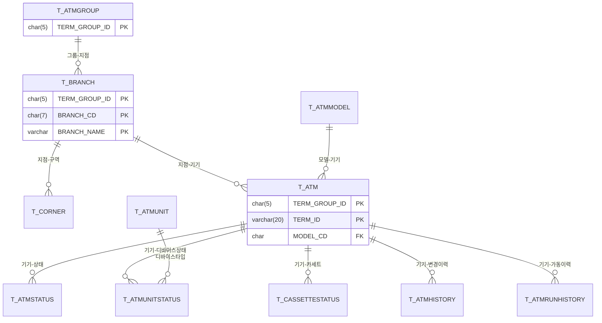
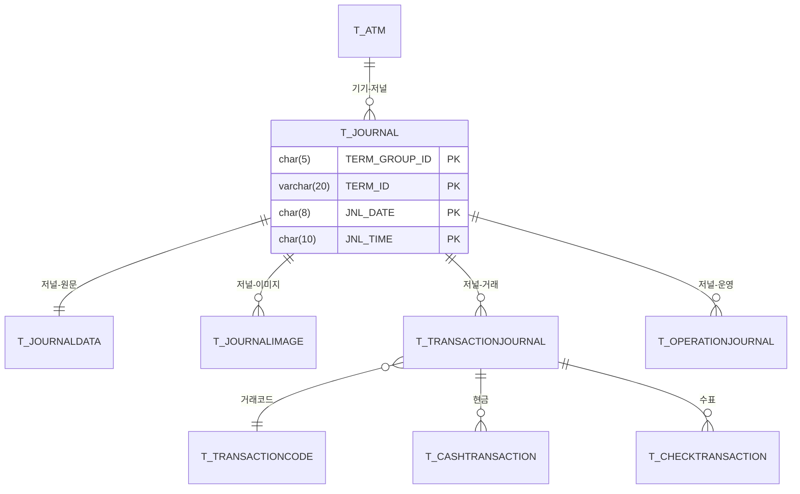
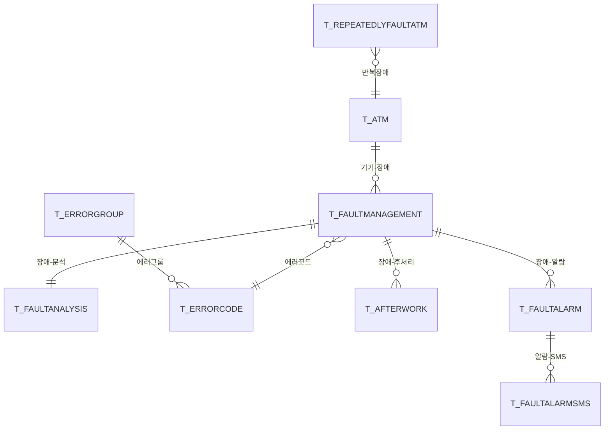
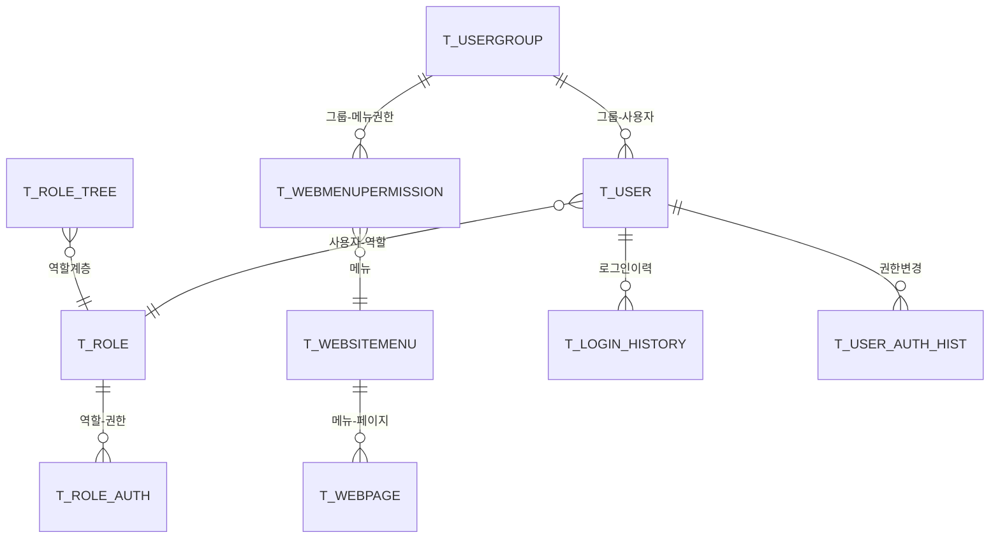

# NH-ATMS DB 분석 — 새마을금고 → NH 변환 가이드

> 원본: `새마을금고.sql` (MySQL 8, datm 스키마, 127 테이블)
> 변환: `oracle19c_ddl.sql` (자동 생성 1차 초안)
> 작성: 2026-05-14

---

## 1. 전체 통계

| 구분 | 값 |
|---|---|
| 원본 DBMS | MySQL 8.0 (utf8mb4 / InnoDB) |
| 원본 스키마 | `datm` |
| 테이블 수 | **127개** |
| 파티션 테이블 | **19개** (저널/거래/장애 — 월별 RANGE) |
| 대상 DBMS | **Oracle 19C** (RFP 사양) |
| 대상 스키마 | `ATMS` (대문자 권장) |
| 인코딩 | `AL32UTF8` |

---

## 2. 모듈 매핑 (127 테이블 → 7 모듈)

> 멀티모듈 백엔드(`nh-atms-api`)와 1:1 매핑.
> **공유 테이블 원칙**: 마스터(`T_ATM`, `T_BRANCH`, `T_CODE` 등)는 모든 모듈에서 **읽기**, 쓰기는 owner 모듈만.

### 2.1 atms-common (28 테이블) — 공통/사용자/권한/메뉴

| 분류 | 테이블 |
|---|---|
| 시스템 설정 | T_ATMS_CONFIG, T_ATOMCONFIG, T_LOCK, T_TABLEMANAGEMENT, T_VENDOR_INFO, T_ATMS_CRUD, T_ATMS_ERROR |
| 코드/공통 | T_CODE, T_CODEGROUP, T_HOLIDAY, T_HOLIDAY_TMP, T_POST, T_SEQNOMASTER, T_ATTACHEDFILE, T_ARCHIVE |
| 사용자/권한 | T_USER, T_USERGROUP, T_ROLE, T_ROLE_AUTH, T_ROLE_TREE, T_AUTHOR, T_ATMS_EGOVROLE, T_USER_AUTH_HIST, T_USER_CONNINFO, T_LOGIN_HIST, T_LOGIN_HISTORY, T_QUICKMENU, T_SURVEY_USER |
| 메뉴/화면 | T_MENU, T_AUTH_MENU, T_WEBMENUPERMISSION, T_WEBMENUPERMISSION_HIS, T_WEBSITEMENU, T_WEBPAGE, T_WEBTERMINAL |

### 2.2 atms-web (32 테이블) — 화면 백엔드 / 마스터 / 공지 / 보고서

| 분류 | 테이블 |
|---|---|
| ATM 마스터 | T_ATM, T_ATM_TEMP, T_ATMGROUP, T_ATMMODEL, T_ATMUNIT, T_ATMUNITSTATUS, T_ATMSTATUS, T_ATMDEVICESTATUS |
| ATM 이력 | T_ATMHISTORY, T_ATMRUNHISTORY, T_ATMSTOPHISTORY, T_ATMERRGROUPHISTORY |
| 지점/구역 | T_BRANCH, T_BRANCH_TEMP, T_CORNER, T_CORNERTIMEINFO, T_PSNADR |
| 카세트 | T_CASSETTESTATUS |
| 점검/관리 | T_ATMCHECKPLAN, T_AUTOREQUESTCHECK, T_AUTOREQUESTCHECK_HIS, T_REPEATEDLYFAULTATM |
| 공지/SMS | T_NOTICE, T_FAQ, T_MESSENGER, T_FAULTALARM, T_FAULTALARMSMS, T_SMSSENDDATA |
| 일일 보고서 | T_DAILYREPORT01 ~ T_DAILYREPORT07, T_DAYTOTAL |

### 2.3 atms-journal (28 테이블) — 전자저널 / 거래 / 장애 / 원격명령 (구 atmr)

| 분류 | 테이블 |
|---|---|
| 저널 | **T_JOURNAL**, T_JOURNALDATA, T_JOURNALIMAGE, T_JNLIMAGE_HISTORY, T_JOURNALFOOTNOTE, T_JOURNALERROR |
| 거래 저널 | **T_TRANSACTIONJOURNAL**, T_OPERATIONJOURNAL |
| 현금/수표 | T_CASHTRANSACTION, T_CHECKTRANSACTION, T_ADDCASH, T_ADDCHECK |
| 모니터링 | T_ATMMONITOR, T_MGSMONITOR, T_AGENTSTATUS |
| 장애 분석 | **T_FAULTMANAGEMENT**, T_FAULTANALYSIS, T_FAULTMAP, T_FAULTSYSTIMES |
| 에러 코드 | T_ERRORCODE, T_ERRORGROUP, T_ERRORGROUP_HIS, T_MODULETYPE |
| 후처리 | T_DECRIPT_EROR, T_AFTERWORK |
| 원격명령 | T_REMOTECOMMAND, T_REMOTECOMMANDITEM, T_REMOTEINTERFACE, T_REMOTEMSG |
| 거래 코드 | T_TRANSACTIONCODE |

### 2.4 atms-batch (8 테이블) — 배치 / 프로세스 / 집계

| 분류 | 테이블 |
|---|---|
| 배치 정의/이력 | T_BATCH, T_BATCHHISTORY, T_ATMS_BATCH, T_ATMS_BATCH_HIS |
| 프로세스 관리 | T_SERVERPROCESS, T_MONPROCESS, T_PROTOCOLPROCESS |
| 일일 집계 | T_TRANSACTIONDAILYTOTAL |

### 2.5 atms-file (7 테이블) — 펌웨어 다운로드 / 파일

| 분류 | 테이블 |
|---|---|
| 다운로드 | T_ATMDOWNLOAD, T_DOWNLOADPROCESS, T_DOWNLOADSERVER |
| 적용 이력 | T_ATMAPPLYHISTORY, T_MODELAPPLYHISTORY |
| 파일 정보 | T_ATMFILEINFO, T_APLASTVERSION |
| 실행 이력 | T_EXEC_DOWNLOAD_FILE, T_EXEC_DOWNLOAD_HISTORY |

### 2.6 atms-if-internal (4 테이블) — 대내 IF (구 atmi)

| 분류 | 테이블 |
|---|---|
| 인터페이스 | T_INTERFACE, T_GWINTERFACE |
| 비동기 메시지 | T_MSG_ASYNC, T_SENDTERMINAL |

### 2.7 atms-if-external (5 테이블) — 대외 IF (구 atme)

| 분류 | 테이블 |
|---|---|
| 외부 사업자 | T_SERVICEPROVIDER |
| 회선/송수신 | T_NETLINESTATUS, T_NETRECVDATA, T_NETSENDDATA, T_NETSENDPOLL |

> ※ 합계 112 + 7개 일일보고서(DAILYREPORT01~07) + 추가 8개 ≈ 127

---

## 3. Oracle 19C 변환 — 자동 변환 결과 & 수동 검토 항목

### 3.1 자동 변환 완료 (`oracle19c_ddl.sql`)

| 항목 | MySQL → Oracle |
|---|---|
| 백틱 | ` ` 제거 |
| 스키마 | `datm.` → `ATMS.` |
| 타입 (정수) | `bigint` → `NUMBER(19)`, `int` → `NUMBER(10)`, `tinyint` → `NUMBER(3)` |
| 타입 (문자) | `char` → `CHAR`, `varchar` → `VARCHAR2` |
| 타입 (대용량) | `text/longtext` → `CLOB`, `blob` → `BLOB` |
| 타입 (날짜) | `datetime` → `TIMESTAMP` |
| 시간 함수 | `CURRENT_TIMESTAMP` → `SYSTIMESTAMP` |
| 주석 | inline `COMMENT 'xxx'` → `COMMENT ON TABLE/COLUMN` 분리 |
| 자동 증가 | `AUTO_INCREMENT` → `GENERATED BY DEFAULT AS IDENTITY` |
| 엔진/캐릭터셋 | `ENGINE=InnoDB`, `CHARSET=utf8mb4`, `COLLATE` 제거 |

### 3.2 ⚠ 수동 검토 필수 항목

#### A. 파티션 (19개 테이블)
저널/거래/장애 계열은 모두 월별 RANGE 파티션. **Oracle INTERVAL 파티션 권장**:

```sql
-- 변환 예 (T_JOURNAL)
CREATE TABLE T_JOURNAL ( ... )
PARTITION BY RANGE (JNL_DATE)
INTERVAL (NUMTOYMINTERVAL(1, 'MONTH'))
( PARTITION P_INIT VALUES LESS THAN ('202601') );
```

**대상**: T_ADDCASH, T_ADDCHECK, T_ATMMONITOR, T_CASHTRANSACTION, T_CHECKTRANSACTION,
T_DAYTOTAL, T_DECRIPT_EROR, T_FAULTANALYSIS, T_FAULTMANAGEMENT, T_FAULTSYSTIMES,
T_JNLIMAGE_HISTORY, T_JOURNAL, T_JOURNALDATA, T_JOURNALIMAGE, T_JOURNALFOOTNOTE,
T_MGSMONITOR, T_OPERATIONJOURNAL, T_TRANSACTIONJOURNAL, T_ATMRUNHISTORY

#### B. Oracle 예약어 충돌 가능 컬럼명
다음 컬럼명은 Oracle에서 예약어/의사컬럼이라 충돌 가능. **별칭 또는 큰따옴표 처리 필요**:

| 의심 컬럼 | Oracle 처리 |
|---|---|
| `LEVEL` | 예약어 → `MENU_LEVEL` 등으로 리네임 |
| `NUMBER` | 예약어 → `NUM` |
| `DATE` | 예약어 → `JNL_DATE` 등 (이미 대부분 OK) |
| `COMMENT` | 예약어 |
| `SIZE` | 예약어 |
| `TYPE` | 예약어 (T_FAULTMANAGEMENT 등) |
| `ORDER`, `GROUP` | 예약어 |
| **`UID`** | **의사컬럼** → `T_MSG_ASYNC.UID` 1건 발견. `MSG_UID` 로 리네임 권장 |

→ `oracle19c_ddl.sql`에서 직접 grep 으로 확인 필요.
→ 검색 명령: `grep -nE "^\s+(LEVEL|SIZE|TYPE|COMMENT|NUMBER|UID|ORDER|GROUP|FILE|SESSION|MODE) " oracle19c_ddl.sql`

#### C. 인덱스 (`KEY` 절)
MySQL의 inline `KEY` / `INDEX` 정의는 `[INDEX-TODO]` 주석으로 변환됨. **별도 `CREATE INDEX` 문 작성 필요**:
```sql
-- 예
CREATE INDEX IX_T_JOURNAL_TERM_GROUP ON T_JOURNAL (TERM_GROUP_ID, TERM_ID);
```

#### D. 시퀀스 (AUTO_INCREMENT)
대부분 IDENTITY로 변환했으나, **분산 시스템(여러 모듈에서 동일 PK 채번)**이면 시퀀스로 분리:
```sql
CREATE SEQUENCE SEQ_T_AFTERWORK START WITH 1 INCREMENT BY 1 NOCACHE;
```

#### E. 대소문자
Oracle은 기본적으로 식별자를 대문자로 저장. 자동 변환 시 모든 식별자 대문자화 완료.
**MyBatis/JPA 매핑 시 컬럼명도 대문자로 통일** 또는 `map-underscore-to-camel-case: true` (이미 설정됨) 활용.

---

## 4. 핵심 도메인 ERD (Mermaid)

### 4.1 ATM 마스터 (atms-web)



### 4.2 전자저널 / 거래 (atms-journal)



### 4.3 장애 관리 (atms-journal + atms-web)



### 4.4 사용자 / 권한 / 메뉴 (atms-common)



---

## 5. 다음 단계

1. **DBA와 ATMS 스키마/유저 생성 협의**
   ```sql
   CREATE TABLESPACE TS_ATMS DATAFILE '...' SIZE 10G AUTOEXTEND ON;
   CREATE USER ATMS IDENTIFIED BY xxx DEFAULT TABLESPACE TS_ATMS;
   GRANT CONNECT, RESOURCE, CREATE VIEW, CREATE SEQUENCE TO ATMS;
   ```

2. **`oracle19c_ddl.sql` 검수** — 위 3.2의 5개 항목 (A~E) 직접 확인

3. **신규/변경 테이블 식별** — RFP 요구사항 (생체인증, 영상관제, 시재관리기, 디지털데스크 등) 반영 → 신규 테이블 추가 설계

4. **MyBatis 매퍼 생성** — 각 모듈별 `src/main/resources/mapper/` 하위에 도메인별 XML

5. **이행(Migration)** — 새마을금고 데이터를 NH로 직접 이관하지 않으나, **테스트 데이터로 활용** 가능
