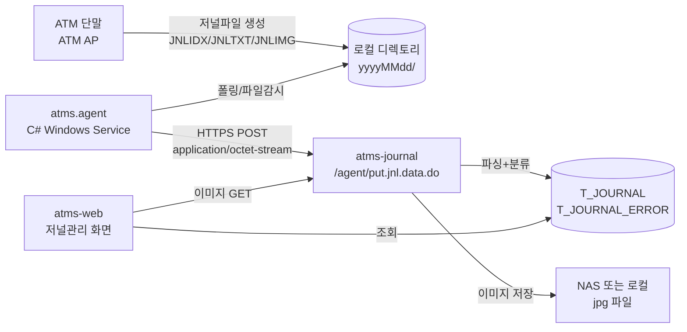

# 09. ATMR 저널 프로토콜 분석 (Agent ↔ atms-journal)

> **목적**: 새마을금고 ATMR 레퍼런스 코드를 분석하여, NH-ATMS의 `atms-journal` 모듈에서 구현해야 할 **저널 수신 프로토콜 / 저널 포맷 / 처리 흐름**을 정리한다.
> **분석 대상**:
> - 레퍼런스: `2.프로젝트/0.기본자료/새마을금고/atmr` (Java/Servlet 기반)
> - Agent: `D:/0.atec/2.Project/14.Agent/Agent-Source/atms.agent` (C# 기반)

---

## 1. 전체 아키텍처



**핵심 흐름**
1. ATM 단말의 AP가 거래/장애/상태 발생 시점에 로컬 디렉토리(`yyyyMMdd/JNLIDX|JNLTXT|JNLIMG`)에 저널 파일을 생성한다.
2. ATM에 설치된 **Agent**(C#)가 주기적으로 디렉토리를 스캔하여 미전송된 저널을 ATMS로 송신한다.
3. **atms-journal**(구 ATMR)이 저널을 수신 → 파싱 → DB 적재 + 이미지 파일 저장.
4. atms-web의 저널관리 화면이 DB를 조회하여 사용자에게 노출.

---

## 2. 통신 프로토콜 (Agent → atms-journal)

### 2.1 엔드포인트 목록

| URI | 메서드 | Content-Type | 설명 |
|---|---|---|---|
| `/agent/put.jnl.data.do` | POST | `application/octet-stream` | **저널 수신** (Agent → ATMS) |
| `/jnl/get.jnl.img.do?ymd=YYYYMMDD&key=...` | GET | `image/jpeg` | 저장된 저널 이미지 조회 |
| `/env.cfg.do` | GET | `text/json` | 서버 설정 조회 (운영/개발) |
| `/spec.jif.do` | GET | `text/json` | 파싱된 저널 인터페이스 스펙 조회 |
| `/spec.jif.org.do` | GET | `text/json` | 원본 저널 인터페이스 스펙(JSON) 조회 |

### 2.2 `/agent/put.jnl.data.do` 바이너리 페이로드 구조

> 바이트 순서: **Little Endian** / 문자셋: **EUC-KR (MS949)**
> 출처: [Ag2AtmsJounalTransferWorker.cs L150~L240](../../14.Agent/Agent-Source/atms.agent/Interface/Ag2AtmsJounalTransferWorker.cs) / [ServletHandler.java L223~L320](../../25.NH-ATMS/2.프로젝트/0.기본자료/새마을금고/atmr/src/main/java/atmr/web/ServletHandler.java)

```
+--------+--------------------------------------------------------------+
| offset | 필드                                                          |
+--------+--------------------------------------------------------------+
|   0    | mask key (uint8)        : 체인 마스킹 키 (1~254 랜덤)         |
|   1    | journal size (int32 LE) : 저널 본문 길이                      |
|   5    | journal bytes           : 마스킹된 저널 원문 (length=위 값)   |
|   ...  | bill size (int32 LE)    : 명세표 길이 (0=없음)                |
|   ...  | bill bytes              : 마스킹된 명세표 (EUC-KR)            |
|   ...  | img1 size (int32 LE)    : 고객 이미지(JPEG) 길이              |
|   ...  | img1 bytes              : 마스킹된 JPEG 바이트                |
|   ...  | img2 size (int32 LE)    : 수취 이미지(JPEG) 길이              |
|   ...  | img2 bytes              : 마스킹된 JPEG 바이트                |
|   ...  | img3 size (int32 LE)    : 카드 이미지(JPEG) 길이              |
|   ...  | img3 bytes              : 마스킹된 JPEG 바이트                |
+--------+--------------------------------------------------------------+
```

### 2.3 마스킹/언마스킹 알고리즘 (체인 XOR)

송신측이 매 패킷마다 1~254의 랜덤 키를 생성하고, 각 청크 본문을 **XOR 체인**으로 마스킹하여 송신. 수신측은 동일 키로 역연산.

```java
// 송신
byte mask = key;
byte original;
for (int i = 0; i < data.length; i++) {
    original = data[i];
    data[i] ^= mask;
    mask = original;     // 다음 마스크는 "원본" 값
}

// 수신
byte mask = key;
for (int i = 0; i < data.length; i++) {
    data[i] ^= mask;
    mask = data[i];      // 다음 마스크는 "복호된" 값
}
```

> **주의**: 진정한 암호가 아닌 단순 전송 마스킹. **HTTPS 위에서 동작 전제**이며, 이미지는 별도의 K-Sign(SDBCrypto) 또는 AES/CBC 암호화가 적용된다.

### 2.4 응답 포맷

```json
// 성공
{}

// 실패
{ "##emsg##": "에러 메시지" }
```

---

## 3. 저널 인터페이스 스펙 (JIF)

> 정의 파일: `interface.journal.json` (서버 시작 시 `Converter.JIF.load()`로 로딩)
> **모든 필드는 고정길이(`fixed`) 또는 구분자(`delim`, 기본 `|`) 기반 파싱**

### 3.1 공통 헤더 (32바이트, fixed)

| 오프셋 | 길이 | 키 | 설명 |
|---:|---:|---|---|
| 0 | 4 | `len` | 본문 길이 (len 제외, 0001~9999) |
| 4 | 4 | `yyyy` | 저널발생 연도 |
| 8 | 2 | `mm` | 월 |
| 10 | 2 | `dd` | 일 |
| 12 | 2 | `hh` | 시 (24h) |
| 14 | 2 | `mi` | 분 |
| 16 | 2 | `ss` | 초 |
| 18 | 3 | `fff` | 밀리초 |
| 21 | 1 | `flag` | 동일시간 일련번호 (0~9) |
| 22 | 3 | `bk_cd` | 은행코드 (NH=011) |
| 25 | 20 | `atm_id` | **영업점코드(5) + 단말번호(3)** + filler |
| 45 | 5 | `jnl_seq` | 저널 일련번호 (Host 거래번호와 동일 set) |
| 50 | 2 | `jnl_kind` | **저널 종류 (아래 표)** ← body 분기 키 |
| 52 | 1 | `idx_enc` | idx 암호화 여부 (0/1/2) |
| 53 | 1 | `jnl_enc` | jnl 암호화 여부 (0/1/2) |
| 54 | 1 | `enc_key_ver` | 암호키 버전 |
| 55 | 5 | `filler` | 예비 |

### 3.2 저널 종류 (`jnl_kind`)

| 코드 | 종류 | 설명 | 본문 포맷 |
|:---:|---|---|---|
| `00` | (없음/Reserved) | - | - |
| `11` | **AP START** | ATM AP 기동 시간 | delim, device version 배열 |
| `12` | **서비스오픈/폐국** | 자동화기기 개/폐국 접속 시간 | delim, 단말 상태/스펙 |
| `21` | **상태저널** | ATM 상태 변화 | delim, 장애코드/현금/카세트 |
| `22` | **장애저널** | ATM 장애 변화 (21과 동일 스펙, `#link#`) | (21과 동일) |
| `31` | **마감저널** | 마감(소계/합계) | delim, host/atm 마감 항목 배열 |
| `41` | **시재저널** | 시재 보충/회수 | delim, 권종/카세트 |
| `52` | **운영저널** | 기타 운영 행위 | `op_cd` + `op_act` |
| `71` | **거래저널** | 거래 발생 내역 | delim, 거래 상세 (출금/입금/계좌 등) |

### 3.3 핵심 본문 발췌 — `21/22 (상태/장애)`

장애 분석에 가장 중요한 본문. 다음 필드가 핵심:

| 키 | 길이 | 의미 |
|---|---:|---|
| `atm_st` | 2 | ATM 전체 상태 코드 |
| `bk_ecd` | 10 | **은행 장애코드** (장애모드일 때만) |
| `vd_ecd` | 10 | 기기업체(벤더) 장애코드 |
| `cash_wth`, `cash_dep` | 1 | 현금 출/입금 가능여부 |
| `prev_trx_sq`, `prev_trx_cd` | 4/6 | 장애 직전 거래 일련번호/코드 |
| `devices[]` | - | 장치별 상세 상태(id+8byte status) |
| `cassettes_log[]`, `cassettes_phy[]` | - | 권종별/물리 카세트 상태 |

### 3.4 핵심 본문 발췌 — `71 (거래)`

| 키 | 길이 | 의미 |
|---|---:|---|
| `trx_no` | 4 | 거래 일련번호 |
| `trx_cd` | 6 | 거래코드 |
| `wth_acc`, `dep_acc` | 2/2 | 출/입금 계좌 종류 |
| `bk_cd` | 4 | 은행코드 |
| `bk_acc` | 32 | 계좌/카드번호 |
| `trx_bk`, `trx_acc` | 4/32 | 이체 대상 은행/계좌 |
| `host_ret_no` 외 | - | 호스트 인증/추적 번호 |

> **전체 필드는 [interface.journal.json](../../25.NH-ATMS/2.프로젝트/0.기본자료/새마을금고/atmr/src/main/webapp/WEB-INF/config/interface.journal.json) 참조.**

---

## 4. Converter 동작 원리 (byte[] → JSON)

`Converter.toJson(byte[] packet)` 핵심 로직:

1. 스펙 로드 시 모든 `field` 배열에 `#off#`(오프셋)과 `#tlen#`(총길이) 자동 계산.
2. 헤더 파싱 → `head.jnl_kind` 추출.
3. `#body-key#: true` 가 붙은 필드(헤더의 `jnl_kind`) 값으로 `body` 스펙을 동적 선택 (예: `body["21"]`).
4. `#type#: fixed` 면 오프셋/길이 기반, `#type#: delim` 면 separator(`|`) 기반 파싱.
5. 결과 JSON:
   ```json
   {
     "head": { "yyyy": "2025", "mm": "11", ..., "jnl_kind": "21" },
     "body": { "atm_st": "00", "bk_ecd": "...", "devices": [...], ... }
   }
   ```
6. ServletHandler가 여기에 `extra` (이미지 경로/명세표)를 덧붙임.

---

## 5. 이미지 저장 규칙

ServletHandler `convert()`에서:

- 저장 경로: `${repository.ejnl}/img/yyyyMMdd/`
- 파일명 패턴: `영업점코드(5).기기번호(3).저널시간(10).이미지형식(2).마스킹키(2hex).암호화여부(1).jpg`
  - 예: `00722.443.1349004180.01.4a.1.jpg`
- 이미지 형식: `01`=고객, `02`=수취, `03`=카드
- 1차: K-Sign(SDBCrypto) 암호화 → 실패 시 2차: AES/CBC/PKCS5Padding (config의 `img.mask` 키/IV에서 6번 바이트만 마스킹키로 동적 치환)

> NH-ATMS에서는 K-Sign 라이선스 미보유 가능성 → **AES/CBC 단일 경로로 단순화** 권장.

---

## 6. NH-ATMS `atms-journal` 구현 방향 (제안)

### 6.1 레퍼런스와의 차이점

| 항목 | 레퍼런스(ATMR) | NH-ATMS(atms-journal) |
|---|---|---|
| 프레임워크 | Servlet 3 + eGov | **Spring Boot 3.5 + MyBatis** |
| 설정 | `config.*.json` + Servlet WebApplicationContext | `application.yml` + `@Value` |
| 저장 위치 | 파일경로 NAS | 동일 (별도 마운트) 또는 S3/오브젝트스토리지 |
| Converter | Gson 기반 자체 구현 | **그대로 포팅 (com.google.gson 의존성 추가)** |
| 인증 | 없음 (HTTPS만 전제) | **Agent 전용 API Key 헤더 추가 권장** (`X-ATMS-AGENT-KEY`) |
| 이미지 암호화 | K-Sign 우선 + AES Fallback | **AES/CBC 단일화** |

### 6.2 패키지 구조 제안

```
atms-journal/
└── src/main/java/kr/co/nh/atms/journal/
    ├── JournalApplication.java          (옵션: 독립 실행)
    ├── controller/
    │   └── JournalReceiveController.java  // POST /agent/put.jnl.data.do
    │   └── JournalImageController.java    // GET  /jnl/get.jnl.img.do
    ├── service/
    │   ├── JournalReceiveService.java     // 수신 + 분류 + 저장
    │   ├── JournalParser.java             // Converter 포팅
    │   └── JournalImageStorage.java       // 파일 저장/조회 + AES
    ├── mapper/
    │   └── JournalMapper.java
    ├── entity/
    │   ├── Journal.java                   // T_JOURNAL
    │   ├── JournalError.java              // T_JOURNAL_ERROR
    │   └── JournalTrx.java                // T_JOURNAL_TRX (옵션)
    └── dto/
        └── JournalParseResult.java
└── src/main/resources/
    ├── application.yml
    ├── mapper/journal/JournalMapper.xml
    └── spec/interface.journal.json        // ATMR에서 그대로 복사
```

### 6.3 의존성 (build.gradle)

```groovy
dependencies {
    implementation project(':atms-common')
    implementation 'org.springframework.boot:spring-boot-starter-web'
    implementation 'com.google.code.gson:gson:2.11.0'   // Converter 포팅용
}
```

### 6.4 atms-web 조회 화면과의 연계

조회 화면은 **atms-web** 에서 구현. atms-journal은 **수신/적재 전담** + **이미지 다운로드 API**만 제공. atms-web의 화면에서 이미지가 필요한 경우 `GET {journal-host}/jnl/get.jnl.img.do?ymd=&key=` 를 호출 (백엔드 프록시 또는 직접).

---

## 7. DB 스키마 초안 (다음 작업에서 확정)

다음 산출물에서 다룰 예정 (`10_DB스키마_저널.md`):

- `T_JOURNAL` : 헤더 + body raw JSON (CLOB) — 모든 저널 공통 적재
- `T_JOURNAL_ERROR` : `jnl_kind IN ('21','22')` & `bk_ecd != ''` → 별도 적재 (장애 조회 인덱스)
- `T_JOURNAL_TRX` : `jnl_kind = '71'` → 거래 인덱싱 (옵션)
- `T_JOURNAL_IMAGE` : 이미지 메타 (경로, 마스킹키, 암호화여부)

---

## 8. 다음 단계 (TODO)

1. [ ] **`10_DB스키마_저널.md`** 작성 → T_JOURNAL 계열 테이블 DDL 확정
2. [ ] `atms-journal/build.gradle` 의존성 추가 + Spring Boot 진입점 생성
3. [ ] `Converter` 포팅 (Gson 기반 그대로) + `JournalParser` 작성
4. [ ] `JournalReceiveController` 구현 (바이너리 청크 파싱)
5. [ ] **테스트 Agent 작성** (`Simulator/journal-agent`): 가짜 저널 생성 → POST
6. [ ] atms-web에 `저널관리` 메뉴 + 화면 (조회/상세/이미지)

---

## 9. 참고 코드 위치

| 항목 | 경로 |
|---|---|
| ATMR 진입점 | `2.프로젝트/0.기본자료/새마을금고/atmr/src/main/java/atmr/web/ApplicationEntryPoint.java` |
| Servlet 핸들러 | `.../atmr/web/ServletHandler.java` |
| 저널 변환기 | `.../atmr/web/Converter.java` |
| 내부 IF 클라이언트 | `.../atmr/web/InterfaceClient.java` |
| 저널 스펙 | `.../atmr/src/main/webapp/WEB-INF/config/interface.journal.json` |
| Agent 송신 워커 | `D:/0.atec/2.Project/14.Agent/Agent-Source/atms.agent/Interface/Ag2AtmsJounalTransferWorker.cs` |
| Agent 전송 클라이언트 | `D:/.../atms.agent/Interface/Ag2AtmsWebServiceClient.cs` |

