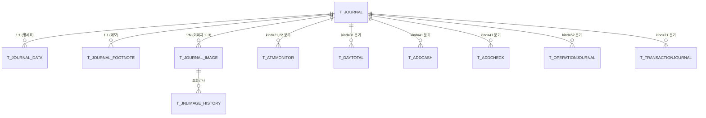

# 10. 저널 도메인 DB 스키마 (Oracle)

> **출처**: 새마을금고 검증 스키마(`0.기본자료/새마을금고/새마을금고.sql`) → Oracle 19c 변환
> **마이그레이션**: `2.개발문서/sql/V1.0.2__journal_schema.sql` (이 문서 기반)
> **관계도**: T_JOURNAL(공통 헤더) → 저널종류(`jnl_kind`)에 따라 분기 테이블 적재

---

## 1. 테이블 일람 & 메뉴 매핑

| # | 테이블 | 설명 | 적재 트리거 (jnl_kind) | 연결 화면 |
|:-:|---|---|:-:|---|
| 1 | **T_JOURNAL** | 저널 공통 헤더 | **전체** | 저널관리 - 저널조회 |
| 2 | T_JOURNAL_DATA | 명세표(영수증) 본문 | 71 (거래) | (상세 모달) |
| 3 | T_JOURNAL_ERROR | 파싱 실패 raw JSON | 파싱 에러 시 | 저널관리 - 에러조회 |
| 4 | T_JOURNAL_FOOTNOTE | 특이저널 메모 | 사용자 입력 | (메모 기능) |
| 5 | T_JOURNAL_IMAGE | 거래 이미지 경로 | 71 (이미지 포함) | (이미지 다운로드) |
| 6 | T_JNLIMAGE_HISTORY | 이미지 조회 감사 | API 호출 시 | (감사 로그) |
| 7 | **T_ATMMONITOR** | 기기 상태/장애 이력 | **21, 22** | **기기상태관리 - 상태이력 / 장애내역조회** |
| 8 | T_DAYTOTAL | 일/시간 마감 | 31 | 마감관리 - 마감조회 |
| 9 | T_ADDCASH | 현금 시재 보충 | 41 | 시재관리 - 시재현황 |
| 10 | T_ADDCHECK | 수표 시재 보충 | 41 | 시재관리 - 시재현황 |
| 11 | T_OPERATIONJOURNAL | 운영(개·폐국 등) | 52 | 저널관리 - 운영저널 |
| 12 | **T_TRANSACTIONJOURNAL** | 거래 저널 | **71** | **거래관리 - 거래조회** |

> 굵은 글씨(**T_JOURNAL / T_ATMMONITOR / T_TRANSACTIONJOURNAL**) = MVP 1주차 우선 구현 대상.

---

## 2. ERD (논리)



**공통 PK 패턴**: `(TERM_GROUP_ID, TERM_ID, JNL_DATE, JNL_TIME)` 4-컬럼 복합키

- `TERM_GROUP_ID` (5자) : 영업점코드
- `TERM_ID` (20자) : 단말번호 (실 사용 3자, 여유)
- `JNL_DATE` (8자) : YYYYMMDD
- `JNL_TIME` (10자) : HHMMSSFFF + flag (헤더의 hh~fff+flag 결합)

---

## 3. Oracle DDL

> **변환 원칙**
> - MySQL `char/varchar` → Oracle `CHAR/VARCHAR2` (바이트 단위)
> - MySQL `bigint` → Oracle `NUMBER(19)`
> - MySQL `text` → Oracle `CLOB`
> - MySQL `AUTO_INCREMENT` → Oracle `SEQUENCE` + `IDENTITY` (19c 이상은 IDENTITY 권장)
> - MySQL `PARTITION BY RANGE` → Oracle `PARTITION BY RANGE (JNL_DATE)` (운영시 적용, 개발은 생략)
> - 한글 컬럼명 주석은 `COMMENT ON COLUMN`으로 분리

### 3.1 T_JOURNAL — 저널 공통

```sql
CREATE TABLE T_JOURNAL (
    TERM_GROUP_ID       CHAR(5)       NOT NULL,
    TERM_ID             VARCHAR2(20)  NOT NULL,
    JNL_DATE            CHAR(8)       NOT NULL,
    JNL_TIME            CHAR(10)      NOT NULL,
    AGENT_TYPE          CHAR(1),
    SEQ_NO              CHAR(5),
    JNL_TYPE_CD         CHAR(2),
    JNL_WRITE_TYPE_CD   CHAR(1),
    RECV_DATE           CHAR(8),
    RECV_TIME           CHAR(10),
    CONSTRAINT PK_T_JOURNAL PRIMARY KEY (TERM_GROUP_ID, TERM_ID, JNL_DATE, JNL_TIME)
);

CREATE INDEX IX_T_JOURNAL_DATE ON T_JOURNAL (JNL_DATE, JNL_TIME);
CREATE INDEX IX_T_JOURNAL_KIND ON T_JOURNAL (JNL_TYPE_CD, JNL_DATE);
```

| 컬럼 | 설명 |
|---|---|
| TERM_GROUP_ID | 영업점코드 (5자) |
| TERM_ID | 단말번호 |
| JNL_DATE | 저널발생일 YYYYMMDD |
| JNL_TIME | 저널발생시간 HHMMSSFFF+flag |
| AGENT_TYPE | 에이전트구분 (A/M 등) |
| SEQ_NO | 저널일련번호 |
| **JNL_TYPE_CD** | **저널종류 (`11/12/21/22/31/41/52/71`)** |
| JNL_WRITE_TYPE_CD | 저널인자모드 |
| RECV_DATE | ATMS 수신일 |
| RECV_TIME | ATMS 수신시간 |

### 3.2 T_ATMMONITOR — 기기 상태/장애 이력 (MVP 1주차 ★)

```sql
CREATE TABLE T_ATMMONITOR (
    TERM_GROUP_ID    CHAR(5)       NOT NULL,
    TERM_ID          VARCHAR2(20)  NOT NULL,
    JNL_DATE         CHAR(8)       NOT NULL,
    JNL_TIME         CHAR(10)      NOT NULL,
    AGENT_TYPE       CHAR(1)       NOT NULL,
    ATM_STATUS       CHAR(2),
    ERR_CD           VARCHAR2(10),
    ATM_ERR_CD       VARCHAR2(10),
    PROCESS_COUNT    CHAR(1),
    MAN_STATUS       CHAR(1),
    OMAN_STATUS      CHAR(1),
    SPR_STATUS       CHAR(1),
    JPR_STATUS       CHAR(1),
    CHK_STATUS       CHAR(1),
    CHA_STATUS       CHAR(1),
    MCR_STATUS       CHAR(1),
    PB_STATUS        CHAR(1),
    RJT_STATUS       CHAR(1),
    SEND_FLAG        CHAR(1),
    RECV_DATE        CHAR(8),
    RECV_TIME        CHAR(10),
    CONSTRAINT PK_T_ATMMONITOR PRIMARY KEY (TERM_GROUP_ID, TERM_ID, JNL_DATE, JNL_TIME)
);

CREATE INDEX IX_T_ATMMONITOR_RECV  ON T_ATMMONITOR (RECV_DATE, RECV_TIME);
CREATE INDEX IX_T_ATMMONITOR_ERR   ON T_ATMMONITOR (ERR_CD, JNL_DATE);
CREATE INDEX IX_T_ATMMONITOR_STAT  ON T_ATMMONITOR (ATM_STATUS, JNL_DATE);
```

| 컬럼 | 설명 |
|---|---|
| ATM_STATUS | ATM 전체 상태 (00=정상 등 코드표) |
| ERR_CD | 은행 장애코드 (장애모드시) |
| ATM_ERR_CD | 기기업체 장애코드 |
| PROCESS_COUNT | 진행카운트 |
| MAN_STATUS / OMAN_STATUS | 만원권/오만원권 상태 |
| SPR_STATUS | 명세표부 상태 |
| JPR_STATUS | 저널부 상태 |
| CHK_STATUS / CHA_STATUS | 수표부/수표출금부 상태 |
| MCR_STATUS | 카드부 상태 |
| PB_STATUS | 통장부 상태 |
| RJT_STATUS | 회수함 상태 |
| SEND_FLAG | (상위 시스템) 송신 여부 |

> **장애내역조회 화면**은 같은 테이블에서 `WHERE ERR_CD IS NOT NULL AND ERR_CD <> '0000000000'` 로 필터링하면 됨.

### 3.3 T_TRANSACTIONJOURNAL — 거래 저널

```sql
CREATE TABLE T_TRANSACTIONJOURNAL (
    TERM_GROUP_ID      CHAR(5)       NOT NULL,
    TERM_ID            VARCHAR2(20)  NOT NULL,
    JNL_DATE           CHAR(8)       NOT NULL,
    JNL_TIME           CHAR(10)      NOT NULL,
    TR_NO              VARCHAR2(4),
    TR_TYPE            CHAR(6),
    TR_FROM_ACCOUNT    CHAR(2),
    TR_TO_ACCOUNT      CHAR(2),
    BANK_CD            CHAR(3),
    ACCOUNT_NO         VARCHAR2(64),
    TO_BANK_CD         CHAR(3),
    TO_ACCOUNT_NO      VARCHAR2(64),
    TR_HOST_DATE       CHAR(8),
    TR_HOST_TIME       CHAR(6),
    TR_HOST_NO         VARCHAR2(8),
    TR_HOST_AUDIT_NO   VARCHAR2(8),
    HOST_NET_ID        VARCHAR2(8),
    HOST_SETTLE_DATE   CHAR(8),
    DEPOSIT_NO         VARCHAR2(8),
    SURCHARGE          NUMBER(19),
    REQUEST_AMOUNT     NUMBER(19),
    DISPENSE_AMOUNT    NUMBER(19),
    REMAIN_AMOUNT      NUMBER(19),
    AVAIL_AMOUNT       NUMBER(19),
    PROC_COUNT         CHAR(1),
    TR_RESULT          CHAR(4),
    ERR_CD1            VARCHAR2(10),
    ERR_CD2            VARCHAR2(10),
    ERR_CD3            VARCHAR2(10),
    CARD_DATA          VARCHAR2(152),
    NON_CASH_VALUE     VARCHAR2(16),
    NON_CASH_TYPE      CHAR(2),
    TR_MEDIA_CD        CHAR(1),
    MESSAGE            VARCHAR2(255),
    HOST_CASH_AMOUNT   NUMBER(19),
    HOST_CHECK_AMOUNT  NUMBER(19),
    TOTAL_TYPE_CD      CHAR(1),
    TRANSFER_NAME      VARCHAR2(60),
    CONSTRAINT PK_T_TRANSACTIONJOURNAL PRIMARY KEY (TERM_GROUP_ID, TERM_ID, JNL_DATE, JNL_TIME)
);

CREATE INDEX IX_T_TRX_DATE ON T_TRANSACTIONJOURNAL (JNL_DATE, JNL_TIME);
CREATE INDEX IX_T_TRX_ACC  ON T_TRANSACTIONJOURNAL (ACCOUNT_NO);
CREATE INDEX IX_T_TRX_CARD ON T_TRANSACTIONJOURNAL (CARD_DATA);
```

### 3.4 T_OPERATIONJOURNAL — 운영 저널

```sql
CREATE TABLE T_OPERATIONJOURNAL (
    TERM_GROUP_ID    CHAR(5)       NOT NULL,
    TERM_ID          VARCHAR2(20)  NOT NULL,
    JNL_DATE         CHAR(8)       NOT NULL,
    JNL_TIME         CHAR(10)      NOT NULL,
    OPERATION_CD     CHAR(2)       NOT NULL,
    OPERATION_ACTION VARCHAR2(2000),
    CONSTRAINT PK_T_OPERATIONJOURNAL PRIMARY KEY (TERM_GROUP_ID, TERM_ID, JNL_DATE, JNL_TIME)
);
```

### 3.5 T_JOURNAL_DATA — 명세표

```sql
CREATE TABLE T_JOURNAL_DATA (
    TERM_GROUP_ID  CHAR(5)       NOT NULL,
    TERM_ID        VARCHAR2(20)  NOT NULL,
    JNL_DATE       CHAR(8)       NOT NULL,
    JNL_TIME       CHAR(10)      NOT NULL,
    JNL_DATA       CLOB,
    CONSTRAINT PK_T_JOURNAL_DATA PRIMARY KEY (TERM_GROUP_ID, TERM_ID, JNL_DATE, JNL_TIME)
);
```

### 3.6 T_JOURNAL_ERROR — 파싱 실패 보관

```sql
CREATE SEQUENCE SEQ_T_JOURNAL_ERROR START WITH 1 INCREMENT BY 1 NOCACHE NOCYCLE;

CREATE TABLE T_JOURNAL_ERROR (
    SEQ         NUMBER(19)  NOT NULL,
    JNL_DATE    CHAR(8),
    JNL_TIME    CHAR(10),
    ATM_ID      CHAR(20),
    JNL_SEQ     CHAR(5),
    JNL_KIND    CHAR(2),
    JNL_JSON    CLOB,
    ERR_MSG     CLOB,
    REG_DT      TIMESTAMP DEFAULT CURRENT_TIMESTAMP,
    CONSTRAINT PK_T_JOURNAL_ERROR PRIMARY KEY (SEQ)
);

CREATE INDEX IX_T_JOURNAL_ERROR_DATE ON T_JOURNAL_ERROR (JNL_DATE, JNL_TIME);
```

### 3.7 T_JOURNAL_FOOTNOTE — 특이저널 메모

```sql
CREATE TABLE T_JOURNAL_FOOTNOTE (
    TERM_GROUP_ID  CHAR(5)       NOT NULL,
    TERM_ID        VARCHAR2(20)  NOT NULL,
    JNL_DATE       CHAR(8)       NOT NULL,
    JNL_TIME       CHAR(10)      NOT NULL,
    DELETE_FLAG    CHAR(1)       DEFAULT '0',
    NOTE_HTML      VARCHAR2(4000),
    NOTE           VARCHAR2(2000),
    CONSTRAINT PK_T_JOURNAL_FOOTNOTE PRIMARY KEY (TERM_GROUP_ID, TERM_ID, JNL_DATE, JNL_TIME)
);
```

### 3.8 T_JOURNAL_IMAGE — 거래 이미지 경로

```sql
CREATE TABLE T_JOURNAL_IMAGE (
    TERM_GROUP_ID  CHAR(5)       NOT NULL,
    TERM_ID        VARCHAR2(20)  NOT NULL,
    JNL_DATE       CHAR(8)       NOT NULL,
    JNL_TIME       CHAR(10)      NOT NULL,
    IMAGE_TYPE     CHAR(1)       NOT NULL,  -- 1:고객, 2:수취, 3:카드
    IMAGE_PATH     VARCHAR2(200),
    CONSTRAINT PK_T_JOURNAL_IMAGE PRIMARY KEY (TERM_GROUP_ID, TERM_ID, JNL_DATE, JNL_TIME, IMAGE_TYPE)
);
```

### 3.9 T_JNLIMAGE_HISTORY — 이미지 조회 감사

```sql
CREATE TABLE T_JNLIMAGE_HISTORY (
    TERM_GROUP_ID        CHAR(5)       NOT NULL,
    TERM_ID              VARCHAR2(20)  NOT NULL,
    JNL_DATE             CHAR(8)       NOT NULL,
    JNL_TIME             CHAR(10)      NOT NULL,
    VIEW_DATE            CHAR(8)       NOT NULL,
    VIEW_TIME            CHAR(6)       NOT NULL,
    VIEW_USER_ID         VARCHAR2(12),
    VIEW_USER_POSITION   VARCHAR2(60),
    VIEW_USER_NAME       VARCHAR2(100),
    VIEW_USER_DEPT       CHAR(5),
    VIEW_USER_DEPT_NAME  VARCHAR2(200),
    CONSTRAINT PK_T_JNLIMAGE_HISTORY PRIMARY KEY (TERM_GROUP_ID, TERM_ID, JNL_DATE, JNL_TIME, VIEW_DATE, VIEW_TIME)
);
```

### 3.10 T_DAYTOTAL / T_ADDCASH / T_ADDCHECK

> 새마을금고 스키마 그대로 변환. 본 MVP 단계에서는 정의만 두고 빈 테이블로 유지. (2주차 이후 본격 적재)

```sql
-- 마감
CREATE TABLE T_DAYTOTAL (
    TERM_GROUP_ID  CHAR(5)       NOT NULL,
    TERM_ID        VARCHAR2(20)  NOT NULL,
    JNL_DATE       CHAR(8)       NOT NULL,
    JNL_TIME       CHAR(10)      NOT NULL,
    TOTAL_TYPE     CHAR(1),
    BEGIN_DATE     CHAR(8),
    BEGIN_TIME     CHAR(6),
    END_DATE       CHAR(8),
    END_TIME       CHAR(6),
    TOTAL_DATA     CLOB,
    CONSTRAINT PK_T_DAYTOTAL PRIMARY KEY (TERM_GROUP_ID, TERM_ID, JNL_DATE, JNL_TIME)
);

-- 시재 (현금)
CREATE TABLE T_ADDCASH (
    TERM_GROUP_ID  CHAR(5)       NOT NULL,
    TERM_ID        VARCHAR2(20)  NOT NULL,
    JNL_DATE       CHAR(8)       NOT NULL,
    JNL_TIME       CHAR(10)      NOT NULL,
    ACTION_TYPE    CHAR(1)       NOT NULL,
    CASSETTE_TYPE  CHAR(1)       NOT NULL,
    CASSETTE_NO    CHAR(2)       NOT NULL,
    CURRENCY       CHAR(3),
    DENOMINATION   NUMBER(10),
    REMAIN_QTY     NUMBER(5),
    ADD_QTY        NUMBER(5),
    CONSTRAINT PK_T_ADDCASH PRIMARY KEY (TERM_GROUP_ID, TERM_ID, JNL_DATE, JNL_TIME, ACTION_TYPE, CASSETTE_TYPE, CASSETTE_NO)
);

-- 시재 (수표)
CREATE TABLE T_ADDCHECK (
    TERM_GROUP_ID  CHAR(5)       NOT NULL,
    TERM_ID        VARCHAR2(20)  NOT NULL,
    JNL_DATE       CHAR(8)       NOT NULL,
    JNL_TIME       CHAR(10)      NOT NULL,
    ACTION_TYPE    CHAR(1)       NOT NULL,
    CURRENCY       CHAR(3),
    DENOMINATION   NUMBER(10),
    JA_AMOUNT      NUMBER(19),
    JA_COUNT       NUMBER(5),
    TA_AMOUNT      NUMBER(19),
    TA_COUNT       NUMBER(5),
    ISSUE_BANK     CHAR(3),
    ISSUE_BRANCH   CHAR(5),
    REG_NO         VARCHAR2(32),
    CONSTRAINT PK_T_ADDCHECK PRIMARY KEY (TERM_GROUP_ID, TERM_ID, JNL_DATE, JNL_TIME, ACTION_TYPE)
);
```

---

## 4. 메뉴 추가 계획

기존 `2000 ATM 운영` 하위에 메뉴를 보강하고, `5000 저널관리` 그룹을 신규 추가.

| MENU_NO | PARENT | 메뉴명 | URL | 비고 |
|---:|---:|---|---|---|
| 2010 | 2000 | 기기현황 | `/atm/status` | 기존 (T_ATMSTATUS) |
| **2015** | 2000 | **기기상태이력** | `/atm/monitor` | **신규 (T_ATMMONITOR) ★** |
| 2020 | 2000 | 거래조회 | `/atm/journal` | 기존 슬롯 → T_TRANSACTIONJOURNAL 연결 |
| 2030 | 2000 | 장애내역조회 | `/atm/fault` | 기존 슬롯 → T_ATMMONITOR WHERE ERR_CD |
| **5000** | NULL | **저널관리** | `-` | **신규 그룹** |
| **5010** | 5000 | 저널조회 | `/journal/list` | T_JOURNAL 전체 (운영저널·저널에러는 별도 조회 화면 불필요 — 5010에서 jnl_kind 필터로 통합 조회) |

---

## 5. 다음 산출물

1. **`V1.0.2__journal_schema.sql`** — 본 문서의 DDL 일괄 적용 마이그레이션
2. **`V1.0.3__journal_menus.sql`** — 메뉴 시드 (위 4번 표)
3. **`V1.0.4__journal_sample.sql`** — 화면 확인용 샘플 데이터 (T_ATMMONITOR 5건)
4. **atms-web 백엔드 `atmmonitor` 패키지** — 기존 `atmstatus` 패턴 그대로 복제
5. **atms-web 프론트엔드 `AtmMonitorPage.tsx`** — `LoginHistPage` 패턴 그대로 복제

