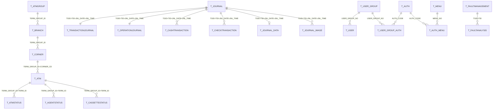

# NH-ATMS 최종 테이블 설계서 (정본)

> 본 문서는 **현재 ATMS 스키마에 실제 배포·운영 중인 48종 테이블**을 정본(Source of Truth)으로 기록하고,
> 추가 설계(미배포)분을 부록으로 정리한 최종 설계서이다.
> - 현행 컬럼 출처: 운영 DB `ATMS` 스키마 실 조회 결과 (사용자 제공 SELECT 목록)
> - 추가 설계 출처: `10_AS-IS전수분석_및_TO-BE테이블설계.md` (V1.2.9 / V1.3.0)
> - DB: Oracle (`jdbc:oracle:thin:@//192.168.28.21:1521/ATMSPDB`, 스키마 `ATMS`)
> - 작성일: 2026-06-02

---

## 0. 요약

| 구분 | 수량 | 비고 |
| --- | --- | --- |
| **현행 배포 테이블 (정본)** | **48** | 본 문서 §2~§10 |
| 추가 설계 — V1.2.9 (거래/상태/마스터 보강) | 11 | §11.1, 미배포 |
| 추가 설계 — V1.3.0 (일괄용역/SLA) | 8 | §11.2, 미배포 |
| **TO-BE 합계** | **67** | 현행 48 + 추가 19 |

### 0.1 카테고리별 현행 테이블 수

| 카테고리 | 수량 | 테이블 |
| --- | --- | --- |
| ① 인증/권한/메뉴 | 8 | T_USER, T_USER_GROUP, T_USER_GROUP_AUTH, T_USER_AUTH_HIST, T_AUTH, T_AUTH_MENU, T_MENU, T_LOGIN_HIST |
| ② 마스터 | 7 | T_BRANCH, T_CORNER, T_ATM, T_ATMGROUP, T_CODE, T_CODEGROUP, T_NOTICE |
| ③ 저널 | 8 | T_JOURNAL, T_JOURNALDATA, T_JOURNALIMAGE, T_JOURNAL_DATA, T_JOURNAL_IMAGE, T_JOURNAL_FOOTNOTE, T_JOURNAL_ERROR, T_JNLIMAGE_HISTORY |
| ④ 거래/운영 저널상세 | 4 | T_TRANSACTIONJOURNAL, T_OPERATIONJOURNAL, T_CASHTRANSACTION, T_CHECKTRANSACTION |
| ⑤ 기기상태/모니터링 | 6 | T_ATMMONITOR, T_ATMSTATUS, T_ATMUNITSTATUS, T_AGENTSTATUS, T_CASSETTESTATUS, T_ATMSTOPHISTORY |
| ⑥ 장애 | 3 | T_FAULTMANAGEMENT, T_FAULTANALYSIS, T_FAULTRATEMANAGEMENT |
| ⑦ 집계/배치 | 7 | T_DAYTOTAL, T_ADDCASH, T_ADDCHECK, T_TRANSACTIONDAILYTOTAL, T_OPERATIONRATEMANAGEMENT, T_BATCHJOB, T_BATCHHISTORY |
| ⑧ 인터페이스/연계 | 5 | T_GWINTERFACE, T_IF_QUEUE, T_NETSENDDATA, T_NETRECVDATA, T_SMSSENDDATA |
| **합계** | **48** | |

---

## 1. 설계 원칙 (현행 컨벤션)

| 항목 | 규칙 |
| --- | --- |
| 테이블명 | `T_` 접두어 + 대문자 SNAKE_CASE |
| 컬럼명 | 대문자 SNAKE_CASE |
| 영업점/기기 표준키 | `TERM_GROUP_ID CHAR(5)` (영업점/그룹), `TERM_ID VARCHAR2(20)` (단말번호) |
| 일자 | `CHAR(8)` (yyyyMMdd) |
| 일시 | `CHAR(14)` (yyyyMMddHHmmss), 등록일시 `REG_DT` / 수정일시 `UPD_DT` |
| 시각 | `CHAR(6)` (HHmmss), 저널시각 `JNL_TIME CHAR(10)` (HHmmssSSS 등) |
| 금액 | `NUMBER(19)` |
| 코드값 | `CHAR(n)` / `VARCHAR2(n)` 고정 길이 코드 |
| 거래상세 PK | (TERM_GROUP_ID, TERM_ID, JNL_DATE, JNL_TIME [+ 구분자]) → T_TRANSACTIONJOURNAL 과 1:1/1:N |
| FK | **논리참조** (물리 제약 미설정 — 저널 INSERT 성능 보호) |
| COMMENT | 모든 테이블/컬럼 한글 COMMENT |

---

## 2. ① 인증 / 권한 / 메뉴 (8종)

### 2.1 T_USER (사용자)
PK: `USER_ID`
```
USER_ID, USER_NAME, PASSWORD, EMP_NO, USER_GROUP_NO, USER_TYPE_CD, EMAIL,
PHONE_NO, CELL_PHONE_NO, DEPT_CD, DEPT_NAME, BRANCH_CD, USER_POSITION,
LAST_LOGIN_DT, LOGIN_FLAG, LOGIN_FAIL_CNT, LOCK_YN, PW_EXPIRE_DT,
INFO_CHG_DT, USE_YN, REG_DT, REG_ID, UPD_DT, UPD_ID
```

### 2.2 T_USER_GROUP (사용자그룹)
PK: `USER_GROUP_NO`
```
USER_GROUP_NO, USER_GROUP_NAME, USER_TYPE_CD, DESCRIPTION, USE_YN, REG_DT, UPD_DT
```

### 2.3 T_USER_GROUP_AUTH (사용자그룹-권한 매핑)
PK: `USER_GROUP_NO, AUTH_CODE`
```
USER_GROUP_NO, AUTH_CODE, REG_DT
```

### 2.4 T_USER_AUTH_HIST (사용자 권한변경 이력)
PK: `HIST_SEQ`
```
HIST_SEQ, USER_ID, BEFORE_GROUP_NO, AFTER_GROUP_NO, CHG_REASON, REG_DT, REG_ID
```

### 2.5 T_AUTH (권한)
PK: `AUTH_CODE`
```
AUTH_CODE, AUTH_NAME, AUTH_DESC, AUTH_TYPE, FSTG_MENU_NO, USE_YN, REG_DT, UPD_DT
```

### 2.6 T_AUTH_MENU (권한-메뉴 매핑)
PK: `AUTH_CODE, MENU_NO`
```
AUTH_CODE, MENU_NO, READ_YN, WRITE_YN, USE_YN, REG_DT
```

### 2.7 T_MENU (메뉴)
PK: `MENU_NO`
```
MENU_NO, PARENT_NO, MENU_NAME, MENU_URL, MENU_LEVEL, MENU_ORDER, MENU_ICON,
MENU_TYPE, VISIBLE_YN, USE_YN, DESCRIPTION, REG_DT, UPD_DT
```

### 2.8 T_LOGIN_HIST (로그인 이력)
PK: `LOGIN_SEQ`
```
LOGIN_SEQ, USER_ID, LOGIN_DT, LOGIN_IP, LOGIN_RESULT, FAIL_REASON, LOGOUT_DT, USER_AGENT
```

---

## 3. ② 마스터 (7종)

### 3.1 T_BRANCH (영업점/지점)
PK: `TERM_GROUP_ID`
```
TERM_GROUP_ID, BRANCH_CD, BRANCH_NAME, BRANCH_TYPE_CD, ZIPCODE, ADDRESS,
DETAIL_ADDRESS, PHONE_NO, FAX_NO, PARTNER_CD, BLNG_SOTY_CD, SOTY_NM,
TERM_GROUP_NAME, ADDR_SEQ
```

### 3.2 T_ATMGROUP (기기그룹/조직 계층)
PK: `TERM_GROUP_ID`
```
TERM_GROUP_ID, TERM_GROUP_NAME, GROUP_LEVEL, PARENT_ID, SUPER_ID
```

### 3.3 T_CORNER (코너/설치장소)
PK: `TERM_GROUP_ID, CORNER_CD`
```
TERM_GROUP_ID, CORNER_CD, CORNER_NAME, CORNER_TYPE_CD, OPERATION_TYPE_CD,
LOCATION_TYPE_CD, SERVICE_START_TIME, SERVICE_END_TIME, SERVICE_WEEKDAY,
BOOTH_TYPE_CD, BOOTH_COUNT, MANAGE_TYPE_CD, OUTSRC_CO_CD, GUARD_CO_CD,
GUARD_BR_CD, GUARD_CRTNO, GUARD_STATUS, CORNER_SAFE_USE_FLAG, CORNER_STATUS,
OPEN_DATE, CLOSE_DATE, TEMP_CLS_START_DATE, TEMP_CLS_END_DATE, TEMP_CLS_REASON,
PHONE_NO, ZIPCODE, AREA1_CD, AREA2_CD, AREA3_CD, DETAIL_ADDRESS, ADDRESS,
LOCATION, LEASE_DEPOSIT, LEASE_VALUE, CHECK_DEP_FLAG, CHECK_WIT_FLAG, LAT, LNG,
BASE_CHARGE, ATM_ADD_CHARGE, TIME_ADD_CHARGE, CHECK_CHARGE, SERVICE_SPEC,
ENTER_DATE, ENTER_TIME, ENTER_USER_ID, CCTV_SET_FLAG, GUARD_EQUIP_CHARGE,
DVR_IP, ENG_SIDO, ENG_ADM_GG, ENG_ADDR, BRANCH_CD, PARTNER_CD, MAINT_TYPE_CD,
PARTNER_NAME, GUARD_CO_NAME, HOLIDAY_START_TIME, HOLIDAY_END_TIME, HOLIDAY_SERVICE
```

### 3.4 T_ATM (자동화기기)
PK: `TERM_GROUP_ID, TERM_ID`
```
TERM_GROUP_ID, TERM_ID, ATM_STATUS, ASSET_FLAG, MANAGE_TYPE_CD, LOCATION_TYPE_CD,
LOCATION_NAME, SERVICE_DAY_TYPE_CD, SERVICE_START_TIME, SERVICE_END_TIME,
SERVICE_START_DATE, SERVICE_END_DATE, ENTER_DATE, ENTER_TIME, PHONE_NO, ATM_CO_CD,
MODEL_CD, ATM_IP, BP_SERVER_IP, SECURITY_PROVIDER_CD, SERVICE_PROVIDER_CD,
OFFICE_CD, TEAM_CD, ASSET_SNO, MACHINE_SNO, RECV_MACHINE_SNO, OWNER_CD,
APP_VERSION, STATUS_FLAG, TRAN_FLAG, RECV_ATM_IP, OPERATE_WEEK, INTRODUCE_DATE,
PROCESSOR_TYPE, SETTLE_DATE, DISUSE_DATE, REMOTE_FLAG, ATM_COST, DURABLE_YEARS,
FIRST_SETUP_COSTS, BRANCH_CD, PROTOCOL_TYPE, BOOTH_TYPE_CD, CORNER_CD
```

### 3.5 T_CODE (공통코드)
PK: `LANG_CD, GROUP_CD, CODE`
```
LANG_CD, GROUP_CD, CODE, NAME, ORDER_NO
```

### 3.6 T_CODEGROUP (공통코드그룹)
PK: `LANG_CD, GROUP_CD`
```
LANG_CD, GROUP_CD, GROUP_NAME
```

### 3.7 T_NOTICE (게시판/공지)
PK: `CAT_CD, SEQ_NO`
```
CAT_CD, SEQ_NO, SUBJECT, CONTENT, HIT, STEP, "DEPTH", ENTER_DATE, ENTER_USER_ID,
ENTER_USER_NAME, ENTER_TERM_GROUP_ID, ATTACHED_FILE_FLAG, PARENT_SEQ_NO, BANK_CD,
TARGET_USER, USE_YN, START_DATE, END_DATE
```
> ※ `DEPTH` 는 Oracle 예약어이므로 큰따옴표 식별자(`"DEPTH"`)로 사용 중.

---

## 4. ③ 저널 (8종)

### 4.1 T_JOURNAL (저널 마스터)
PK: `TERM_GROUP_ID, TERM_ID, JNL_DATE, JNL_TIME`
```
TERM_GROUP_ID, TERM_ID, JNL_DATE, JNL_TIME, AGENT_TYPE, SEQ_NO, JNL_TYPE_CD,
JNL_WRITE_TYPE_CD, RECV_DATE, RECV_TIME
```

### 4.2 T_JOURNALDATA (저널 원문데이터)
PK: `TERM_GROUP_ID, TERM_ID, JNL_DATE, JNL_TIME`
```
TERM_GROUP_ID, TERM_ID, JNL_DATE, JNL_TIME, JNL_DATA
```

### 4.3 T_JOURNALIMAGE (저널 이미지)
PK: `TERM_GROUP_ID, TERM_ID, JNL_DATE, JNL_TIME, IMAGE_TYPE`
```
TERM_GROUP_ID, TERM_ID, JNL_DATE, JNL_TIME, IMAGE_TYPE, IMAGE_PATH
```

### 4.4 T_JOURNAL_DATA (저널 데이터 — 분리본)
PK: `TERM_GROUP_ID, TERM_ID, JNL_DATE, JNL_TIME`
```
TERM_GROUP_ID, TERM_ID, JNL_DATE, JNL_TIME, JNL_DATA
```

### 4.5 T_JOURNAL_IMAGE (저널 이미지 — 분리본)
PK: `TERM_GROUP_ID, TERM_ID, JNL_DATE, JNL_TIME, IMAGE_TYPE`
```
TERM_GROUP_ID, TERM_ID, JNL_DATE, JNL_TIME, IMAGE_TYPE, IMAGE_PATH
```

### 4.6 T_JOURNAL_FOOTNOTE (저널 비고/각주)
PK: `TERM_GROUP_ID, TERM_ID, JNL_DATE, JNL_TIME`
```
TERM_GROUP_ID, TERM_ID, JNL_DATE, JNL_TIME, DELETE_FLAG, NOTE_HTML, NOTE
```

### 4.7 T_JOURNAL_ERROR (저널 처리오류)
PK: `SEQ`
```
SEQ, JNL_DATE, JNL_TIME, ATM_ID, JNL_SEQ, JNL_KIND, JNL_JSON, ERR_MSG, REG_DT,
STATUS, RETRY_CNT, LAST_RETRY_DT
```

### 4.8 T_JNLIMAGE_HISTORY (저널이미지 열람이력)
PK: `TERM_GROUP_ID, TERM_ID, JNL_DATE, JNL_TIME, VIEW_DATE, VIEW_TIME`
```
TERM_GROUP_ID, TERM_ID, JNL_DATE, JNL_TIME, VIEW_DATE, VIEW_TIME, VIEW_USER_ID,
VIEW_USER_POSITION, VIEW_USER_NAME, VIEW_USER_DEPT, VIEW_USER_DEPT_NAME
```

> ※ `T_JOURNALDATA`/`T_JOURNAL_DATA`, `T_JOURNALIMAGE`/`T_JOURNAL_IMAGE` 는 동일 구조의
> 네이밍 변형이 공존(레거시 호환). 신규 적재는 언더스코어 버전(`T_JOURNAL_*`)으로 통일 권장.

---

## 5. ④ 거래 / 운영 저널상세 (4종)

### 5.1 T_TRANSACTIONJOURNAL (거래저널)
PK: `TERM_GROUP_ID, TERM_ID, JNL_DATE, JNL_TIME`
```
TERM_GROUP_ID, TERM_ID, JNL_DATE, JNL_TIME, TR_NO, TR_TYPE, TR_FROM_ACCOUNT,
TR_TO_ACCOUNT, BANK_CD, ACCOUNT_NO, TO_BANK_CD, TO_ACCOUNT_NO, TR_HOST_DATE,
TR_HOST_TIME, TR_HOST_NO, TR_HOST_AUDIT_NO, HOST_NET_ID, HOST_SETTLE_DATE,
DEPOSIT_NO, SURCHARGE, REQUEST_AMOUNT, DISPENSE_AMOUNT, REMAIN_AMOUNT,
AVAIL_AMOUNT, PROC_COUNT, TR_RESULT, ERR_CD1, ERR_CD2, ERR_CD3, CARD_DATA,
NON_CASH_VALUE, NON_CASH_TYPE, TR_MEDIA_CD, MESSAGE, HOST_CASH_AMOUNT,
HOST_CHECK_AMOUNT, TOTAL_TYPE_CD, TRANSFER_NAME
```

### 5.2 T_OPERATIONJOURNAL (운영저널)
PK: `TERM_GROUP_ID, TERM_ID, JNL_DATE, JNL_TIME`
```
TERM_GROUP_ID, TERM_ID, JNL_DATE, JNL_TIME, OPERATION_CD, OPERATION_ACTION
```

### 5.3 T_CASHTRANSACTION (현금 권종별 상세)
PK: `TERM_GROUP_ID, TERM_ID, JNL_DATE, JNL_TIME, DENOM_CD`
```
TERM_GROUP_ID, TERM_ID, JNL_DATE, JNL_TIME, DENOM_CD, DENOM_COUNT
```

### 5.4 T_CHECKTRANSACTION (수표 상세)
PK: `TERM_GROUP_ID, TERM_ID, JNL_DATE, JNL_TIME, CHECK_SEQ`
```
TERM_GROUP_ID, TERM_ID, JNL_DATE, JNL_TIME, CHECK_SEQ, CHECK_AMOUNT, BANK_CD, CHECK_NO
```

---

## 6. ⑤ 기기상태 / 모니터링 (6종)

### 6.1 T_ATMMONITOR (기기 실시간 모니터)
PK: `TERM_GROUP_ID, TERM_ID, JNL_DATE, JNL_TIME`
```
TERM_GROUP_ID, TERM_ID, JNL_DATE, JNL_TIME, AGENT_TYPE, ATM_STATUS, ERR_CD,
ATM_ERR_CD, PROCESS_COUNT, MAN_STATUS, OMAN_STATUS, SPR_STATUS, JPR_STATUS,
CHK_STATUS, CHA_STATUS, MCR_STATUS, PB_STATUS, RJT_STATUS, SEND_FLAG, RECV_DATE, RECV_TIME
```

### 6.2 T_ATMSTATUS (기기 현재상태)
PK: `TERM_GROUP_ID, TERM_ID`
```
TERM_GROUP_ID, TERM_ID, SERVICE_STATUS, INIT_DATE, INIT_TIME, ATM_FAULT_STATUS,
OP_FAULT_STATUS, ERR_GROUP_CD, ERR_CD, ATM_SESSION_STATUS, FAULT_ARISED_DATE,
FAULT_ARISED_TIME, SVR_RECEIVE_DATE, SVR_RECEIVE_TIME, REMAIN_AMOUNT, CHECK_AMOUNT,
CDU_STATUS, MAN_STATUS, OMAN_STATUS, CHK_STATUS, MCR_STATUS, SPR_STATUS, JPR_STATUS,
RJT_STATUS, LAST_TR_DATE, LAST_TR_TIME, LAST_ADD_CASH_DATE, LAST_ADD_CASH_TIME,
LAST_DAY_TOTAL_DATE, LAST_DAY_TOTAL_TIME, STATUS, LAST_OUT_CALL_DATE, LAST_OUT_CALL_TIME,
LAST_OUT_SNO, FAULT_CLASS_CD, LAST_ATM_CALL_DATE, LAST_ATM_CALL_TIME,
LAST_ATM_FAULT_CLASS_CD, LAST_ATM_SNO, LAST_KEY_CALL_DATE, LAST_KEY_CALL_TIME,
LAST_KEY_FAULT_CLASS_CD, LAST_KEY_SNO
```

### 6.3 T_ATMUNITSTATUS (기기 디바이스(유닛)별 상태)
PK: `TERM_GROUP_ID, TERM_ID, DEVICE_ID`
```
TERM_GROUP_ID, TERM_ID, DEVICE_ID, AGENT_TYPE, LOGICAL_SERVICE, STATUS, FAULT_FLAG,
JNL_DATE, JNL_TIME, SP_VERSION, EP_VERSION, UPD_DT
```

### 6.4 T_AGENTSTATUS (에이전트 접속상태)
PK: `ATM_IP, AGENT_TYPE` (또는 TERM_GROUP_ID, TERM_ID, AGENT_TYPE)
```
ATM_IP, AGENT_TYPE, TERM_GROUP_ID, TERM_ID, CONNECT_FLAG, AGENT_VER, AP_DOWN_VER,
OS_NAME, ATM_MAC_ADDR, CONNECT_IP, CONNECT_PORT, JNL_MODE, CARD_IMAGE,
DISPENSER_IMAGE, CUSTOMER_IMAGE, POLL_CYCLE, START_DATE, START_TIME, LAST_POLL_DATE,
LAST_POLL_TIME, EXIT_DATE, EXIT_TIME, REG_DT, UPD_DT
```

### 6.5 T_CASSETTESTATUS (카세트 시재상태)
PK: `TERM_GROUP_ID, TERM_ID, CASSETTE_TYPE, CASSETTE_NO`
```
TERM_GROUP_ID, TERM_ID, CASSETTE_TYPE, CASSETTE_NO, DENOM_CD, CURRENCY_CD,
REMAIN_COUNT, STATUS, CHECK_NO
```

### 6.6 T_ATMSTOPHISTORY (기기 가동중단 이력)
PK: `TERM_GROUP_ID, TERM_ID, JNL_DATE, JNL_TIME, ERR_GROUP_CD`
```
TERM_GROUP_ID, TERM_ID, JNL_DATE, JNL_TIME, ERR_GROUP_CD, DEVICE_ID, FAULT_STATUS,
FINISHED_DATE, FINISHED_TIME, EXCEPT_FLAG
```

---

## 7. ⑥ 장애 (3종)

### 7.1 T_FAULTMANAGEMENT (장애 관리)
PK: `FAULT_SEQ`
```
FAULT_SEQ, GLOBAL_ID, TERM_GROUP_ID, TERM_ID, FAULT_TYPE, ERR_CD, FAULT_STATUS,
CALL_DATE, CALL_TIME, DONE_DATE, DONE_TIME, VENDOR_CD, FAULT_DESC, REG_DT, UPD_DT
```

### 7.2 T_FAULTANALYSIS (장애 분석)
PK: `TERM_GROUP_ID, TERM_ID, JNL_DATE, JNL_TIME`
```
TERM_GROUP_ID, TERM_ID, JNL_DATE, JNL_TIME, DEVICE_ID, ERR_GROUP_CD, MODULE_TYPE_CD,
FAULT_CLASS_CD, ERR_CD, ATM_CO_CD, MODEL_CD, SERVICE_START_TIME, SERVICE_END_TIME,
FINISHED_DATE, FINISHED_TIME, STATUS, AUTO_REQUEST, REQUEST_FLAG, DELAY_CHECK_DATE,
DELAY_CHECK_TIME, DELAY_WAIT_TIME, TIME_ELAPSED, FREQ_FAULT_SNO, TR_NO, TR_CD,
BANK_CD, ACCOUNT_NO, TR_AMOUNT, CHECK_AMOUNT
```

### 7.3 T_FAULTRATEMANAGEMENT (장애율 집계)
PK: `STAT_DATE, TERM_GROUP_ID, TERM_ID`
```
STAT_DATE, TERM_GROUP_ID, TERM_ID, TOTAL_CNT, FAULT_CNT, FAULT_RATE, REG_DT
```

---

## 8. ⑦ 집계 / 배치 (7종)

### 8.1 T_DAYTOTAL (일계/합계)
PK: `TERM_GROUP_ID, TERM_ID, JNL_DATE, JNL_TIME, TOTAL_TYPE`
```
TERM_GROUP_ID, TERM_ID, JNL_DATE, JNL_TIME, TOTAL_TYPE, BEGIN_DATE, BEGIN_TIME,
END_DATE, END_TIME, TOTAL_DATA
```

### 8.2 T_ADDCASH (추가현금/현송)
PK: `TERM_GROUP_ID, TERM_ID, JNL_DATE, JNL_TIME, CASSETTE_TYPE, CASSETTE_NO, CURRENCY, DENOMINATION`
```
TERM_GROUP_ID, TERM_ID, JNL_DATE, JNL_TIME, ACTION_TYPE, CASSETTE_TYPE, CASSETTE_NO,
CURRENCY, DENOMINATION, REMAIN_QTY, ADD_QTY
```

### 8.3 T_ADDCHECK (추가수표)
PK: `TERM_GROUP_ID, TERM_ID, JNL_DATE, JNL_TIME, CURRENCY, DENOMINATION`
```
TERM_GROUP_ID, TERM_ID, JNL_DATE, JNL_TIME, ACTION_TYPE, CURRENCY, DENOMINATION,
JA_AMOUNT, JA_COUNT, TA_AMOUNT, TA_COUNT, ISSUE_BANK, ISSUE_BRANCH, REG_NO
```

### 8.4 T_TRANSACTIONDAILYTOTAL (거래 일별/시간대 집계)
PK: `STAT_DATE, TERM_GROUP_ID, TERM_ID, STAT_HOUR, TR_TYPE`
```
STAT_DATE, TERM_GROUP_ID, TERM_ID, STAT_HOUR, TR_TYPE, TR_CNT, SUCCESS_CNT,
FAIL_CNT, REQUEST_AMOUNT, DISPENSE_AMOUNT, REG_DT
```

### 8.5 T_OPERATIONRATEMANAGEMENT (가동율 집계)
PK: `STAT_DATE, TERM_GROUP_ID, TERM_ID`
```
STAT_DATE, TERM_GROUP_ID, TERM_ID, TOTAL_CNT, NORMAL_CNT, OPERATION_RATE, REG_DT
```

### 8.6 T_BATCHJOB (배치 작업정의)
PK: `PROC_NAME`
```
PROC_NAME, JOB_DESC, CRON_EXPR, HOST_NAME, JOB_STATUS, LAST_START_DATE,
LAST_START_TIME, LAST_END_DATE, LAST_END_TIME, USE_FLAG, SORT_ORDER, REG_DT, UPD_DT
```

### 8.7 T_BATCHHISTORY (배치 실행이력)
PK: `HIST_ID`
```
HIST_ID, PROC_NAME, HOST_NAME, RUN_TYPE, STATUS_CD, START_DATE, START_TIME,
END_DATE, END_TIME, DELAY_TIME, TARGET_CNT, PROC_CNT, ERR_CNT, ERR_MSG, REG_DT
```

---

## 9. ⑧ 인터페이스 / 연계 (5종)

### 9.1 T_GWINTERFACE (게이트웨이 송수신)
PK: `GW_SEQ`
```
GW_SEQ, GLOBAL_ID, TR_CODE, IF_TYPE, TERM_GROUP_ID, TERM_ID, SEND_DATA, RECV_DATA,
RESULT_CD, RESULT_MSG, SEND_DATE, SEND_TIME, RECV_DATE, RECV_TIME, REG_DT
```

### 9.2 T_IF_QUEUE (연계 큐)
PK: `QUEUE_SEQ`
```
QUEUE_SEQ, IF_TARGET, IF_ACTION, TERM_GROUP_ID, TERM_ID, JNL_DATE, JNL_TIME,
ERR_CD, PAYLOAD, STATUS, RETRY_CNT, RESULT_CD, RESULT_MSG, REG_DT, SENT_DT
```

### 9.3 T_NETSENDDATA (전문 송신)
PK: `SEND_SEQ`
```
SEND_SEQ, GLOBAL_ID, TR_CODE, IF_TYPE, TERM_GROUP_ID, TERM_ID, SEND_MSG,
RESULT_CD, RESULT_MSG, SEND_DATE, SEND_TIME, REG_DT
```

### 9.4 T_NETRECVDATA (전문 수신)
PK: `RECV_SEQ`
```
RECV_SEQ, GLOBAL_ID, TR_CODE, SEND_SEQ, RECV_MSG, RESULT_CD, RESULT_MSG,
RECV_DATE, RECV_TIME, REG_DT
```

### 9.5 T_SMSSENDDATA (SMS 발송)
PK: `SMS_SEQ`
```
SMS_SEQ, GLOBAL_ID, TERM_GROUP_ID, TERM_ID, RECV_PHONE, SEND_PHONE, MSG_CONTENT,
ERR_CD, SEND_STATUS, SEND_DATE, SEND_TIME, RESULT_CD, RESULT_MSG, REG_DT
```

---

## 10. 핵심 관계 (ERD 요약)



> 모든 관계는 **논리참조**이며 물리 FK 제약은 설정하지 않음(저널 적재 성능 보호).

---

## 11. 부록 — 추가 설계(미배포)

> 아래는 `10_AS-IS전수분석_및_TO-BE테이블설계.md` 에서 도출된 신규 설계로,
> 현행 운영 스키마에는 **아직 미적용**. 적용 시 §0.1 카테고리에 편입.

### 11.1 V1.2.9 — 거래/상태/마스터 보강 (11종)
| 테이블 | 한글명 | PK |
| --- | --- | --- |
| T_FUNDRETURN | 자금반환 | JNL_DATE, TERM_GROUP_ID, TERM_ID, RETURN_SEQ |
| T_FUNDRETURNMEMO | 자금반환메모 | (반환키 + 메모SEQ) |
| T_ECASHTRANSACTION | 전자화폐거래상세 | TERM_GROUP_ID, TERM_ID, JNL_DATE, JNL_TIME |
| T_NONBANKDEPOSIT | 무통장실명입금현황 | (거래키) |
| T_TRANSTATUSMSG | 거래상태메시지 | STATUS_CD, MSG_TYPE |
| T_NETWORKSTATUS | 망상태상세 | CHANNEL_ID, ORG_CD |
| T_DAEMONSTATUS | 데몬가동정보 | PROG_ID, RUN_SERVER_ID |
| T_UNFINISHEDCOUNT | 업무별미완료건수 | (업무구분키) |
| T_CARDBIN | 카드BIN마스터 | BIN_CD |
| T_DEVICEHEATTIME | 기기온열시간 | TERM_GROUP_ID, TERM_ID |
| T_GIROMONTHLYTOTAL | 지로월별거래통계 | (년월 + 구분키) |

### 11.2 V1.3.0 — 일괄용역/SLA (8종, 6200번대 메뉴)
| 테이블 | 한글명 | PK |
| --- | --- | --- |
| T_SLAGRADE | SLA등급 | EVAL_YYYYMM, VENDOR_CD |
| T_SLAGRADEHIST | SLA등급이력 | EVAL_YYYYMM, VENDOR_CD, HIST_SEQ |
| T_CORNERSLA | 코너SLA평가 | EVAL_YYYYMM, TERM_GROUP_ID |
| T_DEVICEOPRATEHIST | 기기별가동율이력 | STAT_DATE, TERM_GROUP_ID, TERM_ID |
| T_DEVICEFAULTHIST | 기기별장애이력 | FAULT_DATE, TERM_GROUP_ID, TERM_ID, FAULT_SEQ |
| T_VENDORCSEVAL | 용역업체CS평가 | EVAL_YYYYMM, VENDOR_CD |
| T_NONOPREASON | 미가동사유 | NONOP_DATE, TERM_GROUP_ID, TERM_ID, NONOP_SEQ |
| T_SERVICEFEECALC | 용역료산정 | CALC_YYYYMM, VENDOR_CD |

---

## 12. 현행/설계 차이 메모

1. **배포 규모**: 설계 누계(80+)와 달리, 현행 운영 스키마에 실제 존재하는 테이블은 **48종**.
   미배포 설계분(마스터확장 T_VENDOR/T_ATMMODEL, 인사/감사, 거래상세 외화/지로/통장 등)은
   추후 마이그레이션 적용 시 본 문서에 편입.
2. **저널 네이밍 이원화**: `T_JOURNALDATA`/`T_JOURNAL_DATA`, `T_JOURNALIMAGE`/`T_JOURNAL_IMAGE`
   가 병존. 신규 적재는 언더스코어 버전으로 단일화 권장.
3. **예약어**: `T_NOTICE."DEPTH"` 는 Oracle 예약어로 큰따옴표 식별자 사용 중. 신규 컬럼 설계 시
   예약어(DEPTH, LEVEL, NUMBER, DATE 등) 회피.
4. **금액 컬럼**: 현행은 거래/시재 금액에 `NUMBER` 계열 사용. 신규 설계도 `NUMBER(19)` 통일.
