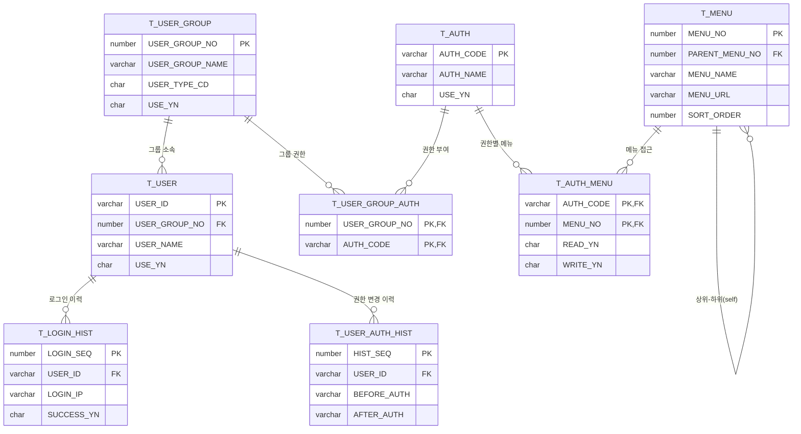
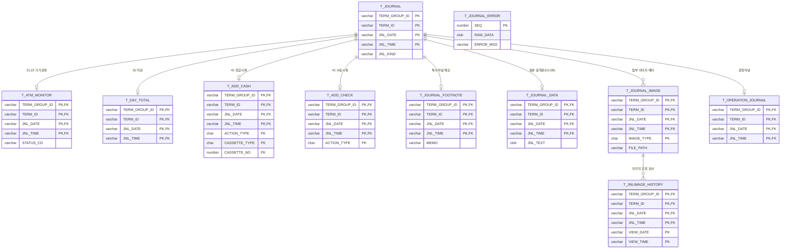
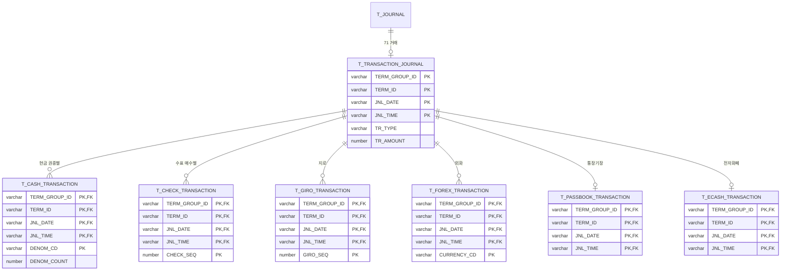
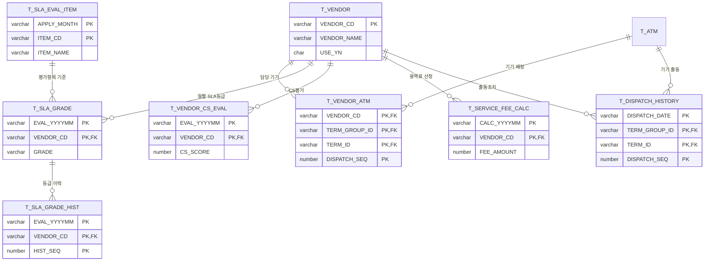
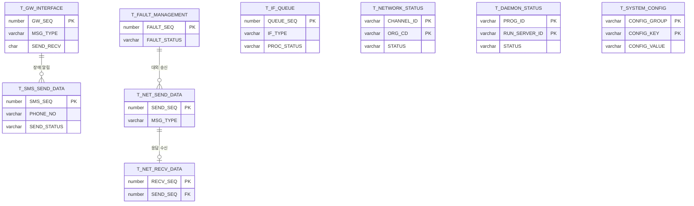

# 08. 도메인별 ERD

> NH-ATMS TO-BE 통합 스키마(105개 테이블)를 7개 도메인으로 분할한 논리 ERD.
> 단일 출처: [16_통합스키마설계.md](16_통합스키마설계.md) · 컬럼 상세: 테이블설계서.csv
>
> **관계 표기 안내**
> - 실제 DB에는 FK 제약을 설정하지 않음(레거시 운영 정책). 아래 관계선은 **PK 컬럼 공유에 근거한 논리적 관계**.
> - `||--o{` 1:N, `||--o|` 1:0..1, `||--||` 1:1.
> - 공통 식별키: `TERM_GROUP_ID+TERM_ID` = ATM 1대, `+JNL_DATE+JNL_TIME` = 저널 1건.

---

## 도메인 1. 인증 · 권한 · 메뉴

로그인 계정, 사용자그룹(롤 묶음), 권한(롤), 메뉴 트리와 매핑·이력.



---

## 도메인 2. 저널 공통 · 기기 상태

모든 저널의 공통 헤더(`T_JOURNAL`)와 `jnl_kind`별 분기 테이블. 헤더와 분기는 동일 PK(`TERM_GROUP_ID+TERM_ID+JNL_DATE+JNL_TIME`)를 공유한다.



> `T_JOURNAL_ERROR`는 파싱 실패 raw를 보관하는 독립 테이블(저널 헤더와 무관, PK=SEQ).

---

## 도메인 3. 거래 저널 · 거래 상세

거래 저널 헤더(`T_TRANSACTION_JOURNAL`, `jnl_kind=71`) 1건에 매체별 상세가 0..N으로 매달린다.



---

## 도메인 4. 기기 · 코너 · 마스터

기관(조합)–코너–ATM 계층과 ATM의 상태/자원/카세트, 코드·모델 마스터.

```mermaid
erDiagram
    T_BRANCH     ||--o{ T_CORNER          : "조합별 코너"
    T_CORNER     ||--o{ T_ATM             : "코너 내 기기"
    T_ATM_GROUP  ||--o{ T_ATM             : "기기그룹"
    T_ATM_MODEL  ||--o{ T_ATM             : "모델"
    T_ATM        ||--|| T_ATM_STATUS      : "현재 상태"
    T_ATM        ||--|| T_ATM_RESOURCE    : "자원 현황"
    T_ATM        ||--o{ T_CASSETTE_STATUS : "카세트"
    T_ATM        ||--o{ T_ATM_UNIT_STATUS : "장치 상태"
    T_ATM        ||--o| T_JOURNAL_POLICY  : "저널 보관정책"
    T_CODE_GROUP ||--o{ T_CODE            : "코드"

    T_BRANCH {
        varchar TERM_GROUP_ID   PK
        varchar BRANCH_CD       PK
        varchar BRANCH_NAME     PK
    }
    T_CORNER {
        varchar TERM_GROUP_ID   PK
        varchar CORNER_CD       PK
        varchar CORNER_NAME
    }
    T_ATM_GROUP {
        varchar TERM_GROUP_ID   PK
        varchar GROUP_NAME
    }
    T_ATM {
        varchar TERM_GROUP_ID   PK,FK
        varchar TERM_ID         PK
        varchar CORNER_CD       FK
        varchar MODEL_CD        FK
        varchar ATM_STATUS
    }
    T_ATM_STATUS {
        varchar TERM_GROUP_ID   PK,FK
        varchar TERM_ID         PK,FK
    }
    T_ATM_RESOURCE {
        varchar TERM_GROUP_ID   PK,FK
        varchar TERM_ID         PK,FK
    }
    T_CASSETTE_STATUS {
        varchar TERM_GROUP_ID   PK,FK
        varchar TERM_ID         PK,FK
        char    CASSETTE_TYPE   PK
        number  CASSETTE_NO     PK
    }
    T_ATM_UNIT_STATUS {
        varchar TERM_GROUP_ID   PK,FK
        varchar TERM_ID         PK,FK
        varchar DEVICE_ID       PK
        varchar AGENT_TYPE      PK
    }
    T_JOURNAL_POLICY {
        varchar TERM_GROUP_ID   PK,FK
        varchar TERM_ID         PK,FK
        number  RETENTION_DAYS
    }
    T_ATM_MODEL {
        varchar MODEL_CD        PK
        varchar MODEL_NAME
    }
    T_CODE_GROUP {
        varchar LANG_CD         PK
        varchar GROUP_CD        PK
        varchar GROUP_NAME
    }
    T_CODE {
        varchar LANG_CD         PK,FK
        varchar GROUP_CD        PK,FK
        varchar CODE            PK
        varchar CODE_NAME
    }
```



---

## 도메인 5. 집계 · 통계 · 배치

배치 작업 마스터·이력과 일/시간/월별 통계 집계 테이블. 통계는 ATM(`TERM_GROUP_ID+TERM_ID`)을 차원으로 가진다.

```mermaid
erDiagram
    T_BATCH_JOB ||--o{ T_BATCH_HISTORY : "실행 이력"
    T_ATM ||--o{ T_TRANSACTION_DAILY_TOTAL   : "일별 거래실적"
    T_ATM ||--o{ T_TRANSACTION_HOURLY_TOTAL  : "시간별 거래"
    T_ATM ||--o{ T_TRANSACTION_MONTHLY_TOTAL : "월별 거래"
    T_ATM ||--o{ T_FAULT_RATE_MANAGEMENT     : "장애율"
    T_ATM ||--o{ T_OPERATION_RATE_MANAGEMENT : "가동률"
    T_ATM ||--o{ T_JOURNAL_PROCESS_TOTAL     : "저널처리유형"
    T_ATM ||--o{ T_OPEN_CLOSE_STATUS         : "개국마감현황"

    T_BATCH_JOB {
        varchar PROC_NAME   PK
        varchar JOB_DESC
        char    USE_YN
    }
    T_BATCH_HISTORY {
        number  HIST_ID     PK
        varchar PROC_NAME   FK
        varchar RUN_STATUS
        date    START_DT
        date    END_DT
    }
    T_TRANSACTION_DAILY_TOTAL {
        varchar STAT_DATE       PK
        varchar TERM_GROUP_ID   PK,FK
        varchar TERM_ID         PK,FK
        varchar STAT_HOUR       PK
        varchar TR_TYPE         PK
    }
    T_TRANSACTION_HOURLY_TOTAL {
        varchar JNL_DATE        PK
        varchar TERM_GROUP_ID   PK,FK
        varchar TERM_ID         PK,FK
        varchar HOUR_CD         PK
        char    FEE_FLAG        PK
    }
    T_TRANSACTION_MONTHLY_TOTAL {
        varchar JNL_MONTH       PK
        varchar TERM_GROUP_ID   PK,FK
        varchar TERM_ID         PK,FK
        varchar TR_GUBUN_CD     PK
        char    SELF_FLAG       PK
    }
    T_FAULT_RATE_MANAGEMENT {
        varchar STAT_DATE       PK
        varchar TERM_GROUP_ID   PK,FK
        varchar TERM_ID         PK,FK
    }
    T_OPERATION_RATE_MANAGEMENT {
        varchar STAT_DATE       PK
        varchar TERM_GROUP_ID   PK,FK
        varchar TERM_ID         PK,FK
    }
    T_JOURNAL_PROCESS_TOTAL {
        varchar JNL_DATE        PK
        varchar TERM_GROUP_ID   PK,FK
        varchar TERM_ID         PK,FK
        varchar JNL_TYPE_CD     PK
    }
    T_OPEN_CLOSE_STATUS {
        varchar JNL_DATE        PK
        varchar TERM_GROUP_ID   PK,FK
        varchar TERM_ID         PK,FK
    }
```



---

## 도메인 6. SLA · 용역 · 출동

용역업체 마스터와 업체–기기 매핑, SLA 등급 평가, 출동/장애 조치 이력.



---

## 도메인 7. 연계 · IF · 시스템

대내(atmi)·대외(atme) 전문 송수신, SMS, 비동기 IF 큐, 망/데몬 상태, 시스템 공통설정.



---

## 미분류 / 부가 테이블 (도메인 외)

아래 테이블은 위 7개 도메인 ERD에 직접 포함하지 않은 부가·감사·마스터 성격의 테이블이다. 필요 시 해당 도메인에 합류시킨다.

| 테이블 | 논리명 | 성격 | 연관 도메인 |
|---|---|---|---|
| T_NOTICE | 공지사항 | 콘텐츠 | 시스템(7) |
| T_PROMOTION | 홍보문구관리 | 콘텐츠 | 시스템(7) |
| T_HOLIDAY | 휴일마스터 | 마스터 | 마스터(4) |
| T_FEE | 출금수수료마스터 | 마스터 | 마스터(4) |
| T_ERROR_MESSAGE | 에러메시지마스터 | 마스터 | 마스터(4) |
| T_CARD_BIN | 카드BIN마스터 | 마스터 | 마스터(4) |
| T_PERSON | 인사정보마스터 | 마스터 | 인증(1)/저널권한 |
| T_JOURNAL_AUTH / _HIST | 저널열람권한/이력 | 권한 | 인증(1) |
| T_JOURNAL_VIEW_LOG | 거래내역열람감사 | 감사 | 저널(2) |
| T_PERSONAL_INFO_PRINT_HIST | 개인정보출력감사 | 감사 | 저널(2) |
| T_DATA_DELETE_HIST | 데이터삭제이력 | 감사 | 시스템(7) |
| T_DESTROY_VIEW_HIST | 1차파기거래조회기록 | 감사 | 저널(2) |
| T_FILE_ATTACH / T_ATTACHED_FILE | 첨부파일 | 공통 | 시스템(7) |
| T_SLIP_FORMAT / T_SLIP_EDIT | 명세표양식/편집 | 설정 | 마스터(4) |
| T_REMOTE_COMMAND | 기기원격지시이력 | 운영 | 기기(4) |
| T_AGENT_STATUS | ATM에이전트상태 | 운영 | 기기(4) |
| T_FAULT_ANALYSIS | 장애이력 | 운영 | 기기(4) |
| T_ATM_STOP_HISTORY | 기기운영이력 | 운영 | 기기(4) |
| T_FOREX_TOTAL / T_GIRO_MONTHLY_TOTAL | 외화/지로 집계 | 통계 | 집계(5) |
| T_OVERSEA_REMITTANCE | 해외송금관리 | 거래 | 거래(3) |
| T_ACCIDENT_REPORT | 사고신고전문 | 거래 | 거래(3) |
| T_CASH_SHORTAGE | 시재부족관리 | 거래 | 거래(3) |
| T_FUND_RETURN / _MEMO | 자금반환/메모 | 거래 | 거래(3) |
| T_NONBANK_DEPOSIT | 무통장실명입금 | 거래 | 거래(3) |
| T_EAPPROVAL_HIST | 전자결재이력 | 워크플로 | 시스템(7) |
| T_VIP_CUSTOMER | 우수고객 | 마스터 | 마스터(4) |
| T_DEVICE_HEAT_TIME | 기기온열시간 | 운영 | 기기(4) |
| T_DEVICE_OP_RATE_HIST / T_DEVICE_FAULT_HIST | 기기별 가동율/장애 이력 | SLA | SLA(6) |
| T_CORNER_SLA | 코너SLA평가 | SLA | SLA(6) |
| T_NON_OP_REASON | 미가동사유 | SLA | SLA(6) |
| T_PNI_GRADE | PNI등급컷 | SLA | SLA(6) |
| T_SERVICE_FEE_STD | 용역료단가기준 | SLA | SLA(6) |
| T_SERVICE_PROVIDER | 업체마스터 | 마스터 | SLA(6) |
| T_UNFINISHED_COUNT | 업무별미완료건수 | 모니터링 | 시스템(7) |
| T_TRAN_STATUS_MSG | 거래상태메시지 | 마스터 | 시스템(7) |
```
