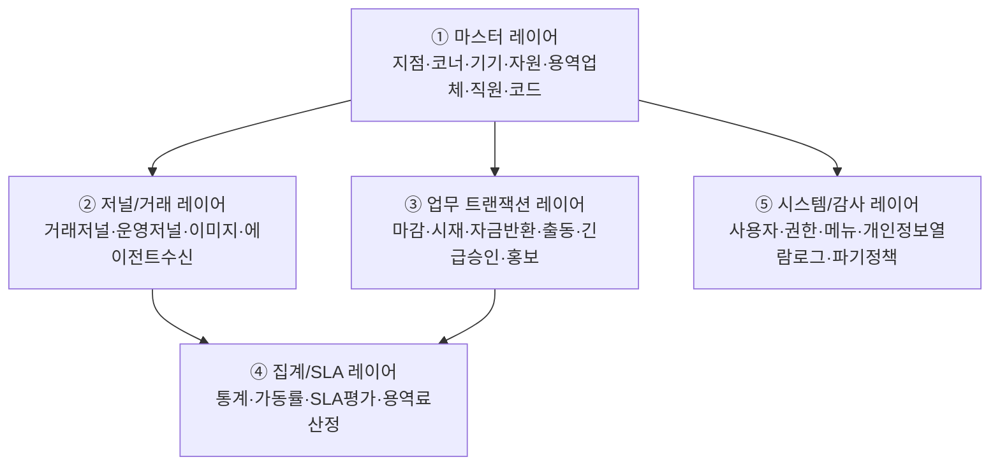

# NH-ATMS 통합 스키마 설계 (TO-BE)

> 최종 수정: 2026-06-04
> DB: Oracle 19C
> 출처 통합: `04_DB스키마설계.md`(초안) + `15_ASIS화면_상세분석.md`(전 도메인 1000~9000 전수확인 결과)
> 목적: **흩어진 기존설계 테이블 + AS-IS 화면에서 도출된 신규 테이블/컬럼**을 하나의 최종 스키마로 통합한다.

---

## 0. 이 문서를 읽는 법 (혼자 설계하는 사람을 위한 안내)

- 이 문서는 **DBA 없이 단독으로 설계**하기 위한 단일 기준서입니다.
- 설계는 한 번에 다 하지 않습니다. **레이어(층) 순서**대로 쌓습니다. 아래 §2 순서를 그대로 따르면 중간에 무너지지 않습니다.
- 표기 규칙:
  - `[기존]` = 04 문서에 이미 있음 (보존)
  - `[확장]` = 04 테이블에 AS-IS 컬럼 추가
  - `[신규]` = AS-IS 분석으로 새로 도출
  - ★ = 핵심(우선), ○ = 필요, △ = 후순위

---

## 0.5 문서 위상 (어떤 문서가 기준인가)

> 설계 문서가 04~16까지 누적되며 역할이 겹쳤습니다. 11번은 "배포 48종이 정본", 12번은 "PDF가 진짜 정본", 16번은 "통합 최종"이라 하여 **서로 다른 정본을 주장**해 혼선이 있었습니다. 무엇이 구현 기준이고 무엇이 참고/이력인지 한 장으로 정리합니다.

| 계층 | 문서 | 역할 | 상태 |
|------|------|------|------|
| **구현 기준(코드·DDL)** | `sql/V1.x` + 백엔드 매퍼 | 실제 적재/조회 = **트랙 A** | 가동 |
| 배포 정본(설계) | `11_최종테이블설계서` | 운영 DB 실조회 48종 + 추가설계 19종. 트랙 A의 설계 근거 | 정본 |
| **TO-BE 통합안(본 문서)** | `16_통합스키마설계` | 04 초안 + 15 화면분석을 종합한 **목표 스키마**. 트랙 A가 빠뜨린 누락분 도출 | 진행 |
| AS-IS 분석 입력 | `15_ASIS화면_상세분석`, `10_AS-IS전수분석` | 화면·ERD에서 컬럼/테이블 도출(16의 입력) | 분석완료 |
| 정본 재검증 | `12_ATMS테이블정본_매칭`, `13_PDF대조표` | PDF(ATMS Table 1)로 11번 검증·보강 | 진행중 |
| 초기 이력 | `04_DB스키마설계`, `09_메뉴별_테이블_매핑` | 최초 초안·메뉴매핑(참고용, 손대지 않음) | 보존 |

**한 줄 요약**: 코드를 짤 땐 **트랙 A(11번 + V1.x DDL)**가 기준이고, 16번(본 문서)은 **"앞으로 채워야 할 TO-BE 목표"**입니다. 12/13번은 11번을 PDF로 다시 검증하는 작업이라, 끝나면 11번을 갱신합니다.

### 명명 표준 (확정 — 언더스코어 표기)

- 모든 테이블·컬럼은 `UPPER_SNAKE_CASE`, **단어 사이에 언더스코어**를 넣어 가독성을 높인다. 예) `T_TRANSACTION_JOURNAL`, `BRANCH_CODE`, `SERVICE_FEE`.
- 본 문서(16) 설계와 **앞으로 만드는 모든 신규 DDL**은 이 표준을 따른다.
- ⚠️ **현황**: 기존 트랙 A는 명명이 혼재되어 있다 — 비즈니스 핵심 테이블은 언더스코어 없음(`T_TRANSACTIONJOURNAL`, `T_ATMMONITOR`), 인증·저널서브는 언더스코어 있음(`T_USER_GROUP`, `T_JOURNAL_ERROR`).
- 기존 테이블의 일괄 개명은 매퍼 XML·엔티티·옵티마이저 힌트·PK 제약명까지 묶여 있어 **별도 전환 작업**으로 처리한다(아래 전환 정책).

#### 명명 전환 정책 (2026-06-05 — A안 즉시 일괄 전환 결정)

> 테스트 서버 단계(데이터 거의 없음)에서 전환 비용이 가장 낮다는 판단으로 **지금 일괄 전환**한다.

| 구분 | 처리 |
|------|------|
| 신규 테이블 | 처음부터 언더스코어 표준으로 생성 |
| 기존 트랙 A 테이블 | **즉시 일괄 개명** — DDL 테이블명/PK명 + 매퍼 XML + 옵티마이저 힌트 + 엔티티 주석 동시 수정 후 빌드 검증. 기존 테스트 서버는 표준 DDL로 재구축 |
| 16번 설계 표기 | 언더스코어 표준 유지(목표 스키마이므로) |

#### 폐기(중복) 테이블 — 일괄 전환 시 제거

전수 조사 결과, 같은 개념이 언더스코어 유/무로 **중복 정의**되어 있어 백엔드 실사용 쪽만 남긴다.

| 폐기 대상 (제거) | 정본 (유지·표준화) | 근거 |
|------------------|--------------------|------|
| `T_JOURNAL_DATA` (V1.0.2, 빈 테이블) | `T_JOURNALDATA` → **`T_JOURNAL_DATA`** (V1.0.6, 14M 실사용) | 동일 4PK·CLOB, 백엔드 매퍼/힌트/엔티티가 V1.0.6 참조 |
| `T_JOURNAL_IMAGE` (V1.0.2, 빈 테이블) | `T_JOURNALIMAGE` → **`T_JOURNAL_IMAGE`** (V1.0.6 실사용) | 동일 구조, 백엔드가 V1.0.6 참조 |
| `T_OPERATIONJOURNAL` (V1.0.2 정의) | `T_OPERATIONJOURNAL` → **`T_OPERATION_JOURNAL`** (V1.0.9 정의, INDEX·COMMENT 완비) | V1.0.9가 정식 정의, V1.0.2 중복 |

## 0.6 명명 전환 매핑 사전 (현행 → 표준, 단일 출처)

> 모든 DDL·매퍼·힌트·엔티티 치환은 이 표를 기준으로 한다. **단어 경계(`\bT_xxx\b`) 정확 일치**로만 치환(부분 문자열 충돌 방지: `T_ATM`↔`T_ATM_MONITOR`, `T_CODE`↔`T_CODE_GROUP`, `T_VENDOR`↔`T_VENDOR_ATM`). PK명 `PK_T_xxx`, 인덱스 `IX_T_xxx`, 시퀀스 `SEQ_T_xxx`도 동일 규칙으로 변경.

**변경 없음(이미 표준)**: `T_JOURNAL`, `T_USER`, `T_USER_GROUP`, `T_USER_GROUP_AUTH`, `T_USER_AUTH_HIST`, `T_AUTH`, `T_AUTH_MENU`, `T_MENU`, `T_LOGIN_HIST`, `T_JOURNAL_ERROR`, `T_JOURNAL_FOOTNOTE`, `T_JNLIMAGE_HISTORY`, `T_IF_QUEUE`, `T_BRANCH`, `T_CORNER`, `T_CODE`, `T_NOTICE`, `T_ATM`, `T_VENDOR`, `T_HOLIDAY`, `T_FEE`, `T_PERSON`, `T_PROMOTION`, 그리고 V1.3.1/V1.3.2 신규 5종.

| 현행 | 표준 | 현행 | 표준 |
|------|------|------|------|
| T_ATMMONITOR | T_ATM_MONITOR | T_TRANSACTIONJOURNAL | T_TRANSACTION_JOURNAL |
| T_OPERATIONJOURNAL | T_OPERATION_JOURNAL | T_JOURNALDATA | T_JOURNAL_DATA |
| T_JOURNALIMAGE | T_JOURNAL_IMAGE | T_DAYTOTAL | T_DAY_TOTAL |
| T_ADDCASH | T_ADD_CASH | T_ADDCHECK | T_ADD_CHECK |
| T_AGENTSTATUS | T_AGENT_STATUS | T_ATMUNITSTATUS | T_ATM_UNIT_STATUS |
| T_BATCHJOB | T_BATCH_JOB | T_BATCHHISTORY | T_BATCH_HISTORY |
| T_TRANSACTIONDAILYTOTAL | T_TRANSACTION_DAILY_TOTAL | T_FAULTRATEMANAGEMENT | T_FAULT_RATE_MANAGEMENT |
| T_OPERATIONRATEMANAGEMENT | T_OPERATION_RATE_MANAGEMENT | T_GWINTERFACE | T_GW_INTERFACE |
| T_SMSSENDDATA | T_SMS_SEND_DATA | T_NETSENDDATA | T_NET_SEND_DATA |
| T_NETRECVDATA | T_NET_RECV_DATA | T_FAULTMANAGEMENT | T_FAULT_MANAGEMENT |
| T_CODEGROUP | T_CODE_GROUP | T_ATMGROUP | T_ATM_GROUP |
| T_ATMSTATUS | T_ATM_STATUS | T_CASHTRANSACTION | T_CASH_TRANSACTION |
| T_CHECKTRANSACTION | T_CHECK_TRANSACTION | T_CASSETTESTATUS | T_CASSETTE_STATUS |
| T_FAULTANALYSIS | T_FAULT_ANALYSIS | T_ATMSTOPHISTORY | T_ATM_STOP_HISTORY |
| T_TRANSACTIONHOURLYTOTAL | T_TRANSACTION_HOURLY_TOTAL | T_TRANSACTIONMONTHLYTOTAL | T_TRANSACTION_MONTHLY_TOTAL |
| T_JOURNALPROCESSTOTAL | T_JOURNAL_PROCESS_TOTAL | T_OPENCLOSESTATUS | T_OPEN_CLOSE_STATUS |
| T_ATMMODEL | T_ATM_MODEL | T_VENDORATM | T_VENDOR_ATM |
| T_ERRORMESSAGE | T_ERROR_MESSAGE | T_DISPATCHHISTORY | T_DISPATCH_HISTORY |
| T_JOURNALAUTH | T_JOURNAL_AUTH | T_JOURNALAUTHHIST | T_JOURNAL_AUTH_HIST |
| T_SYSTEMCONFIG | T_SYSTEM_CONFIG | T_JOURNALVIEWLOG | T_JOURNAL_VIEW_LOG |
| T_PERSONALINFOPRINTHIST | T_PERSONAL_INFO_PRINT_HIST | T_DATADELETEHIST | T_DATA_DELETE_HIST |
| T_GIROTRANSACTION | T_GIRO_TRANSACTION | T_FOREXTRANSACTION | T_FOREX_TRANSACTION |
| T_PASSBOOKTRANSACTION | T_PASSBOOK_TRANSACTION | T_FOREXTOTAL | T_FOREX_TOTAL |
| T_FILEATTACH | T_FILE_ATTACH | T_SLIPFORMAT | T_SLIP_FORMAT |
| T_REMOTECOMMAND | T_REMOTE_COMMAND | T_VIPCUSTOMER | T_VIP_CUSTOMER |
| T_OVERSEAREMITTANCE | T_OVERSEA_REMITTANCE | T_DESTROYVIEWHIST | T_DESTROY_VIEW_HIST |
| T_ACCIDENTREPORT | T_ACCIDENT_REPORT | T_CASHSHORTAGE | T_CASH_SHORTAGE |
| T_EAPPROVALHIST | T_EAPPROVAL_HIST | T_SLIPEDIT | T_SLIP_EDIT |
| T_FUNDRETURN | T_FUND_RETURN | T_FUNDRETURNMEMO | T_FUND_RETURN_MEMO |
| T_ECASHTRANSACTION | T_ECASH_TRANSACTION | T_NONBANKDEPOSIT | T_NONBANK_DEPOSIT |
| T_TRANSTATUSMSG | T_TRAN_STATUS_MSG | T_NETWORKSTATUS | T_NETWORK_STATUS |
| T_DAEMONSTATUS | T_DAEMON_STATUS | T_UNFINISHEDCOUNT | T_UNFINISHED_COUNT |
| T_CARDBIN | T_CARD_BIN | T_DEVICEHEATTIME | T_DEVICE_HEAT_TIME |
| T_GIROMONTHLYTOTAL | T_GIRO_MONTHLY_TOTAL | T_SLAGRADE | T_SLA_GRADE |
| T_SLAGRADEHIST | T_SLA_GRADE_HIST | T_CORNERSLA | T_CORNER_SLA |
| T_DEVICEOPRATEHIST | T_DEVICE_OP_RATE_HIST | T_DEVICEFAULTHIST | T_DEVICE_FAULT_HIST |
| T_VENDORCSEVAL | T_VENDOR_CS_EVAL | T_NONOPREASON | T_NON_OP_REASON |
| T_SERVICEFEECALC | T_SERVICE_FEE_CALC | T_ATTACHEDFILE | T_ATTACHED_FILE |
| T_SERVICEPROVIDER | T_SERVICE_PROVIDER | | |

> ⚠️ **검토 요망(약어 분리 주관적)**: `T_EAPPROVAL_HIST`(전자결재), `T_NONBANK_DEPOSIT`(비은행), `T_TRAN_STATUS_MSG`(거래상태), `T_ECASH_TRANSACTION`(전자화폐) — 사용자 선호에 따라 조정 가능.

---

## 1. 정규화 원칙 (어렵게 생각하지 않기)

ATMS는 **학문적 정규화(BCNF 등)를 추구하지 않습니다.** 실무 기준은 단순합니다.

| 단계 | 한 줄 규칙 | 적용 범위 |
|------|-----------|-----------|
| 1NF | 한 칸에 한 값 (반복 컬럼 금지) | 전 테이블 (AS-IS가 이미 지킴) |
| 2NF/3NF | "이 컬럼이 PK **전체**에 종속되나?"만 확인 | **마스터 테이블만** 신경쓰면 됨 |
| 의도적 비정규화 | 저널·집계·통계는 **일부러 넓게** (조회속도) | 저널/집계/통계 |

### 정규화 판단 공식 (이 3개 질문만)
1. **"이 값이 반복되나?"** → 반복되면 별도 마스터로 분리 (예: 용역업체명 → `T_SERVICE_COMPANY`)
2. **"이 컬럼이 PK 일부에만 딸려있나?"** → 그러면 분리 (예: 코너정보가 기기 PK에 매번 반복 → `T_CORNER` 분리)
3. **"성격(갱신주기)이 다른가?"** → 다르면 분리 (예: 기기 기준정보=T_ATM은 거의 안 변함 / 에이전트 자원보고=T_ATM_RESOURCE는 수시 갱신 → **분리**)

> 위 3개만 통과시키면 끝입니다. 마스터(아래 §3)만 이 규칙을 적용하고, 저널·집계는 넓은 테이블 그대로 둡니다.

---

## 2. 레이어 빌드 순서 (의존성: 뿌리 → 잎)



| 순서 | 레이어 | 이유 | 상태 |
|------|--------|------|------|
| 1 | **마스터** | 모든 화면이 참조하는 뿌리. 여기가 흔들리면 전부 흔들림 | ✅ 본 문서 §3 작성 완료 |
| 2 | 저널/거래 | 에이전트 수신 데이터. 마스터(기기) 확정 후 | ⏳ §6 다음 단계 |
| 3 | 업무 트랜잭션 | 마감/시재/출동 등. 마스터·코드 확정 후 | ⏳ §6 다음 단계 |
| 4 | 집계/SLA | 저널·트랜잭션을 집계. SLA 기준 마스터 포함 | ⏳ §6 다음 단계 |
| 5 | 시스템/감사 | 사용자/권한/개인정보 로그. 독립적이라 병행 가능 | ⏳ §6 다음 단계 |

---

## 3. 레이어 ① 마스터 (통합 최종본) ★

> 여기가 이번 통합의 핵심 산출물. 04 원본 + AS-IS 확장 컬럼을 **한 표로 머지**했다.

### 3.1 T_BRANCH (지점/조직) `[기존]` ★

04 문서 그대로 유지. 변경 없음. (BRANCH_CODE PK, 상위조직 PARENT_CODE 자기참조)

### 3.2 T_CORNER (코너/설치장소) `[확장]` ★★ — **완전체**

> 04 기본 + 3000(설치코너) + 9300(영업점기준) + 9630(용역관리점기준) 머지.
> AS-IS의 코너정보는 **영업점기준(9300)/용역관리점기준(9630)** 두 진입점이 같은 테이블을 본다.

| 컬럼명 | 타입 | NULL | 설명 | 출처 |
|--------|------|------|------|------|
| BRANCH_CODE | CHAR(5) | NOT NULL | 지점코드 (PK) | 04 |
| CORNER_CODE | CHAR(3) | NOT NULL | 코너코드 (PK) | 04 |
| CORNER_NAME | VARCHAR2(100) | | 코너설치위치명 | 04/3000 |
| CORNER_TYPE | CHAR(2) | | 코너구분 | 04 |
| ROAD_ADDR | VARCHAR2(255) | | 도로명주소 | 9300 |
| DETAIL_ADDR | VARCHAR2(100) | | 상세주소 | 9300 |
| PHONE_NO | VARCHAR2(50) | | 대표전화 | 04 |
| SERVICE_START_TIME | CHAR(4) | | 운영시작시간(HHmm) | 04/3000 |
| SERVICE_END_TIME | CHAR(4) | | 운영종료시간(HHmm) | 04/3000 |
| IS_365 | CHAR(1) | | 365운영 여부 | 3000/9300 |
| IS_365_APPROVED | CHAR(1) | | 365코너 승인여부 | 3000 |
| IN_OUT_GUBUN | CHAR(1) | | 점내(I)/점외(O) 구분 | 3000/9300 |
| BRANCH_DISTANCE | NUMBER | | 영업점과 거리(m) | 3000/9300 |
| BOOTH_TYPE | VARCHAR2(20) | | 부스형태 | 9300 |
| PLACE_FEATURE | VARCHAR2(200) | | 장소특성 | 9300 |
| CCTV_YN | CHAR(1) | | CCTV 설치여부 | 9300 |
| **SECURITY_COMPANY** | VARCHAR2(100) | | 경비업체명(지사명) | 3000/9300 |
| SEC_MANAGE_NO | VARCHAR2(30) | | 경비 관리번호(에스원 CERT NO 등) | 3000/9300 |
| SEC_BRANCH | VARCHAR2(100) | | 경비 지사명 | 9300 |
| SEC_TEL | VARCHAR2(20) | | 경비 연락처 | 9300 |
| SEC_FAX | VARCHAR2(20) | | 경비 팩스 | 9300 |
| POLICE_NM | VARCHAR2(100) | | 인근 파출소명 | 9300 |
| POLICE_TEL | VARCHAR2(20) | | 인근 파출소 전화 | 9300 |
| **SVC_COMPANY_CD** | VARCHAR2(10) | | 일괄용역업체 (FK→T_SERVICE_COMPANY) | 9630 |
| SVC_FROM | CHAR(8) | | 용역계약 시작일 | 9630 |
| SVC_TO | CHAR(8) | | 용역계약 종료일 | 9630 |
| SLA_TARGET_YN | CHAR(1) | | SLA 평가대상 여부 | 9630 |
| SPECIAL_BASE_FEE | NUMBER | | 특별기본용역료 | 9630 |
| CHECK_BIZ_GUBUN | CHAR(1) | | 수표업무 구분 | 9630 |
| USE_YN | CHAR(1) | | 사용여부 | 04 |
| REG_DATE | CHAR(14) | | 등록일시 | 04 |
| UPD_DATE | CHAR(14) | | 수정일시 | 04 |

```sql
PRIMARY KEY (BRANCH_CODE, CORNER_CODE)
-- FK: SVC_COMPANY_CD -> T_SERVICE_COMPANY(COMPANY_CD)
```

> ⚠️ 정규화 결정: 경비업체/용역업체는 **이름을 직접 저장(SECURITY_COMPANY)** 하되, 일괄용역업체는 코드(SVC_COMPANY_CD)로 `T_SERVICE_COMPANY`를 참조한다. 경비업체는 별도 관리화면이 없어 비정규화(이름 직접보관)가 실무적으로 더 단순함.

### 3.3 T_ATM (기기 마스터) `[확장]` ★

> 04 기본 + 3202(기기정보) 머지. **기준정보(거의 안 변함)만** 여기 둔다.
> 에이전트가 수시 보고하는 자원/스펙은 **T_ATM_RESOURCE로 분리**(§3.4) — 갱신주기가 달라서 3NF 규칙③ 적용.

| 컬럼명 | 타입 | NULL | 설명 | 출처 |
|--------|------|------|------|------|
| BRANCH_CODE | CHAR(5) | NOT NULL | 지점코드 (PK) | 04 |
| DEVICE_ID | VARCHAR2(20) | NOT NULL | 기기번호 (PK) | 04/3202 |
| CORNER_CODE | CHAR(3) | | 소속 코너 (FK→T_CORNER) | 04/3202 |
| ATM_STATUS | CHAR(2) | | 기기상태(정상/장애/폐기) | 04 |
| MODEL_CODE | CHAR(3) | | 모델코드 (FK→T_ATM_MODEL) | 04/3202 |
| ATM_VENDOR_CD | CHAR(2) | | 기기업체(효성/청호/에이텍) | 04/3202 |
| ATM_TYPE | CHAR(2) | | 기종(CD/ATM/STM) | 3202 |
| LOCATION_TYPE | CHAR(2) | | 설치장소구분 | 04 |
| INSTALL_LOC | VARCHAR2(255) | | 설치위치명 | 04/3202 |
| IN_OUT_GUBUN | CHAR(1) | | 점내(I)/점외(O) | 3202 |
| IS_365 | CHAR(1) | | 365 여부 | 3202 |
| HAS_DES | CHAR(1) | | DES 유무 | 3202 |
| ATM_IP | CHAR(15) | | 기기 IP | 04/3202 |
| OPERATE_WEEK | CHAR(7) | | 운영요일(1100100) | 04 |
| SERVICE_START_DATE | CHAR(8) | | 운영시작일 | 04 |
| SERVICE_END_DATE | CHAR(8) | | 운영종료일 | 04 |
| SECURITY_CD | CHAR(2) | | 보안업체코드 | 04 |
| SERVICE_PROVIDER_CD | VARCHAR2(10) | | 용역업체(FK→T_SERVICE_COMPANY) | 04/6000 |
| ASSET_NO | VARCHAR2(20) | | 자산관리번호 | 04 |
| MACHINE_SNO | VARCHAR2(20) | | 제조일련번호 | 04 |
| SETTLE_DATE | CHAR(8) | | 설치일 | 04 |
| DISUSE_DATE | CHAR(8) | | 폐기일 | 04 |
| USE_YN | CHAR(1) | | 사용여부 | 04 |
| REG_DATE | CHAR(14) | | 등록일시 | 04 |
| UPD_DATE | CHAR(14) | | 수정일시 | 04 |

```sql
PRIMARY KEY (BRANCH_CODE, DEVICE_ID)
CREATE INDEX IX_ATM_01 ON T_ATM (BRANCH_CODE, CORNER_CODE, DEVICE_ID);
CREATE INDEX IX_ATM_02 ON T_ATM (ATM_STATUS, BRANCH_CODE);
```

> 04에 있던 APP_VERSION / OS / FW_VERSION 등 **버전·스펙 컬럼은 T_ATM_RESOURCE로 이동**(에이전트 보고값이라 수시 변함).

### 3.4 T_ATM_RESOURCE (기기 자원정보, 에이전트 보고) `[신규]` ★ — 9322

> ★★ 에이전트 설계의 핵심 산출물. 에이전트가 주기적으로 ATMS에 보고하는 자산/스펙/모듈 정보.
> T_ATM(기준정보, 1:1)과 분리 — 갱신주기·성격이 다름. 펌웨어배포(atms-file)·호환성점검·자산관리의 기반.

| 컬럼명 | 타입 | 설명 |
|--------|------|------|
| BRANCH_CODE | CHAR(5) | 지점코드 (PK) |
| DEVICE_ID | VARCHAR2(20) | 기기번호 (PK, FK→T_ATM) |
| STATUS_DTM | TIMESTAMP | 최종 보고일시 |
| VENDOR_CD | VARCHAR2(10) | 공급업체 |
| MODEL_NM | VARCHAR2(100) | 모델명 |
| PRODUCT_NO | VARCHAR2(50) | 제품번호 |
| OS_TYPE | VARCHAR2(30) | OS 종류 |
| AP_VER | VARCHAR2(30) | AP(업무) 버전 |
| AGENT_VER | VARCHAR2(30) | Agent 버전 |
| CPU_INFO | VARCHAR2(100) | CPU 정보 |
| MEMORY | VARCHAR2(30) | 메모리 |
| DISK_CNT | NUMBER | 디스크 수 |
| DISK_TOTAL | VARCHAR2(30) | 디스크 총용량 |
| DISK_FREE | VARCHAR2(30) | 디스크 여유 |
| COMM_TYPE | VARCHAR2(20) | 통신방식 |
| COMM_SPEED | VARCHAR2(20) | 통신속도 |
| IP_ADDR | VARCHAR2(15) | IP |
| MAC_ADDR | VARCHAR2(20) | MAC |
| IC_KCASH / IC_MYBI / IC_FIN / IC_EMV1 / IC_EMV2 | CHAR(1) | IC카드 모듈 장착여부 |
| MOD_SEED / MOD_SECURITY / MOD_VACCINE / MOD_CAMERA / MOD_UPS / MOD_50K | CHAR(1) | HW/SW 모듈(시드/보안/백신/카메라/UPS/5만원권) 장착여부 |

```sql
PRIMARY KEY (BRANCH_CODE, DEVICE_ID)
```

### 3.5 T_ATM_MODEL (기기 모델) `[확장]` — 7208

04 기본 유지 + 7208 우측(기기종류/모델 마스터) 반영. MODEL_CODE PK, VENDOR_CD/ATM_TYPE/CASSETTE_CNT.

### 3.6 T_CODE_GROUP / T_CODE (공통코드) `[확장]` ★ **선행필수** — 7201/7202

> 모든 화면의 드롭다운/구분코드의 뿌리. **가장 먼저 채워야 하는 마스터.**
> 7000번대 전수확인 결과: 거래상태머신(11접수/21처리중/31완료/41실패/61취소) 등 핵심 코드가 여기 거주 → **하드코딩 금지, 전부 코드테이블화**.

04 구조(CODE_GROUP_ID/CODE_ID/CODE_NAME/SORT_ORDER/ATTR1~3) 유지.

### 3.7 T_SERVICE_COMPANY (용역업체) `[신규]` ★ — 6303

| 컬럼명 | 타입 | 설명 |
|--------|------|------|
| COMPANY_CD | VARCHAR2(10) | 업체코드 (PK) |
| COMPANY_NM | VARCHAR2(100) | 업체명(나이스인프라/한네트 등) |
| BIZ_NO | VARCHAR2(20) | 사업자번호 |
| CONTACT_TEL | VARCHAR2(20) | 대표연락처 |
| USE_YN | CHAR(1) | 사용여부 |

### 3.8 T_SERVICE_STAFF (용역직원) `[신규]` — 6300

| 컬럼명 | 타입 | 설명 |
|--------|------|------|
| STAFF_ID | VARCHAR2(20) | 사번 (PK) |
| COMPANY_CD | VARCHAR2(10) | 업체 (FK→T_SERVICE_COMPANY) |
| STAFF_NM | VARCHAR2(50) | 직원명 |
| DEPT_NM | VARCHAR2(50) | 소속 |
| OFFICE_TEL | VARCHAR2(20) | 사무소전화 |
| MOBILE_TEL | VARCHAR2(20) | 핸드폰 |
| MANAGE_BRANCH_CD | CHAR(5) | 담당영업점 |
| MANAGE_CORNER_CD | CHAR(3) | 담당코너 |
| WORK_YN | CHAR(1) | 재직여부 |

### 3.9 그 외 마스터 (요약 — 컬럼 상세는 15번 문서 해당 절 참조)

| 테이블 | 구분 | 출처 | 한 줄 설명 |
|--------|------|------|-----------|
| T_VENDOR | `[확장]` | 7208/04 | 업체(기기/용역/보안) 통합 마스터 |
| T_FAULT_MAP | `[기존]` | 04 | 장애코드 매핑 |
| T_TRANSACTION_CODE | `[기존]` | 04 | 거래코드 |
| T_ERROR_MESSAGE | `[신규]` | 7203 | 명세표/화면 메시지 마스터 |
| T_RHQ_MANAGER | `[신규]` | 3206 | 지역본부 담당자 |
| T_GLOBAL_ATM | `[신규]` | 3210/3205 | 글로벌카드망 단말 |
| T_STM_MEDIA | `[신규]` | 3207 | STM 매체현황 |
| T_ATM_DEVICE_CONFIG | `[신규]` | 3004~3006 | 기기 매체/거래 설정 |
| T_VIP_CUSTOMER | `[신규]`△ | 3003 | 우수고객(개인정보) |
| T_ALARM_SETTING | `[신규]` | 3002 | 단말 알림설정 |

---

## 4. 레이어 ② 저널/거래 (통합 최종본) ★

> 에이전트가 실시간 수신하는 데이터. **04 코어 저널 + 15 화면확장**을 합친 완전체.
> ⚠️ 명명 통일: 15 문서의 `T_TRANSACTIONJOURNAL` → **`T_TRANSACTION_JOURNAL`**(언더스코어, 04 기준)로 확정.

### 4.0 저널 코드 ↔ 테이블 매핑 (먼저 이 표로 큰그림 잡기)

| 저널코드 | 종류 | 수신 테이블 | 비고 |
|---|---|---|---|
| 71 | Transaction(거래) | T_TRANSACTION_JOURNAL | 데이터량 최대, 월 파티션 |
| 22 | Failure(장애) | T_FAULT_ANALYSIS | 장애 발생/해제 raw |
| 21/11/12 | Status/APStart/Open | T_ATM_MONITOR | 기기 상태 이력 |
| 41 | Cash(카세트) | T_CASSETTE_STATUS | 카세트별 시재 |
| 31 | Total(마감합계) | T_DAY_TOTAL | 일마감 합계 (→레이어③ 마감업무와 연계) |
| 52 | Operation(운영전환) | T_OPERATION_JOURNAL | 운영모드 전환 |
| - | 현금보충/회수 | T_ADD_CASH | 시재 증감 |

### 4.1 T_TRANSACTION_JOURNAL (거래저널, 저널71) `[확장]` ★★

> 04 코어 + 15 확장컬럼(거래종류별 특화 + 운영필드 1003~1008/1300) 머지 최종본.

| 컬럼명 | 타입 | NULL | 설명 | 출처 |
|--------|------|------|------|------|
| BRANCH_CODE | CHAR(5) | NOT NULL | 지점코드 (PK) | 04 |
| DEVICE_ID | VARCHAR2(20) | NOT NULL | 기기번호 (PK) | 04 |
| JNL_DATE | CHAR(8) | NOT NULL | 저널발생일 (PK, 파티션키) | 04 |
| JNL_TIME | CHAR(10) | NOT NULL | 저널발생시간 (PK) | 04 |
| TRANS_TYPE | CHAR(2) | | 거래구분 | 04 |
| TRANS_CODE | VARCHAR2(10) | | 거래코드 (FK→T_TRANSACTION_CODE) | 04 |
| RESULT_CODE | CHAR(2) | | 처리결과(성공/실패/취소) | 04 |
| AMOUNT | NUMBER(18) | | 거래금액 | 04 |
| ACCOUNT_NO | VARCHAR2(30) | | 계좌번호 (마스킹저장) | 04 |
| CARD_NO | VARCHAR2(20) | | 카드번호 (마스킹저장) | 04 |
| BANK_CODE | CHAR(3) | | 은행코드 | 04 |
| MEDIA_TYPE | CHAR(1) | | 매체구분(통장/카드/무매체) | 04 |
| HOST_DATE / HOST_TIME / HOST_SEQ_NO | CHAR/VARCHAR2 | | HOST 처리일/시간/거래번호 | 04 |
| ERROR_CODE | VARCHAR2(10) | | 에러코드 | 04 |
| BILL_CNT | NUMBER | | 장표건수 | 1003 |
| RECEIPT_RESULT | VARCHAR2(2) | | 수납결과 | 1003 |
| CARD_DIV | VARCHAR2(2) | | 카드구분(단기/장기/기타) | 1004 |
| CHECK_CNT / CHECK_NO | NUMBER/VARCHAR2(20) | | 수표매수/수표번호 | 1005 |
| PASSBOOK_LINE / PASSBOOK_PAGE / PASSBOOK_ISSUE_NO | - | | 기장LINE/통장페이지/발급번호 | 1007 |
| FX_AMOUNT | NUMBER(18,2) | | 외화금액 | 1008/1501 |
| CURRENCY_CD | VARCHAR2(3) | | 통화코드 | 1008/1501 |
| SVR_CD | VARCHAR2(10) | | 처리서버 | 1300 |
| HOST_ID | VARCHAR2(20) | | 호스트 ID | 1300 |
| **PRC_STAT** | VARCHAR2(2) | | 처리상태(11접수/21처리중/31완료/41실패/61취소) | 1300/7207 |
| PRC_ROUTE | VARCHAR2(10) | | 처리라우팅 | 1300 |
| FEE_EXEM_RSN | VARCHAR2(20) | | 수수료면제사유 | 1300 |
| SUM_DIV | VARCHAR2(1) | | 합계구분(합계전/후) | 1001 |
| DESTROY_FLAG / DESTROY_DATE | CHAR(1)/CHAR(8) | | 2차파기여부/파기일 | 04 |

```sql
PRIMARY KEY (BRANCH_CODE, DEVICE_ID, JNL_DATE, JNL_TIME)
PARTITION BY RANGE (JNL_DATE) ( ... 월별 )
CREATE INDEX IX_TRANSJNL_01 ON T_TRANSACTION_JOURNAL (JNL_DATE, BRANCH_CODE);
CREATE INDEX IX_TRANSJNL_02 ON T_TRANSACTION_JOURNAL (JNL_DATE, DEVICE_ID);
```

> ⚠️ 거래상태머신: `PRC_STAT`는 7207/7227 코드(11/21/31/41/61)를 따른다. **하드코딩 금지, T_CODE 참조.**

### 4.2 저널 코어 (04 유지, 명명만 통일) `[기존]`

> 아래 5개는 04 설계가 이미 충실. 컬럼 변경 없이 명명·FK만 정리. 상세는 04 문서 §5 참조.

| 테이블 | 저널코드 | PK | 핵심 컬럼 | 비고 |
|--------|---------|----|----|------|
| T_FAULT_ANALYSIS | 22 | FAULT_SEQ | 발생/해제일시, FAULT_CODE, FAULT_STATUS, FAULT_DURATION, DISPATCH_FLAG | 장애 raw. 출동/조치는 레이어③ T_FAULT_DISPATCH로 분리 |
| T_ATM_MONITOR | 21/11/12 | 기기+JNL일시 | JNL_TYPE, ATM_STATUS, OPERATE_MODE | AGENT_VERSION/OS_INFO는 T_ATM_RESOURCE로 이관 권장 |
| T_CASSETTE_STATUS | 41 | 기기+CASSETTE_NO | DENOM_CODE, REMAIN_CNT, MAX_CNT | 카세트별 시재 |
| T_ADD_CASH | - | 기기+JNL일시+카세트 | ACTION_TYPE, ADD_CNT, REMAIN_CNT | 현금 보충/회수 |
| T_OPERATION_JOURNAL | 52 | 기기+JNL일시 | BEFORE_MODE, AFTER_MODE, CHANGE_TYPE | 운영모드 전환 |

> ⚠️ 정규화 결정: `T_ATM_MONITOR`의 AGENT_VERSION/OS_INFO는 **에이전트 자원정보(T_ATM_RESOURCE)와 중복**. 자원정보는 T_ATM_RESOURCE 단일화, 모니터는 상태(status)만 유지(중복 제거 = 3NF).

### 4.3 T_JOURNAL_IMG_AUTH (저널이미지 조회권한) `[신규]` — 4002/4005

| 컬럼명 | 타입 | 설명 |
|--------|------|------|
| OFFICE_CD | VARCHAR2(10) | 사무소 (PK1) |
| USER_ID | VARCHAR2(20) | 개인번호 (PK2) |
| USER_GRADE / USER_NAME | VARCHAR2 | 직급/이름 |
| IMG_AUTH_YN | CHAR(1) | 저널조회권한 |
| UPD_DTM / UPD_USER | TIMESTAMP/VARCHAR2 | 변경일시/변경자(이력) |

### 4.4 T_JOURNAL_SEQ_GAP (결번 관리) `[신규]` — 4102/4201

| 컬럼명 | 타입 | 설명 |
|--------|------|------|
| OFFICE_CD / ATM_ID | VARCHAR2 | 사무소/기번 (PK) |
| JOURNAL_DATE | DATE | 저널일자 (PK) |
| GAP_SEQ_NO | VARCHAR2(20) | 결번 저널일련번호 (PK) |
| REQ_STATUS | VARCHAR2(2) | 요청상태(요청중/완료) |
| STATUS_DTM | TIMESTAMP | 상태일시 |

> 저널 이미지/첨부 테이블은 04 기존 설계 유지(BLOB 경로 또는 파일스토어 키).

---

## 5. 레이어 ③ 업무 트랜잭션 (통합 최종본) ★

> 마감·시재·출동·자금반환·승인 등 사람이 일으키는 업무 데이터. 마스터·코드 확정 후 채운다.

### 5.1 마감 업무 (2000번대)

**T_REMOTE_COMMAND (원격명령) `[신규]` — 2000/3001/7205**

| 컬럼명 | 타입 | 설명 |
|--------|------|------|
| CMD_ID | NUMBER | 명령 ID (PK) |
| BRANCH_CODE / DEVICE_ID | VARCHAR2 | 대상 사무소/기번 |
| CMD_TYPE | VARCHAR2(2) | 11강제개국/12강제합계/21합계후OPEN/22합계후DOWN/31사용중지해제 |
| CMD_REASON | VARCHAR2(100) | 사유 |
| RESERVE_DTM | TIMESTAMP | 예약실행일시(3001) |
| EXEC_DTM | TIMESTAMP | 실행일시 |
| EXEC_RESULT | VARCHAR2(4000) | 실행결과 텍스트 |
| RESULT_CD | VARCHAR2(2) | 성공/실패 |
| REQ_USER_ID | VARCHAR2(20) | 요청자 |

**T_CLOSING_SUMMARY (마감집계) `[신규]` — 2101/2102**

| 컬럼명 | 타입 | 설명 |
|--------|------|------|
| SUMMARY_ID | NUMBER | 집계 ID (PK) |
| OFFICE_CD / ATM_NO | VARCHAR2 | 사무소/기번 |
| TX_DATE | DATE | 거래일 |
| SUMMARY_SCOPE | CHAR(1) | C=센터 / M=기기 |
| TX_TYPE_CD | VARCHAR2(2) | 현금지급/수표지급/현금입금/수표입금/농협수표/타행수표 |
| CLOSE_PHASE | VARCHAR2(2) | 10전일합계후/20당일합계전/30합계/40당일합계후 |
| TX_COUNT / TX_AMOUNT | NUMBER | 건수/금액 |
| CURRENCY_CD | VARCHAR2(3) | 통화(외화 2102, KRW 기본) — 외화는 별도테이블 아닌 흡수 |

**T_CLOSING_APPROVAL / _ITEM (마감 전자결재) `[신규]` — 2200/2201**

마감장표(2200)·일마감(2201) 결재. 팀원→팀장 2단계 결재(EMP_NO/NAME/DTTM), SENT_FLAG(환원자료 전송), STATUS(작성/팀원결재/팀장결재/전송완료). `_ITEM`은 결재대상 자료 목록(SRC_SCREEN/ITEM_NAME/CONFIRM_FLAG).

> ⚠️ `T_DAY_TOTAL`(저널31, 레이어②)은 **기기가 올린 마감 raw**, `T_CLOSING_SUMMARY`는 **조회/집계용 가공본**. 둘은 다른 테이블 — raw는 보존, summary는 화면집계.

### 5.2 시재/현송/대사 업무 (3200 + 6100번대)

**T_ATM_CASH (시재현황, 외화포함) `[신규]` — 3200/3203/3208/3209/3500**

| 컬럼명 | 타입 | 설명 |
|--------|------|------|
| OFFICE_CD / ATM_NO | VARCHAR2 | 사무소/기번 (PK) |
| CASH_DATE | DATE | 시재일자 (PK) |
| CURRENCY_CD | VARCHAR2(3) | 통화(외화 흡수, KRW 기본) (PK) |
| PREV_CASH / RECV_AMT / DEPOSIT_AMT / HANDOVER_AMT / WITHDRAW_AMT | NUMBER(18) | 전일시재①/인수②/입금③/인도④/인출⑤ |
| CUR_CASH | NUMBER(18) | 현시재⑥(=①+②+③−④−⑤) |
| BILL_50000_IN / OUT / SUM | NUMBER | 5만원권 입/출/계 |
| CHECK_BALANCE / CHECK_NO / CHECK_TYPE | - | 수표잔여/번호/권종 |
| LAST_UPD_DTTM | TIMESTAMP | 최종변경시간 |

**T_FAULT_DISPATCH (출동/조치 추적) `[신규]` ★ — 6000~6004**

| 컬럼명 | 타입 | 설명 |
|--------|------|------|
| DISPATCH_ID | VARCHAR2(20) | 출동일련번호 (PK) |
| ATM_ID | VARCHAR2(20) | 기번 |
| COMPANY_CD | VARCHAR2(10) | 용역업체 |
| FAULT_TYPE / FAULT_NM | VARCHAR2 | 기기장애/운영장애 + 장애명 |
| DISPATCH_SEQ | NUMBER | 출동차수(1차/2차) |
| RECEIVE_DTM / ARRIVE_DTM / RECOVER_DTM | TIMESTAMP | 접수/도착/복구 시각 (★SLA 산정 기준) |
| ACTION_RESULT | VARCHAR2(200) | 조치결과 |
| CANCEL_YN | CHAR(1) | 취소여부 |

> ⚠️ `T_FAULT_ANALYSIS`(저널22, 장애발생 raw) → `T_FAULT_DISPATCH`(출동/조치) 1:N 관계. ARRIVE_DTM은 9601에서 수기보정 가능 → SLA 직접영향, **변경이력·권한 필수**.

**그 외 시재/정산 (요약 — 컬럼 상세는 15번 §6 참조)**

| 테이블 | 출처 | 핵심 | 개인정보 |
|--------|------|------|:---:|
| T_CASH_REPLENISH | 6100/6105/6106 | 현송(정규/추가), 전3개월평균=수요예측 | |
| T_SERVICE_CLOSING | 6101 | 용역마감(은행잔액↔업체통보잔액) | |
| T_CASH_UNPROCESSED | 6102 | 미처리(계좌/카드/고객명) | ★ |
| T_CASH_RECONCILE | 6103/6104 | 양면대사(업체신고재고↔ATMS산출재고) | |
| T_CASH_REFUND | 6107 | 반환금액(회차별) | |
| T_FUND_RETURN | 1100/1200 | 미수취 과잉금 자금반환 | ★ |
| T_IT_COST_BILLING | 6304 | 전산비용 청구액(사무소단위) | |

### 5.3 장애/운영 보조 (3000·9000번대)

| 테이블 | 출처 | 핵심 |
|--------|------|------|
| T_CALLCENTER_FAULT | 3102 | 콜센터 장애조치(고객정보 마스킹) |
| T_FAULT_DETAIL | 3101/3103 | 장애 상세·통보 |
| T_FAULT_NOTIFY_HIST | 9311 | 채널별 장애통보이력(경비/보수/알림톡/단말) |
| T_EMERGENCY_APPROVAL | 9303/9633 | 긴급승인(2인 maker-checker) |
| T_ATM_TEMP_OPER | 9301/9631 | 기기 한시운영 |
| T_AD_PROMOTION | 9512 | 홍보/광고(승인워크플로우) |

---

## 6. 레이어 ④ 집계/SLA (통합 최종본) ★

> 저널·트랜잭션을 배치 집계. **SLA 3대 기준 마스터는 절대 하드코딩 금지(이력 테이블화).**

### 6.1 통계 집계 (배치 생성)

| 테이블 | 출처 | 집계단위 | 비고 |
|--------|------|----------|------|
| T_TX_STAT | 5031/5100/5500 | 일/월·기기/코너 | 거래량·수수료. 04 T_DAY_TOTAL 확장 가능 |
| T_UPTIME_STAT | 5160/5161/5162 | 일·코너/기기 | 가동률(코너평균/고객체감/휴일). 04 T_ATM_RUN_HISTORY 대체·통합 |
| T_CASH_USAGE_STAT | 5555 | 일·기기 | 현금사용량 ±순증감 = 현송 수요예측 입력 |
| T_JOURNAL_DAILY_STAT | 4104/4200 | 일/월·기기 | 저널처리 유형별 집계 |

> ⚠️ 정규화 결정: 04 `T_ATM_RUN_HISTORY`(가동률)와 15 `T_UPTIME_STAT`는 동일 목적 → **T_UPTIME_STAT로 통합**(코너평균·고객체감·휴일 구분 컬럼 보유).

### 6.2 SLA 기준 마스터 ★★ (하드코딩 금지)

**T_SLA_EVAL_ITEM (평가항목 마스터, 이력) — 6208**

| 컬럼명 | 타입 | 설명 |
|--------|------|------|
| APPLY_MONTH | VARCHAR2(6) | 기준월 (PK1, 이력) |
| ITEM_CD | VARCHAR2(2) | 평가코드(01~11) (PK2) |
| ITEM_NM | VARCHAR2(100) | 평가종류(가동률/30분출동율/평균출동시간/복구율/현장조치/코너환경/CS/현금부족/운영자금보유율) |
| ITEM_TYPE1~4 | CHAR(1) | 계산구분 타입 |
| MAX_SCORE / MIN_SCORE | NUMBER | 최고점/최저점 |
| USE_YN | CHAR(1) | 사용여부 |

**T_PNI_GRADE (P&I 등급컷 마스터) — 6209**

| 컬럼명 | 타입 | 설명 |
|--------|------|------|
| GRADE | VARCHAR2(2) | 등급 S/A/B/C/D/E/F (PK) |
| MIN_SCORE / MAX_SCORE | NUMBER | 점수구간(S 951~1000 / C 851~900 / F 0~800) |
| PNI_RATE | NUMBER(5,2) | P&I적용율(=용역료 가감율, S +5%/F −5%) |
| USE_YN | CHAR(1) | 사용여부 |

**T_SERVICE_FEE_STD (용역료 단가 마스터, 이력) — 6211**

| 컬럼명 | 타입 | 설명 |
|--------|------|------|
| APPLY_MONTH | VARCHAR2(6) | 기준월 (PK1) |
| COMPANY_CD | VARCHAR2(10) | 용역업체 (PK2) |
| OPER_TYPE | VARCHAR2(20) | 운영구분(무인점포/점외24시간/점외365/점외시간내) (PK3) |
| BASE_DEV_CNT / BASE_FEE | NUMBER | 운영기준대수/기본용역료 |
| CHK_OUT_FEE / CHK_IN_FEE | NUMBER(18) | 수표출금/입금 추가용역료 |
| INCENTIVE_MAX | NUMBER(18) | 인센티브 최대금액 |
| ADD_FEE_* | NUMBER(18) | 추가용역료(경비구축/거리별) |

### 6.3 SLA 산정 결과

| 테이블 | 출처 | 핵심 |
|--------|------|------|
| T_SLA_EVAL | 6200~6207 | 월별 평가결과(EVAL_MONTH/COMPANY/ITEM_SCORE/TOTAL_SCORE/PNI_GRADE) |
| T_SERVICE_FEE_CALC | 6212 | 용역료 산정(농협vs업체 대수대사/PNI적용/FINAL_FEE) |

> SLA 계산 흐름: 출동raw(T_FAULT_DISPATCH) → 항목점수(T_SLA_EVAL_ITEM 기준) → 합산(T_SLA_EVAL) → 등급(T_PNI_GRADE) → 용역료(T_SERVICE_FEE_STD × P&I율 = T_SERVICE_FEE_CALC).

---

## 7. 레이어 ⑤ 시스템/감사 (통합 최종본) ★

> 04 시스템 테이블 + 개인정보·파기·정책 신규. 독립적이라 다른 레이어와 병행 가능.

### 7.1 시스템 (04 유지)

| 테이블 | 구분 | 핵심 |
|--------|------|------|
| T_USER | 기존 | 사용자(BCrypt PW, 계정잠금, 만료) |
| T_ROLE / T_AUTH_MENU | 기존 | 권한 + 메뉴별 CRUD/엑셀 권한 |
| T_WEBSITE_MENU | 기존 | 메뉴 트리(self ref) |
| T_USER_CONN_INFO | 기존 | 접속이력 |
| T_NOTICE | 확장 | 공지+업무연락 통합(7000/7001) |
| T_MSG_LOG | 신규 | 전문 송수신 로그(7204) |

### 7.2 개인정보 보호·파기 (핵심 ★)

**T_JOURNAL_POLICY (저널/이미지 보관정책) `[신규]` ★★ — 4101**

기기별 운영모드(종이/전자) + 저널범위(내용/안면/수취/카드) + 보관·삭제 주기(월). 카드이미지는 회의 1차#2 제외대상 → `SCOPE_CARD_YN='N'`. atms-journal/batch 파기처리가 이 정책을 참조.

| 컬럼명 | 타입 | 설명 |
|--------|------|------|
| ATM_ID | VARCHAR2(20) | 기번 (PK) |
| OPER_MODE | VARCHAR2(2) | 운영모드(종이/전자/전자+종이) |
| SCOPE_CONTENT_YN / SCOPE_FACE_YN / SCOPE_RECEIVE_YN / SCOPE_CARD_YN | CHAR(1) | 저널범위 |
| KEEP_*_M / DEL_*_M | NUMBER | 항목별 보관/삭제 주기(월) |

**T_DATA_RETENTION_POLICY (파기/보존 정책) `[신규]` — 1099**

POLICY_CD / DESTRUCT_STAGE(1차90일/2차5년) / ELAPSED_DAYS / APPROVER_CNT(1인/2인).

**T_PRIVACY_ACCESS_LOG (개인정보/이미지 열람감사) `[신규]` ★ — 4003/4006/4020/9101~9105/9400/1020/1301 통합**

| 컬럼명 | 타입 | 설명 |
|--------|------|------|
| ACCESS_ID | NUMBER | 열람 ID (PK) |
| ACCESS_TYPE | VARCHAR2(2) | 이미지열람/거래파기조회/2차파기조회/거래상세조회 |
| USER_ID / USER_NAME | VARCHAR2 | 열람자/성명 |
| MENU_CD | VARCHAR2(10) | 조회화면(9101 등) |
| TARGET_KEY | VARCHAR2(50) | 대상 거래키(MCN_NO/DTLS_SEQNO) |
| UNMASK_YN | CHAR(1) | 마스킹 해제 여부(IMMS 권한) |
| REQ_ORG / REASON | VARCHAR2 | 요청기관/사유 |
| APPROVER_ID | VARCHAR2(20) | 승인자(2차파기는 2인) |
| ACCESS_DTM / ACCESS_IP | TIMESTAMP/VARCHAR2 | 열람일시/IP |

**T_DATA_ACCESS_LOG (영상정보 열람이력) `[신규]` — 1091**

조회사유(법원/조세/본인/민원/기타) + 조회기간 + 승인자. T_PRIVACY_ACCESS_LOG와 통합 검토 가능.

> 개인정보 4중 방어: ① 마스킹 기본 ② IMMS 권한 unmask 분기 ③ 열람 시 로그 적재(T_PRIVACY_ACCESS_LOG) ④ 보관/파기 정책(T_JOURNAL_POLICY + T_DATA_RETENTION_POLICY).

---

## 8. 전체 테이블 인벤토리 (빠진 것 점검표)

> "빠진 거 없나?" 에 대한 답. 8개 도메인 전수확인에서 도출된 **모든** 테이블을 레이어별로 모았다.

### ① 마스터 레이어
| 테이블 | 구분 | 출처 | ★ |
|--------|------|------|---|
| T_BRANCH | 기존 | 04 | ★ |
| T_CORNER | 확장 | 04/3000/9300/9630 | ★★ |
| T_ATM | 확장 | 04/3202 | ★ |
| T_ATM_RESOURCE | 신규 | 9322 | ★ |
| T_ATM_MODEL | 확장 | 04/7208 | ○ |
| T_CODE_GROUP / T_CODE | 확장 | 04/7201/7202 | ★ |
| T_SERVICE_COMPANY | 신규 | 6303 | ★ |
| T_SERVICE_STAFF | 신규 | 6300 | ○ |
| T_VENDOR | 확장 | 04/7208 | ○ |
| T_FAULT_MAP | 기존 | 04 | ○ |
| T_TRANSACTION_CODE | 기존 | 04 | ○ |
| T_ERROR_MESSAGE | 신규 | 7203 | ○ |
| T_RHQ_MANAGER | 신규 | 3206 | △ |
| T_GLOBAL_ATM | 신규 | 3210/3205 | △ |
| T_STM_MEDIA | 신규 | 3207 | △ |
| T_ATM_DEVICE_CONFIG | 신규 | 3004~3006 | ○ |
| T_VIP_CUSTOMER | 신규 | 3003 | △ |
| T_ALARM_SETTING | 신규 | 3002 | ○ |

### ② 저널/거래 레이어
| 테이블 | 구분 | 출처 | ★ |
|--------|------|------|---|
| T_TRANSACTION_JOURNAL | 확장 | 04/1003~1008/1300 | ★ |
| (운영저널 - 04 기존) | 기존 | 04 | ★ |
| T_JOURNAL_IMG_AUTH | 신규 | 4002/4005 | ○ |
| T_JOURNAL_SEQ_GAP | 신규 | 4102/4201 | ○ |
| (저널 이미지/첨부 - 04 기존) | 기존 | 04 | ○ |

> T_TRANSACTION_JOURNAL 확장 컬럼: RECEIPT_RESULT/HOST_ID/SVR/PRC_STAT/PRC_RUT/FEE_EXEM/DAV 등 (거래종류별 특화 + 운영필드). 거래상태머신(11/21/31/41/61) 연계.

### ③ 업무 트랜잭션 레이어
| 테이블 | 구분 | 출처 | ★ |
|--------|------|------|---|
| T_REMOTE_COMMAND | 신규 | 2000/3001/7205 | ★ |
| T_CLOSING_SUMMARY | 신규 | 2101/2102 | ★ |
| T_CLOSING_APPROVAL | 신규 | 2200/2201 | ★ |
| T_CLOSING_APPROVAL_ITEM | 신규 | 2200 | ○ |
| T_FUND_RETURN | 신규 | 1100/1200 | ○ |
| T_ATM_CASH (+외화확장) | 신규 | 3200/3203/3208/3209/3500 | ★ |
| T_ATM_FUND_OPER | 신규 | 3201 | ○ |
| T_CALLCENTER_FAULT | 신규 | 3102 | ○ |
| T_FAULT_DETAIL | 신규 | 3101/3103 | ○ |
| T_FAULT_DISPATCH | 신규 | 6000~6004 | ★ |
| T_CASH_REPLENISH | 신규 | 6100/6105/6106 | ○ |
| T_SERVICE_CLOSING | 신규 | 6101 | ○ |
| T_CASH_UNPROCESSED | 신규 | 6102 | ○ |
| T_CASH_RECONCILE | 신규 | 6103/6104 | ○ |
| T_CASH_REFUND | 신규 | 6107 | ○ |
| T_IT_COST_BILLING | 신규 | 6304 | △ |
| T_EMERGENCY_APPROVAL | 신규 | 9303/9633 | ○ |
| T_ATM_TEMP_OPER | 신규 | 9301/9631 | ○ |
| T_FAULT_NOTIFY_HIST | 신규 | 9311 | ○ |
| T_AD_PROMOTION | 신규 | 9512 | △ |

### ④ 집계/SLA 레이어
| 테이블 | 구분 | 출처 | ★ |
|--------|------|------|---|
| T_TX_STAT | 신규 | 5031/5100/5500 | ★ |
| T_UPTIME_STAT | 신규 | 5160/5161/5162 | ★ |
| T_CASH_USAGE_STAT | 신규 | 5555 | ○ |
| T_JOURNAL_DAILY_STAT | 신규 | 4104/4200 | ○ |
| **T_SLA_EVAL_ITEM** | 신규 | 6208 | ★ (평가항목 마스터, 하드코딩금지) |
| **T_PNI_GRADE** | 신규 | 6209 | ★ (P&I 등급컷 마스터) |
| **T_SERVICE_FEE_STD** | 신규 | 6211 | ★ (용역료 단가 마스터, 이력) |
| T_SLA_EVAL | 신규 | 6200~6207 | ○ (월별 평가결과) |
| T_SERVICE_FEE_CALC | 신규 | 6212 | ○ (용역료 산정결과) |

> ⚠️ SLA 3대 기준 마스터(6208/6209/6211)는 **절대 코드/로직에 하드코딩 금지**. 평가항목 배점·등급컷·용역료 단가는 시점별로 바뀌므로 **이력(APPLY_MONTH) 포함 테이블화**.

### ⑤ 시스템/감사 레이어
| 테이블 | 구분 | 출처 | ★ |
|--------|------|------|---|
| T_USER | 기존 | 04 | ★ |
| T_ROLE / T_AUTH_MENU | 기존 | 04 | ★ |
| T_WEBSITE_MENU | 기존 | 04 | ★ |
| T_USER_CONN_INFO | 기존 | 04 | ○ |
| T_NOTICE | 확장 | 04/7000/7001 | ○ |
| T_MSG_LOG | 신규 | 7204 | ○ (전문 송수신 로그) |
| **T_PRIVACY_ACCESS_LOG** | 신규 | 4003/4006/4020/9101~9105/9400 | ★ (개인정보 열람감사) |
| T_DATA_RETENTION_POLICY | 신규 | 1099 | ★ (파기/보존 정책) |
| T_DATA_ACCESS_LOG | 신규 | 1091 | ○ (영상정보 열람이력) |
| T_JOURNAL_POLICY | 신규 | 4101 | ★★ (저널/이미지 보관정책) |

> 개인정보 보호 설계의 기둥: T_JOURNAL_POLICY(보관/파기 정책) + T_DATA_RETENTION_POLICY + T_PRIVACY_ACCESS_LOG(열람감사) + IMMS 권한 기반 마스킹/unmask 분기.

---

## 9. 통합 시 정규화 의사결정 기록 (왜 이렇게 나눴나)

| 결정 | 분리/통합 | 근거(3NF 질문) |
|------|-----------|----------------|
| T_ATM ↔ T_ATM_RESOURCE | **분리** | Q3 갱신주기 다름(기준정보 vs 에이전트 수시보고) |
| T_CORNER 영업점기준/용역관리점기준 | **통합(1테이블)** | 같은 코너 실체. 진입점만 2개 |
| 경비업체명 | **비정규화(이름직접)** | 별도 관리화면 없음 → 분리 실익 없음 |
| 일괄용역업체 | **정규화(코드참조)** | 6303 관리화면 존재 → T_SERVICE_COMPANY |
| SLA 배점/등급/단가 | **이력 테이블화** | Q1 시점별 반복+변경 → 하드코딩 금지 |
| 거래상태/구분 | **코드테이블화** | Q1 반복값 → T_CODE |
| 외화 시재 | **T_ATM_CASH에 CURRENCY_CD로 흡수** | Q2 통화는 시재 PK의 일부 |

---

## 10. 다음 단계 (이어서 할 일)

1. **[완료] 레이어 ① 마스터** — 본 문서 §3
2. **[완료] 레이어 ② 저널/거래** — §4. T_TRANSACTION_JOURNAL 04+15 머지, 저널코드 매핑, 코어 5종 명명통일.
3. **[완료] 레이어 ③ 업무 트랜잭션** — §5. 마감/시재/출동/대사/자금반환 + 9000 보조.
4. **[완료] 레이어 ④ 집계/SLA** — §6. SLA 3대 마스터(6208/6209/6211) + 산정흐름.
5. **[완료] 레이어 ⑤ 시스템/감사** — §7. 개인정보 4중 방어(마스킹/unmask/로그/파기정책).
6. **[다음] DDL 생성** — `V1.0.0__init.sql` Oracle CREATE TABLE 일괄 생성. 레이어순(마스터→저널→트랜잭션→집계→시스템)으로 FK 의존성 맞춰 작성.
7. **[다음] atms-journal 구현 대조** — JIF 핸들러(jnl_kind별)와 §4 저널 컬럼 1:1 검증.
8. **[다음] 코딩컨벤션 확정** — `01_코딩컨벤션.md` 기준 컬럼명/타입 최종 정렬(현재 일부 후보 표기 혼재).

> 레이어 ①~⑤ 설계 완료. 다음은 이 문서를 Oracle DDL로 옮기는 단계.
