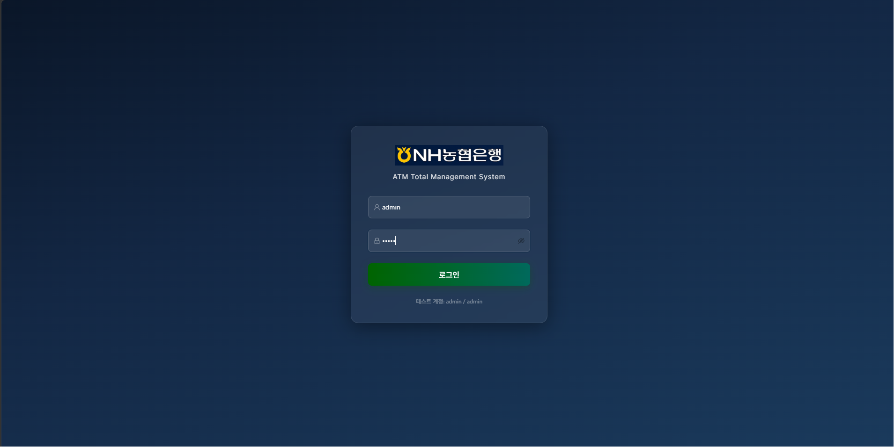
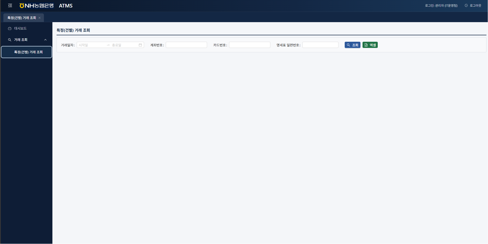

# NH-ATMS — 자동화기기 관리 시스템 (ATM Management System)

## 목적

농협은행 자동화기기(ATM) 운영 현황의 실시간 모니터링, 장애 관리, 기기 정보 관리, 운영자 업무 지원을 위한 **차세대 ATMS 솔루션**입니다.

기존 새마을금고 ATMS(Spring 4 / eGov 3.9 / Java 8) 기반의 업무 노하우를 바탕으로, 농협 환경에 맞게 재설계한 시스템입니다.





---

## 기술 스택

| 구분 | 개발 환경 | 운영 환경 |
|---|---|---|
| **OS** | Windows / macOS | RHEL 9.4 |
| **WAS** | 내장 Tomcat (Spring Boot) | JEUS 9.1 |
| **WEB** | — | WebtoB 5 |
| **JDK** | 21 | 21 |
| **DB** | H2 (인메모리) | Oracle 19C |
| **Build** | Gradle 8 (Multi-Module) | Gradle 8 |
| **Frontend** | Vite Dev Server (5173) | Nginx / WebtoB |

---

## 프로젝트 구성

```
1.Project/
├── Backend/
│   └── nh-atms-api/               # Spring Boot 멀티모듈 API
│       ├── atms-common/           # 공통 라이브러리 (보안, JWT, 응답, 예외)
│       ├── atms-web/              # 운영 화면 REST API (메인)
│       ├── atms-journal/          # 거래저널 조회/관리
│       ├── atms-batch/            # 배치 (정산, 통계, 집계)
│       ├── atms-file/             # 파일 업로드/다운로드 (POI 연동)
│       ├── atms-if-internal/      # 내부 인터페이스 (ATM ↔ 서버)
│       └── atms-if-external/      # 외부 인터페이스 (대외 기관 연동)
├── Frontend/
│   └── nh-atms-web/               # React + TypeScript + Ant Design
├── Document/                      # 설계/분석 문서
├── monitoring/                    # Prometheus + Grafana (제외 from git)
├── Simulator/                     # ATM 시뮬레이터 (제외 from git)
└── docker-compose.yml             # 인프라 로컬 구동 (제외 from git)
```

---

## 실행 방법

### 사전 준비

- JDK 21 설치 (`JAVA_HOME` 설정)
- Node.js 20+ 설치 (Frontend)
- IntelliJ IDEA 2024+ (권장)

---

### Backend 실행

#### 방법 1 — IntelliJ Run Configuration (권장)

1. `File > Open` → `1.Project/Backend/nh-atms-api` 선택
2. Gradle 동기화 완료 후  
   `Run > Edit Configurations > + > Spring Boot`
3. 아래와 같이 설정:

   | 항목 | 값 |
   |---|---|
   | Name | `AtmsWeb (dev)` |
   | Module classpath | `nh-atms-api.atms-web.main` |
   | Main class | `kr.co.nh.atms.web.AtmsWebApplication` |
   | Active profiles | `dev` |
   | VM options | `-Dfile.encoding=UTF-8` |

4. Run → `http://localhost:8080`

#### 방법 2 — Gradle 명령어

```bash
cd Backend/nh-atms-api

# 개발 서버 실행 (H2 인메모리 DB, dev 프로파일)
./gradlew :atms-web:bootRun

# JAR 빌드
./gradlew :atms-web:bootJar
```

#### 주요 Backend URL

| URL | 설명 |
|---|---|
| `http://localhost:8080/swagger-ui/index.html` | **Swagger UI** (API 테스트) |
| `http://localhost:8080/v3/api-docs` | OpenAPI 3.0 spec |
| `http://localhost:8080/h2-console` | H2 DB 콘솔 (dev 전용) |
| `http://localhost:8080/api/auth/login` | 로그인 (JWT 발급) |

> `http://localhost:8080` 루트 접근 시 `401 인증이 필요합니다` 응답은 **정상**입니다.  
> Swagger UI로 `/api/auth/login` 호출 후 JWT 토큰을 발급받아 사용하세요.

---

### Frontend 실행

```bash
cd Frontend/nh-atms-web

npm install
npm run dev   # → http://localhost:5173
```

Backend(`8080`)와 동시에 실행하면 됩니다.

---

### 로그인 테스트

개발 환경 기본 계정 (Mock SSO):

```
ID: admin
PW: password
```

Swagger UI → `POST /api/auth/login` → 응답의 `accessToken` 복사  
→ Swagger 우상단 **Authorize** 버튼 → `Bearer <accessToken>` 입력

---

## 도메인 구조 (atms-web 핵심 8개)

| 도메인 | 엔드포인트 | 설명 |
|---|---|---|
| auth | `/api/auth` | 로그인, 토큰 갱신, 로그아웃 |
| atm | `/api/atm` | 기기 정보 CRUD |
| branch | `/api/branch` | 영업점 관리 |
| atmgroup | `/api/atm-group` | ATM 그룹 관리 |
| atmstatus | `/api/atm-status` | 기기 실시간 상태 조회/갱신 |
| user | `/api/user` | 사용자 관리 (BCrypt 암호화) |
| role | `/api/role` | 역할/권한 관리 |
| notice | `/api/notice` | 공지사항 |
| code | `/api/code` | 공통코드 |

---

## 참고 문서

| 문서 | 위치 |
|---|---|
| 코딩 컨벤션 | `Document/01_코딩컨벤션.md` |
| API 스펙 정의 | `Document/02_API스펙정의.md` |
| DB 스키마 설계 | `Document/04_DB스키마설계.md` |
| 화면 설계서 | `Document/06_화면설계서.md` |
| 모듈별 개발문서 | `Backend/nh-atms-api/atms-web/README.md` |
