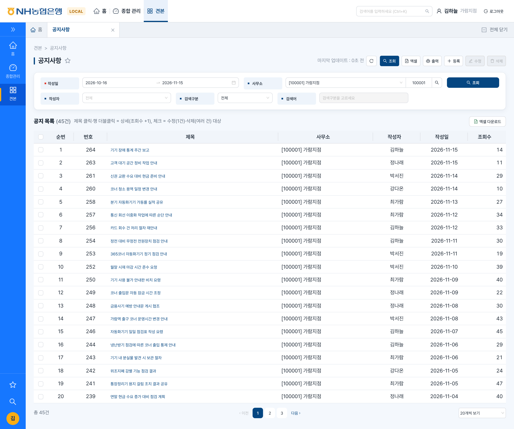

# 집필 규칙서

이 책의 모든 장은 이 규칙을 따른다. 장마다 쓰는 사람이 달라도 한 사람이 쓴 책처럼 읽혀야 한다.

## 1. 누가 읽는가

- 독자는 **개발을 처음 해 보는 사람**이다. 컴퓨터로 문서 작업은 하지만 HTML, 자바스크립트, 프로그래밍 용어는 모른다.
- 독자는 은행 자동화기기 관리 시스템(ATMS) 프로젝트에 막 들어왔고, 앞에 이 프로젝트의 프론트엔드 소스가 열려 있다. 목표는 "이 소스를 읽고, 공지사항 같은 화면을 혼자 만들 수 있게 되는 것"이다.
- 독자는 똑똑하다. 모르는 것은 배경지식이지 이해력이 아니다. 낮춰 말하지 않는다.

## 2. 목소리

- **합니다체**로 쓴다. "~합니다", "~입니다". 권할 때는 "~해 보세요", "~봅시다". 해요체("~해요")와 반말은 쓰지 않는다.
- 한 문장은 60자 안쪽이 기본이고 길어도 90자를 넘기지 않는다. 한 문단은 2~5문장.
- 문단의 첫 문장이 그 문단의 요점이다. 예고만 하는 문장("이제 ~에 대해 알아보겠습니다")으로 문단을 시작하지 않는다.
- 설명은 **왜 → 무엇 → 어떻게** 순서로 한다. 문법부터 내밀지 말고, 그것이 없으면 무엇이 불편한지부터 보여 준다.
- 비유는 **은행 창구의 세계**에서 가져온다(번호표, 창구, 전표, 통장, 금고, 안내 데스크, ATM). 한 개념에 비유는 하나만 쓰고, 비유 바로 뒤에 정확한 뜻을 한 문장으로 적는다. 비유가 억지스러우면 쓰지 않는다.
- **비유 배정표**(책 전체에서 한 소재는 한 개념만 가리킨다. 장마다 새 비유는 1~2개, 앞 장의 비유를 되부를 때는 같은 낱말):
  번호표 = 이 책·key(5장) / 창구 = 화면(14번 창구 = 14장), 창구 번호 = 주소, 창구 안내판 = 화면 등록부 / 은행·본점 = 서버 / 전화 = `api` 폴더 / 공용 창구 = `http.ts`의 `api`(API 함수에는 비유를 쓰지 않는다) / 전표 = 객체·props, 칸 = 속성 / 양식 = 타입·인터페이스·`domain` / 도장 = 컴포넌트 / 공용 비품 = 공통 부품 / 창구 업무 = 함수 / 접수증 = Promise / 번호 표시기 = state / 메모지 = 그냥 변수 / 보관함 = 훅의 칸 / 수첩 = `useRef` / 현판 = Context / 게시판 = 스토어 / 출입증 = `MeGate` / 쪽지 = location state / 봉투 = `ApiResponse`·`PageResult` / 서랍장 = 캐시, 서랍 이름 = 쿼리 키, '낡았음' 딱지 = 무효화 / 이름표 = 타입·코드 블록 이름표. 포트에는 비유를 쓰지 않는다.
- 새 용어는 처음 나올 때 굵게 쓰고 원어를 괄호에 넣는다: `**컴포넌트**(component)`. 같은 문단 안에서 한 문장으로 뜻을 풀어 준다. 두 번째부터는 그냥 쓴다.
- 앞 장에서 배우지 않은 용어를 설명 없이 쓰지 않는다. 꼭 먼저 써야 하면 "(7장에서 배웁니다)"처럼 한 번만 미룬다.

### 본보기 글

이 책의 목소리는 아래와 같다. 장면으로 열고, 비유 뒤에 정확한 뜻을 붙이고, 실제 코드를 보여 준 다음 줄 번호로 짚어 풀어 준다.

> 은행 창구에는 도장이 여러 개 놓여 있습니다. '접수', '지급', '확인'. 한 번 파 둔 도장은 전표가 몇 장이든 똑같이 찍힙니다. 리액트의 **컴포넌트**(component)가 이 도장과 닮았습니다. 화면의 한 조각을 한 번 만들어 두고 필요한 곳마다 찍어 씁니다.
>
> 우리 소스에서 가장 짧은 컴포넌트를 열어 보겠습니다. "불러오는 중…"이라는 글자와 빙글빙글 도는 표시를 그리는 부품입니다.
>
> (코드: `src/components/feedback/LoadingBlock.tsx` 1~7줄)
>
> 7줄이 전부입니다. 3행에 `LoadingBlock`이라는 화살표 함수가 있고, 이 함수가 돌려주는 것이 4~6행의 태그 묶음입니다. *컴포넌트는 화면 조각을 돌려주는 함수입니다.* 2부에서 배우는 나머지는 모두 이 한 문장에서 가지를 뻗습니다.

같은 내용을 이렇게 쓰지 않는다.

> 컴포넌트는 리액트의 핵심적인 개념으로, UI를 독립적이고 재사용 가능한 조각으로 나눌 수 있게 해 줍니다. 이를 통해 코드의 유지보수성이 크게 향상됩니다. 이제 컴포넌트에 대해 자세히 알아보겠습니다.

두 번째 글이 나쁜 까닭: 장면이 없다. "핵심적인", "재사용 가능한", "유지보수성" 같은 낱말은 입문자에게 아무 그림도 주지 않는다. 마지막 문장은 예고만 한다.

### 쓰지 않는 표현

| 쓰지 않는다 | 이유 | 대신 |
|---|---|---|
| "간단히 말해", "쉽게 말하면", "사실", "기본적으로" | 군말 | 지우고 바로 말한다 |
| "아주 쉽죠?", "어렵지 않습니다" | 독자가 어려워하면 상처가 된다 | 쓰지 않는다 |
| "~에 대해 알아보겠습니다", "살펴보도록 하겠습니다" | 예고만 하고 내용이 없다 | 바로 내용을 쓴다 |
| "~할 수 있습니다"의 연속 | 늘어진다 | "~합니다" |
| "~되어집니다", "~에 의해", "~를 통해" 남발 | 번역투 | 능동문으로 |
| "강력한", "놀라운", "마법 같은", "핵심적인" | 광고 문구 | 무엇이 어떻게 좋은지 적는다 |
| 이모지, 느낌표 연속, "ㅎㅎ" | 책이다 | 쓰지 않는다 |
| 줄표(—)로 이어 붙인 문장 | 문장이 길어진다 | 문장을 나눈다 |
| "A가 아니라 B입니다"의 반복 | 버릇이 된다 | B를 바로 말한다 |

## 3. 사실만 쓴다

- 이 책의 교재는 실제 소스 `nh-atms-common-main/Frontend/nh-atms-web` 이다. **소스에 없는 파일·명령·기능을 있다고 쓰지 않는다.** 문서와 소스가 다르면 소스가 맞다.
  - 예: 지금 소스에는 `npm run dev:mock`, `src/mocks`, 단위 테스트 파일이 없다. 책에 쓰지 않는다.
- 실제 소스를 인용할 때는 코드 블록에 `src="경로:시작-끝"` 을 단다. 빌드할 때 실제 파일과 한 줄씩 대조하고, 한 글자라도 다르면 빌드가 실패한다. 줄을 건너뛸 때는 `// …` 한 줄을 넣는다(빌드가 ⋮로 바꾼다). diff(고치기) 블록은 빌드가 바꾸지 않으니 ` ⋮` 줄을 직접 쓴다.
- 가르치려고 지어낸 예제는 `title="예제 …"` 를 달아 소스 인용과 구별한다. 지어낸 예제의 실행 결과는 **실제로 실행해서** 확인한 것만 적는다.
- 리액트·타입스크립트·라이브러리의 동작을 설명할 때는 이 프로젝트가 쓰는 버전 기준으로 쓴다(React 19.2, TypeScript 5.9, Vite 7, antd 6, TanStack Query 5, zustand 5, react-router 7). 확실하지 않은 내용은 쓰지 않는다.
- 서버 주소(IP), 비밀번호, 개인번호, 실제 사람 이름은 쓰지 않는다. 예시 이름은 지어낸 이름(김하늘, 이도윤 등)을 쓴다.

## 4. 용어 통일

| 영어 | 이 책의 표기 | 비고 |
|---|---|---|
| React / TypeScript / JavaScript | 리액트 / 타입스크립트 / 자바스크립트 | 첫 등장만 원어 병기 |
| component | 컴포넌트 | 풀어 쓸 때 "부품". "공통 부품"(`src/components`)·"antd 부품"은 굳은 이름. 정의·목표·요약은 "컴포넌트" |
| element | 요소 | HTML 요소, 리액트 요소 |
| props | props | 첫 등장: "props(프롭스)" |
| state | state | 첫 등장: "state(상태)". 풀어 말할 때 "상태 값" |
| hook | 훅 | "커스텀 훅" |
| render | 렌더링 | 첫 등장: "렌더링(화면에 그리는 일)". 다시 그릴 때 "다시 렌더링" |
| function / arrow function | 함수 / 화살표 함수 | |
| parameter / argument | 매개변수 / 인자 | 받는 쪽이 매개변수, 넘기는 값이 인자 |
| return value | 반환값 | "돌려준다" |
| object / property / method | 객체 / 속성 / 메서드 | |
| array | 배열 | |
| variable / constant | 변수 / 상수 | |
| type / interface / generic / union | 타입 / 인터페이스 / 제네릭 / 유니온 타입 | |
| import / export | 가져오기 / 내보내기 | 코드 글자로는 `import`, `export` |
| module | 모듈 | |
| library / package | 라이브러리 / 패키지 | |
| request / response | 요청 / 응답 | |
| query / mutation | 쿼리 / 뮤테이션 | TanStack Query 용어 |
| cache / invalidate | 캐시 / 무효화 | |
| store | 스토어 | zustand |
| selector | 셀렉터 / 선택자 | zustand 에서 값을 고르는 함수는 셀렉터, CSS 의 selector 는 선택자 |
| router / route / path | 라우터 / 라우트 / 경로 | |
| screen | 화면 | 이 프로젝트의 말. "페이지" 대신 "화면" |
| modal | 팝업 | 첫 등장: "팝업(모달)" |
| table / grid | 표 | 컴포넌트 이름은 `DataGrid` |
| column / row | 컬럼 / 행 | |
| search condition | 조회조건 | 버튼은 [조회]. "검색"은 검색어·전체 검색에만 |
| destructuring | 구조 분해 | |
| spread | 전개 연산자 | |
| template literal | 템플릿 문자열 | |
| optional chaining | 옵셔널 체이닝 | |
| nullish coalescing | 널 병합 연산자 | |
| callback / event handler | 콜백 / 이벤트 핸들러 | |
| build / dev server | 빌드 / 개발 서버 | |
| directory | 폴더 | |
| error | 오류 | "에러" 대신 "오류". 이름에 들어간 것은 그대로(`ErrorBoundary`) |
| bug | 버그 | |
| boolean | 참거짓 | |
| AppShell / PageFrame | 앱 틀 / 화면 틀 | |
| ActionBar / ResultHeader | 버튼줄 / 건수 줄 | |
| DetailModal / NoticeViewModal / NoticeEditModal | 팝업 틀 / 상세 팝업 / 등록·수정 팝업 | 등록으로 연 장면만 "등록 팝업" |
| Popconfirm | 확인 풍선 | 삭제 앞이면 "삭제 확인 풍선", 버튼은 [확인]·[취소] |
| rowSelection | 체크 칸 | |
| SettingsDrawer / StatusTag / SidePanel / IconRail | 환경설정 창 / 상태 알약 / 메뉴 패널 / 아이콘 줄 | |
| browser / terminal | 브라우저 / 터미널 | |

## 5. 표기

- 코드, 파일 이름, 경로, 명령은 백틱으로 감싼다. 경로는 `src/` 부터 쓴다: `src/app/App.tsx`.
- 백틱·영어 뒤의 조사는 **붙여** 쓴다: `` `App.tsx`를 ``, `` `useState`는 ``.
- 화면의 버튼과 메뉴는 대괄호: [조회], [등록]. 키보드는 `<kbd>F12</kbd>`.
- 숫자는 아라비아 숫자, 단위는 붙여 쓴다: 9줄, 3개, 150쪽. 개·줄·건·쪽·칸·장·곳·군데는 아라비아(3개, 2곳). 종류를 세는 "가지"·"갈래"·"겹"은 열까지 한글(두 가지, 네 갈래). 횟수 "번"은 "한 번·두 번" 같은 말버릇만 한글, 셈한 횟수는 아라비아(13번). 표의 행 수는 한글(두 행). 단위 없는 "둘·셋·넷"과 명사 앞 "세 폴더"는 한글.
- 코드 줄은 본문에서 위치 "N행", 범위 "N~M행"(그림 글자도 물결표), 개수 "N줄"로 쓴다.
- 따옴표는 큰따옴표 " " 와 작은따옴표 ' ' 를 쓴다. 강조하려고 따옴표를 쓰지 않는다.
- 정말 중요한 한 문장은 `*형광펜*`(별표 한 쌍)으로 칠한다. **한 절에 한 번까지.**
- 굵은 글씨는 새 용어와 꼭 눈에 띄어야 하는 낱말에만 쓴다.

## 6. 장의 틀

```
# 장 제목

::: lead
이 장이 무엇을 다루고 읽고 나면 무엇이 되는지 2~3문장(100~170자).
:::

::: goals
- 배우는 것 3~4개 ("~을 설명할 수 있다", "~을 읽을 수 있다")
:::

::: files
- `src/…` 이 장에서 여는 소스 3~6개
:::

(도입 3~6문장: 장면이나 질문으로 시작)

## 절 제목  (한 장에 3~6개)
...

::: summary
- 핵심 4~6개. 한 줄에 하나.
:::

::: quiz
1. 문제 3개. 본문을 읽었으면 풀 수 있는 것.
:::
::: answer
1. 답 … 2. 답 … 3. 답 …
:::
```

- answer 와 summary 는 한다체로 맺는다("~이다", "~한다").

- 장 제목(`#`)은 한 번, 절은 `##`(번호가 자동으로 붙는다), 그 아래는 `###`. `####` 는 쓰지 않는다.
- 절 하나의 흐름: 왜 필요한가 → 개념 → 우리 소스에서 확인 → (직접 해 보기).
- 상자(팁·주의·잠깐·용어·소스·해 보기)는 장마다 합쳐서 3~7개. 본문에 넣어도 되는 말을 상자에 넣지 않는다.
- 그림은 장마다 2~4개. 글로 세 문단이 필요한 구조는 그림 하나로 바꾼다.

## 7. 원고 문법

원고는 Markdown 이고, 아래 확장을 쓴다.

### 상자

```
::: tip 제목(없어도 됨)
한두 문단.
:::
```

| 이름 | 꼬리표 | 쓰는 때 |
|---|---|---|
| `tip` | 팁 | 알아 두면 편한 요령 |
| `warn` | 주의 | 틀리기 쉬운 것, 하면 안 되는 것 |
| `note` | 잠깐 | 곁가지 설명, "왜 그럴까" |
| `term` | 용어 | 낱말 풀이 (제목 자리에 용어) |
| `source` | 소스 | "이 파일을 열어 보세요" |
| `try` | 해 보기 | 독자가 직접 따라 하는 짧은 실습 |
| `check` | 확인 | 실습 뒤 화면에서 확인할 것 (14장) |
| `step 번호 제목` | 단계 | 따라 만들기 단계 머리 (14장). 본문은 그 단계에서 할 일 한 줄 |

### 코드

````
```tsx src="src/app/App.tsx:1-9" hl="4" marks="4=①;6=②"
(실제 소스 그대로. 건너뛴 곳은 // … 한 줄)
```
````

| 속성 | 뜻 |
|---|---|
| `src="경로:시작-끝"` | 실제 소스 인용. 줄 번호가 실제 번호로 찍히고 빌드 때 대조한다 |
| `title="…"` | 코드 위 이름표. 지어낸 예제는 `title="예제 3-1 화살표 함수"` |
| `kind="…"` | 이름표 오른쪽 글. 14장에서 `새 파일`, `고치기` |
| `nums` | 줄 번호(1부터). `nums="12"` 면 12부터 |
| `hl="3,5-7"` | 형광펜 줄(블록 안에서 센 번호). 본문에서는 "형광펜 줄", "형광펜을 칠한 N행"이라 부른다 |
| `marks="3=①;7=②"` | 줄 끝에 동그라미 번호. 본문에서 "①은 …"으로 설명(조사는 붙여 쓴다) |
| `diff` | 줄 맨 앞 `+` 는 더한 줄, `-` 는 뺀 줄, 빈칸은 그대로인 줄 |

- 언어: `tsx` `ts` `js` `jsx` `html` `css` `json` `bash`(터미널 명령, 검은 바탕) `out`(실행 결과) `text`.
- 한 블록은 되도록 25줄 안쪽. 길면 나누고 사이에 설명을 넣는다.
- 코드 안의 긴 줄은 그대로 둔다(조판이 알아서 접는다). 소스 인용을 보기 좋게 고쳐 쓰지 않는다.
- 코드 다음에는 반드시 그 코드를 풀어 주는 글이 온다. 코드만 던지고 넘어가지 않는다.

### 그림

```
{width=80%}
{width=100%}
```

- 캡션을 쓰면 "그림 5-1" 번호가 자동으로 붙는다.
- 직접 그리는 그림은 SVG 로 `img/chNN-이름.svg` 에 둔다(8절 규칙). 화면 캡처는 `img/shots/` 에 있는 것을 쓴다(`img/shots/INDEX.md`).

### 표

```
표: 캡션

| 머리 | 머리 |
|---|---|
| 값 | 값 |
```

- 표는 3열 안쪽, 한 칸은 두 줄 안쪽이 좋다.

### 그 밖

- 찾아보기: `@@컴포넌트@@`(글자가 보이고 색인에 오름), `@@props(프롭스)|props@@`(보이는 글|색인어), `@@|JSX@@`(보이지 않고 색인만). 용어를 **정의하는 자리**와 **깊이 다루는 자리**에만 단다. 장마다 8~20개. 색인어에 풀이 괄호를 달지 않는다(props, state). 괄호는 같은 말이 뜻이 갈릴 때만, 앞을 띄우지 않고 쓴다(속성(HTML), api(http.ts)).
- 다른 곳 가리키기: 절 제목에 `{#이름}` 을 달고 `[[#이름]]` 으로 가리키면 "5.2절"로 바뀐다. 장은 `[[#ch7]]` → "7장". 이름은 영문 소문자·숫자·`-` 만. 본문 문장에서 다른 장·절은 이렇게 가리키고, 평문 "N장"은 lead·quiz·표 칸에만 쓴다. `[[#chN]]` 뒤 조사는 "장"의 받침에 맞춘다(`[[#ch5]]과`).
- 본문이 "N행"으로 가리키는 줄은 그 장이나 가리킨 앞 장에 실린 줄이어야 한다. 싣지 않은 줄은 파일 이름까지만. 소스 셈("…번 나온다")은 장 도입에 한 번까지.
- 형광펜: `*중요한 한 문장*`. 굵게: `**용어**`. 키: `<kbd>F12</kbd>`.

## 8. 그림(SVG) 규칙

- `viewBox="0 0 600 높이"` 로 그린다. 너비 600 이 본문 너비(150mm)다. `width`/`height` 속성은 쓰지 않는다.
- 색·글꼴·선 굵기를 직접 쓰지 않고 **class** 만 쓴다(책 스타일이 정한다).
  - 상자: `box`(흰 바탕 검은 선) `box-blue`(옅은 파랑) `box-solid`(진한 파랑, 글자는 `t-white`) `box-gray` `box-yellow`(강조) `box-red`(주의) `box-dash`(점선 테두리)
  - 선: `line` `line-blue` `line-gray` `line-dash` — 화살표는 `marker-end="url(#arrow)"`
  - 글자: 기본 12.5px. `t-sm`(10.5) `t-xs`(9.2) `t-lg`(15, 굵게) `t-b`(굵게) `t-mono`(코드 글꼴) `t-blue` `t-red` `t-gray` `t-white`
  - 채우기: `fill-ink` `fill-blue` `fill-marker`
- 화살표 머리는 파일마다 `<defs>` 에 넣는다:
  `<marker id="arrow" viewBox="0 0 10 10" refX="9" refY="5" markerWidth="7" markerHeight="7" orient="auto-start-reverse"><path d="M0,0 L10,5 L0,10 z" class="fill-ink"/></marker>`
- 글자는 12.5px 보다 작게 쓰지 않는 것이 기본이다(인쇄하면 9pt). 상자 안 글자는 가운데 정렬(`text-anchor="middle"`).
- 그림자·그라데이션·둥근 모서리(rx 4 초과)·아이콘 그림은 쓰지 않는다. 상자와 선과 글자만으로 그린다.
- 한 그림에 상자는 12개 안쪽. 읽는 방향은 왼쪽 → 오른쪽, 위 → 아래.
- 그린 뒤 `node scripts/fig.mjs img/chNN-이름.svg` 로 PNG 를 만들어 **눈으로 확인**한다(글자가 상자를 넘치지 않는지, 겹치지 않는지).

## 9. 쪽수 맞추기

- 장마다 목표 쪽수가 있다(`book.config.mjs` 의 `budget`). 넘쳐도 모자라도 안 된다.
- `node scripts/build.mjs --only 05` → "ch05 …: 9쪽 (목표 9쪽 — 맞음)" 이 나올 때까지 고친다.
- `--png` 를 붙이면 `dist/png/ch05-N.png` 가 생긴다. 마지막 쪽이 절반 넘게 차 있어야 한다. 쪽 맨 위에 제목만 덩그러니 남거나 코드가 어색하게 잘리면 글의 양을 조절한다.
- 분량을 줄일 때는 곁가지 설명 → 중복 예제 → 상자 순서로 뺀다. 핵심 개념과 소스 인용은 빼지 않는다.
- `--check` 는 파일을 만들지 않고 원고 문법과 소스 인용 대조만 한다. `--tag 이름` 을 붙이면 결과 파일 이름이 `ch05-이름` 으로 나뉜다(여러 사람이 같은 장을 동시에 빌드할 때).
